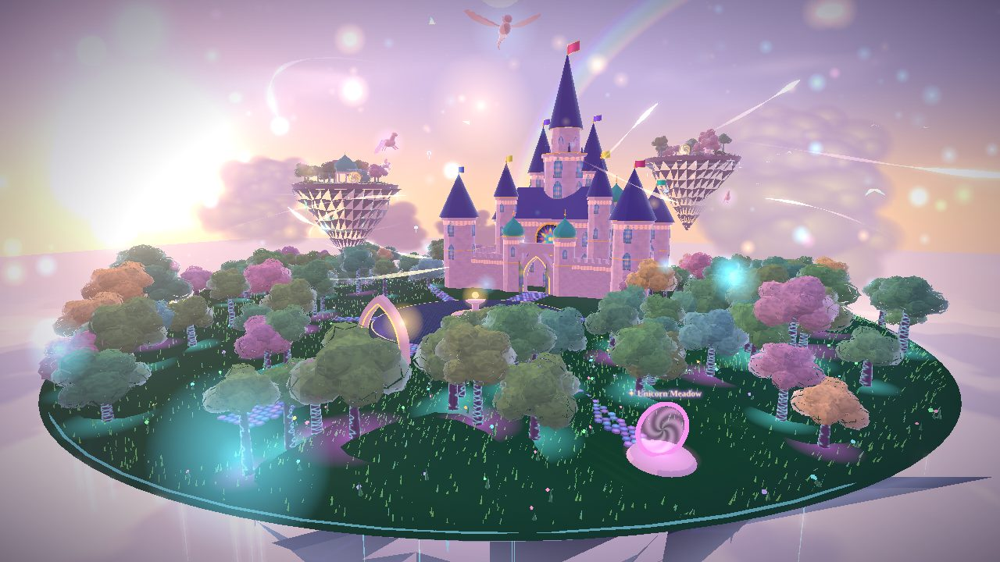

# Castle of Starlight

A magical multiplayer birthday world: a gothic-and-Islamic fairy-tale castle on
a floating island above a sea of clouds, under the aurora and the milky way.
Friends can explore together before the celebration; at midnight on her
birthday the fireworks, lanterns, cake and banner appear, and when she arrives
everyone in the world watches her grand welcome.

## Play

Open the GitHub Pages link in Chrome, Edge or Firefox on any ordinary laptop or
PC (phones work too). No install, no account.

| Key | Action |
| --- | --- |
| W A S D / arrows | walk (Shift to run) |
| Space | jump |
| Drag / scroll | look around / zoom |
| Click the path | make the gem path ripple |
| T | twirl |
| E | release a wish lantern (at Lantern Lake's shrine) |

* **Floating islands:** step into a portal ring and a lotus sky-boat flies you to
  Crystal Garden, Aurora Peak, Lantern Lake, Unicorn Meadow or Starfall Isle.
* **Mini games:** Stardust Hunt (collect star shards on every island; shared
  leaderboard) and Wish Lanterns (everyone sees your wish rise into the sky).
* **Proximity voice:** press the microphone button; you hear players louder the
  closer they are, and from the direction they stand.
* **Outfits:** modest gowns, abayas, kaftans, hijab or long hair; coats,
  sherwanis and robes. Ladies may also pick a party gown, which only other
  ladies see: gentlemen see her everyday gown instead.

## Personalise it

Everything lives in [`js/config.js`](js/config.js): her name, the welcome
cutscene lines, the celebration time, the secret key and the room name.

* Her link: `https://<you>.github.io/birthday-castle/?key=<honoreeKey>` marks
  her as the guest of honour (crown, golden aura, and the welcome cutscene
  plays for everyone who is in the world when she arrives).
* Friends' link: `https://<you>.github.io/birthday-castle/`
* Testing: `?celebrate=1` turns celebration mode on early; `?room=test` uses a
  private test room.

## Performance

Stylised toon shading, instanced trees/flowers/particles, canvas-painted
textures (no downloads) and almost everything merged into a few draw calls.
Graphics presets Low / Medium / High; "Automatic" picks one from the device and
then lowers the resolution on the fly whenever the frame rate dips.

## How it works

* Static site, no build step: Three.js r169 and PeerJS are vendored in `vendor/`.
* Multiplayer and voice are peer-to-peer WebRTC through the free PeerJS cloud
  broker. The first player in the room acts as the hub; if they leave, another
  player takes over automatically. Comfortable for a party of friends
  (roughly up to 15 people).

## Honest limits

* Lady / gentleman is chosen by each player, so the party-gown privacy is a
  courtesy between friends, not a security system.
* The secret key is visible to anyone who reads this repository's source.

## Design handout

The whole art and world design (reference analysis, world layout, castle versions, component library, design sheets and the owner's requirements) is in [design/README.md](design/README.md).
