# Castle of Starlight: Image Analysis (from the actual pictures)

This is the main reference table now. Every row comes from **looking at the image itself**. The hex colours were measured with a script: a median-cut palette of 8 colours per image, plus the average of the top 12% of the frame ("top"), the darkest 10% of pixels ("shadow") and the brightest 5% ("highlight").
Images live in [images/](images/). Every picture is also tagged one by one in [image-index.md](image-index.md). **U01–U400** are the 400 pictures the owner sent on 2026-10-10 (twenty batches). The build plan that combines them is [world-build-plan.md](world-build-plan.md). **C01–C13** are screenshots taken from the owner's screen during the first slideshow run. They carry a label bar and a Windows watermark, but the colours and detail are real.
The older text-only table, [reference-table.md](reference-table.md), is kept as background only.

**Web cost** for Three.js on a laptop: 🟢 cheap · 🟡 needs care (instancing, LOD) · 🔴 fake it or skip.
Saturation (sat) and luminance (lum) are frame averages: sat runs 0–1, lum runs 0–255.

Last updated: 2026-10-10.

---

## 1. Per-image breakdown

### U01: Terraced sky islands, glider view
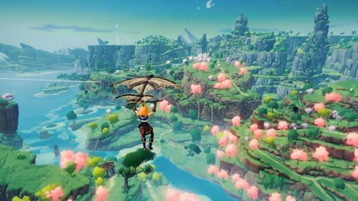
- **What:** Aerial view over stacked grassy plateaus, separated by teal water, with pink blossom trees dotted across the terraces. A player glides on a canvas wing.
- **Shading:** Stylized PBR with soft GI. Rock walls are low-frequency sculpted shapes with no texture noise. Grass tops are a flat matte green.
- **Outlines:** None.
- **Texture density:** Very low. Cliffs are 2–3 value bands, and grass is a single colour field.
- **Palette:** teal water `#66b0b0` `#55a19f` `#3e8d8d` · grass `#729080` `#4c7572` · haze `#a7c5b9` · blossom pink ≈ `#f2a0b0` (small %) · shadow `#374d48`. sat 0.41, lum 140: a **soft, hazy, pastel-teal** frame.
- **Light:** High overcast sun with very soft shadows. A strong aerial haze (`#a7c5b9`) swallows anything beyond the middle distance.
- **Layout:** The world is **layered tiers** with cliffs between them, so verticality reads from above. Pink trees punctuate the green the way stars punctuate a night sky.
- **Take for the castle:** The floating-island ring should look like this from the air. Use flat-topped islands with cliff skirts, a pale haze between them, and pink or glowing trees as accents. 🟢

### U02 / U14: Red-haired kid facing a ruin tower (same image twice)
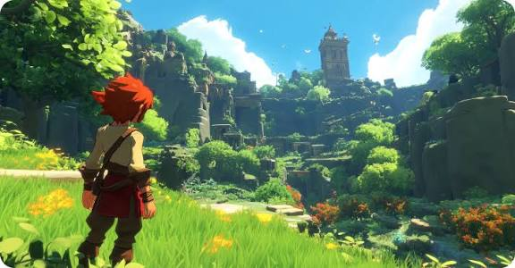
- **What:** A Ghibli-like illustration, probably AI-generated judging by the soft smearing. A mossy canyon of ruins leads to a tall stone tower under a bright sky.
- **Shading:** Painted-soft cel. The character has a two-tone face and a clear rim light. The environment uses soft gradients.
- **Outlines:** Thin dark lines on the character only.
- **Texture:** Medium. The moss is a mottled painted texture, with **no real geometry detail**.
- **Palette:** moss green `#88a955` · deep teal shadow `#26423b` `#1d2d24` · lit grass `#d0e49d` · mint `#79c69b` · sky `#68acb3`. sat 0.48, lum 118, **dark-cool shadows and warm-lime lights**.
- **Light:** A sun from the back right puts the foreground in shadow and lights the distant tower. Values run dark at the front and bright at the back, which is classic **reveal framing**.
- **Layout:** A foreground character (the viewer stand-in) looks down a valley toward a tall tower in the centre. Overgrown terraces step down toward it.
- **Take:** This is exactly the **arrival shot** we want for the castle. Frame the castle in a bright, misty distance, seen from a shadowed, overgrown foreground. 🟢

### U03: Ruins meadow, white fox mount, coral tree
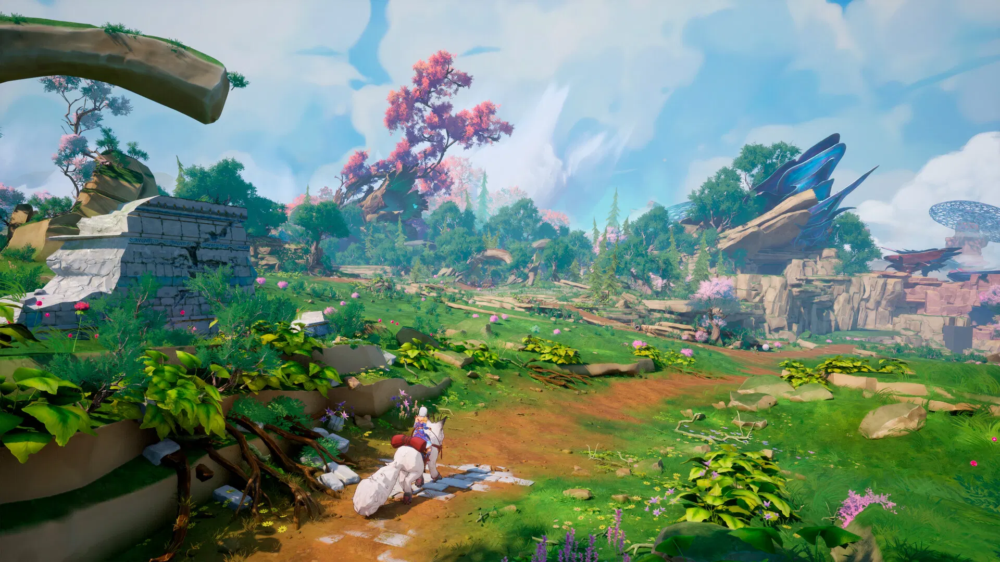
- **What:** A wide open-world vista. It has a carved stone ruin wall, a giant twisted tree with coral-pink leaf clusters, glassy blue crystal blades on a rock, and a lattice dome far away.
- **Shading:** **Stylized PBR (UE5)**, with real GI and soft shadows. Rocks are smooth chunky bevelled forms. Crystals are glossy and specular.
- **Outlines:** None.
- **Texture:** Medium-low. The ruin wall has **carved trim bands**, a blue engraved frieze that is ornament concentrated in a strip. Ground textures are soft.
- **Foliage:** Leaf-cluster cards on twisted trunks. The pink tree uses **dense clusters with gaps showing sky**, so it reads as a lace silhouette. Fern and taro clumps fill the foreground.
- **Palette:** sky haze `#c3d5e1` `#8bbccd` · grass `#347242` `#6a9266` · dark foliage `#11351b` · earth path `#7f7652` · coral tree ≈ `#d9607a`/`#b04a8a` · crystal blue ≈ `#3a5fd0`. sat 0.45.
- **Light:** A high sun with blue sky fill. **Strong atmospheric perspective**: the far trees turn pale blue-grey within about 40% of the depth.
- **Layout:** A curving dirt path leads from the bottom centre into the middle distance. A big tree is the vertical anchor, and the stone arch at the top left frames the shot.
- **Take:** Carved trim bands on the castle and the ruins (Islamic geometry in a strip, not all over), the lace-silhouette magic tree, and crystal blades as bioluminescent accents at night. 🟡 (the tree needs alpha cards)

### U04: Windmill cliffs, orange maples, sandy path
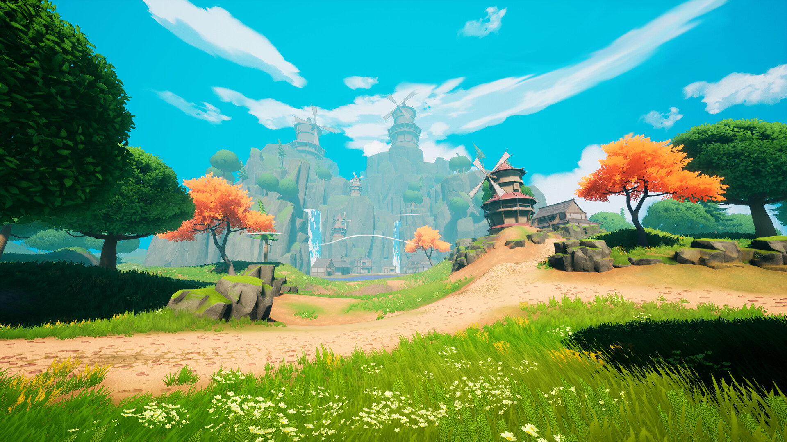
- **What:** A low camera on a sandy path. A grey cliff mesa carries windmill towers and waterfalls, framed by orange maples and huge round dark-green trees.
- **Shading:** **Hard-edged cel with a dark core**. Foliage has a clear lit side and a nearly black-green shadow side (`#032112`). The cliff is flat-shaded faceted planes.
- **Outlines:** None, but the value contrast does the work an outline would.
- **Texture:** Low. The path has **decal pebbles/footprints**, and the cliffs use only planar colour.
- **Foliage:** **Many individual leaf-shaped cards** on a sphere canopy, each card painted as a single leaf with a lighter tip. The orange maples use the same card trick, in `#ff7a1a`→`#ffb04a`. The grass is dense blade geometry with white flower clusters.
- **Sky:** A **flat saturated cyan `#00c5e1`** with brush-stroke wispy clouds (alpha cards with painted edges). This is the most saturated frame of the set (sat **0.70**).
- **Light:** A strong sun, front-left. The cast shadow from an off-screen tree is a **big, dark, flat shape** across the right foreground (foreground framing).
- **Layout:** The path S-curves to a central landmark. Trees frame the left and right. Waterfalls give the cliff vertical lines.
- **Take:** This is the best foliage reference for our trees (leaf cards on a sphere, dark core, bright rim). A flat sky colour plus brush clouds is the cheapest beautiful sky there is. 🟢

### U05: BotW, explosion on Hyrule field
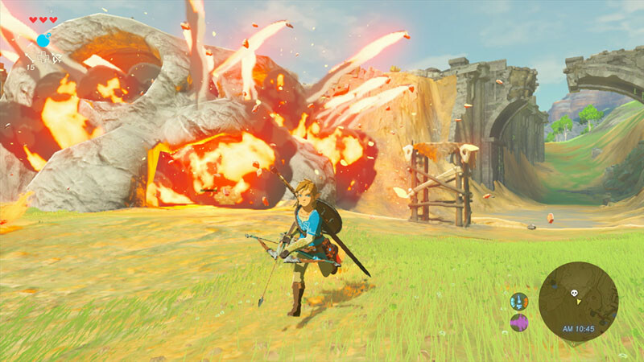
- **Shading:** BotW cel shading. Soft two-tone with a **painted brush-hatch texture** on rocks (the rock has hand-painted cross strokes). Fire uses bright additive cards.
- **Grass:** Flat yellow-green with geometric blades. **The grass colour varies in large patches** (`#c5cc74`, `#acca9a`, `#e0c573`), and this patchiness is what makes it look natural.
- **Palette:** warm, desaturated pastel (sat 0.44, lum **175**, the brightest of the set). Fire `#f8ebae` highlight, rust `#9c5934`.
- **Take:** Patchy grass tint (two or three hues blended by large noise), and a painterly hatch on stone. 🟢

### U06 (also C12, C13): Kids With Sticks, Ghibli UE4 meadow
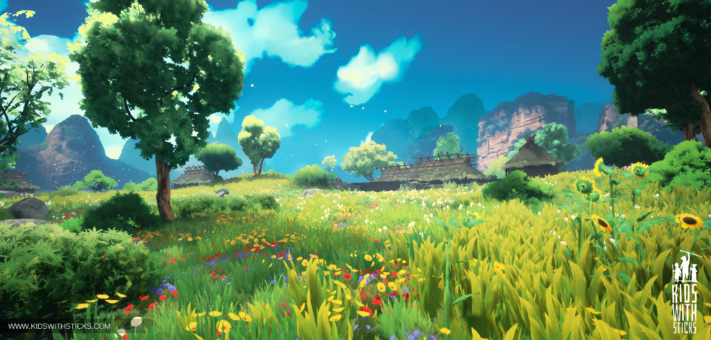
- **What:** A meadow of tall yellow-green grass, poppies and sunflowers. Puffy round trees, thatched huts, and pink-red karst mountains.
- **Shading:** Soft cel with **sky-tinted shadows** (shadows go teal `#2a7292`, not grey). The trees are **puffy ball clusters with a soft gradient**, and the clouds are **soft blobs with glowing cyan rims**.
- **Foliage:** Grass is long, curved, chunky blades with a strong yellow tip (`#c2e097`). Flowers are small billboards in red, yellow and violet scattered in drifts.
- **Palette:** grass `#a3ae48` `#577749` · deep sky `#2a7292` · shadow `#102b1d` · cloud rim `#cbf1cc`. sat 0.59.
- **Light:** A backlit, high sun creates rim glow on the clouds and trees. Floating white **pollen motes** sit in the air.
- **Take:** Shadows tinted by the sky colour, glowing cloud rims, pollen motes (our stardust), and flower drifts. 🟢

### U07: Genshin Impact, Liyue harbour vista
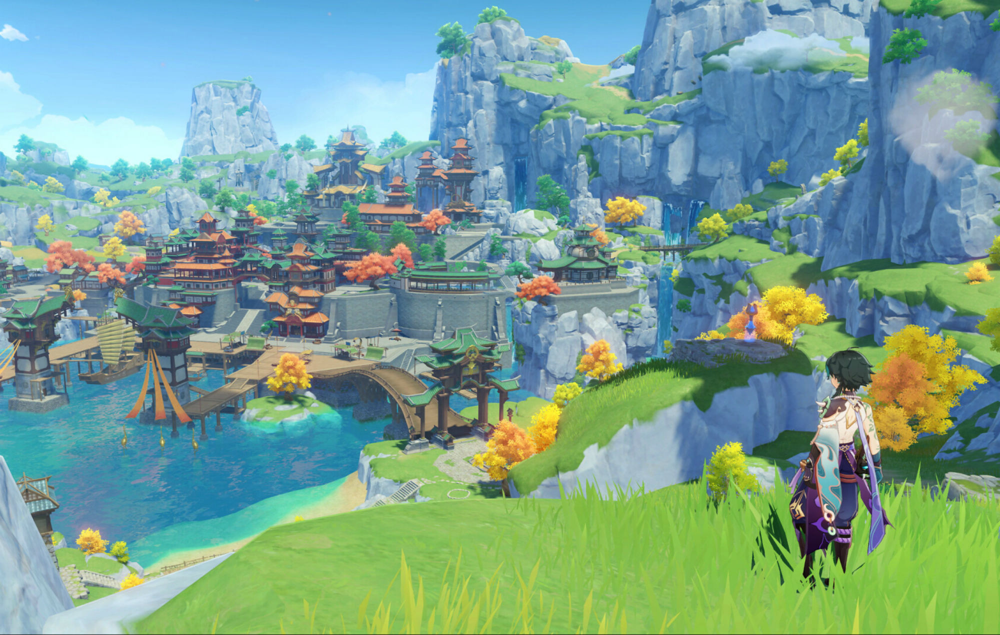
- **What:** Seen from a cliff, a harbour city of tiered pagodas with green and orange roofs, a stone arch bridge, junks, and towering blue-grey karst cliffs with waterfalls.
- **Shading:** **Toon ramp on everything**. Cliffs are painted planes in 3–4 flat blue-grey values (`#53758d`, `#415664`) with crisp terminators. The grass is a single lime colour, `#84c486`, with almost no shading.
- **Outlines:** On the character only.
- **Texture:** Very low. Rock is **painted planar colour** with no noise.
- **Foliage:** Ginkgo-yellow and maple-orange trees as **round blobs of leaf cards**, used as colour accents against the blue rock.
- **Palette:** sky `#73b0d1` · rock `#53758d` `#4d8ca0` · grass `#84c486` `#b2d7ba` · roofs green ≈ `#3f8a5a`, orange ≈ `#e0763a`. sat 0.43.
- **Layout:** **Density hierarchy**: the city is dense and detailed in one zone, while the nature around it stays simple. The water opens a negative space in front of the focal point.
- **Take:** Treat the castle city as one dense zone of tiered roofs and towers. Use toon-ramp cliffs for the floating islands, and **complementary accent trees** (orange/gold against blue rock). 🟢

### U08: Pink-haired jumper, mushroom-dome treehouses
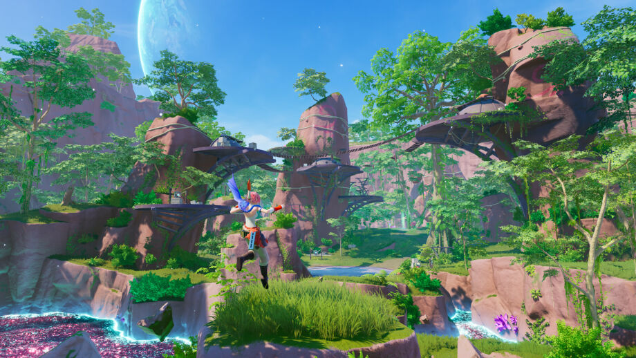
- **What:** Pink sandstone pillars topped with jungle trees and saucer-shaped huts, rope bridges, **glowing magenta and cyan water**, purple crystals, and a giant moon in a daytime sky.
- **Shading:** Stylized PBR. The water is **emissive**: a magenta pool with cyan foam edges.
- **Palette:** sky `#55a5c8` · rock pink ≈ `#c08a80` · jungle `#28653f` `#4b896b` · glow water magenta ≈ `#e04aa8` + cyan foam ≈ `#7af0ff`. sat 0.44.
- **Take:** **Glowing water with a cyan rim**, which is perfect for night pools and moats. A huge moon or planet in the sky. 🟢 (an emissive plane with an edge mask)

### U09: Japanese shrine hillside, torii, floating cliffs
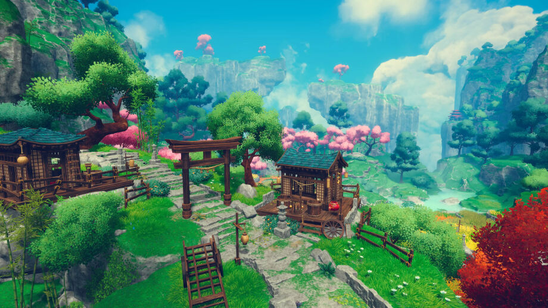
- **What:** Stone steps climb through a torii gate between two wooden shrines with lanterns. Pink cherry trees, a crimson maple, and floating rock spires in clouds.
- **Shading:** Stylized PBR with saturated colour. Wood is dark brown with clear plank geometry.
- **Foliage:** Puffy clump trees (cards), with a stand-out **crimson tree** (`#c0202a`) in the corner as a colour bookend.
- **Palette:** teal-green `#0f7056` `#319766` · sky cyan `#2db4c0` · dark wood `#59333a` · shadow `#2c2333`. sat 0.56.
- **Layout:** A **stepped path through a gate to a shrine**, which is our gate-to-castle beat in miniature. The floating cliffs in the background give a sense of scale.
- **Take:** The gate-on-stairs composition, lanterns along the steps, and colour-bookend trees in the frame corners. 🟢

### U10: Low-poly animal adventurers at dusk (sci-fi platform)
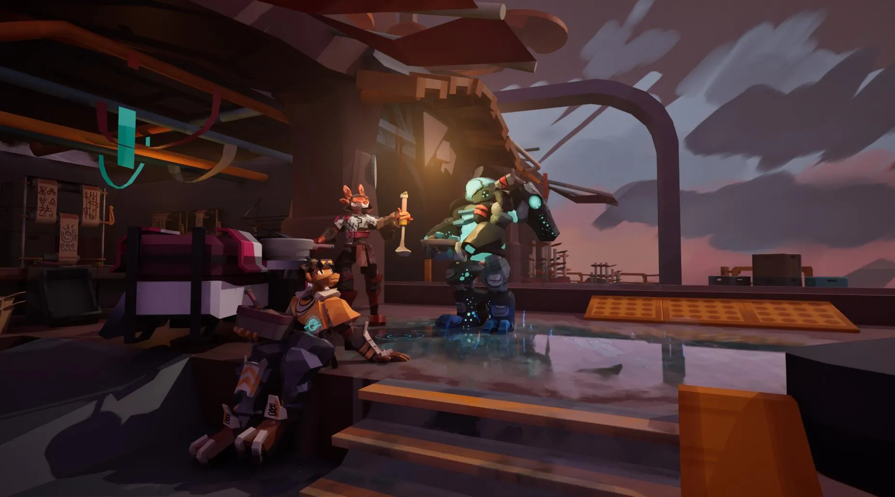
- **Shading:** **Faceted low-poly with painterly cloud cards**. The clouds are **broad brush-stroke shapes** in purple and pink. Glowing cyan dots and lines run over the armour, and a wet floor reflects the sky.
- **Palette:** dark, plum dusk (lum **49**): `#614849` `#261619` `#7d6e75` · sky pink ≈ `#d89aa0`. Accent cyan ≈ `#5ff0e0`.
- **Take:** A **brush-stroke cloud style for the dusk sky**, glowing cyan pattern lines (like our tree-trunk patterns), and a reflective wet-stone floor for the courtyard. 🟢 (painted cloud cards)

### U11: "Point #2 Color & Lighting" infographic (Palworld vs BotW/TotK/Firewatch/Dota)
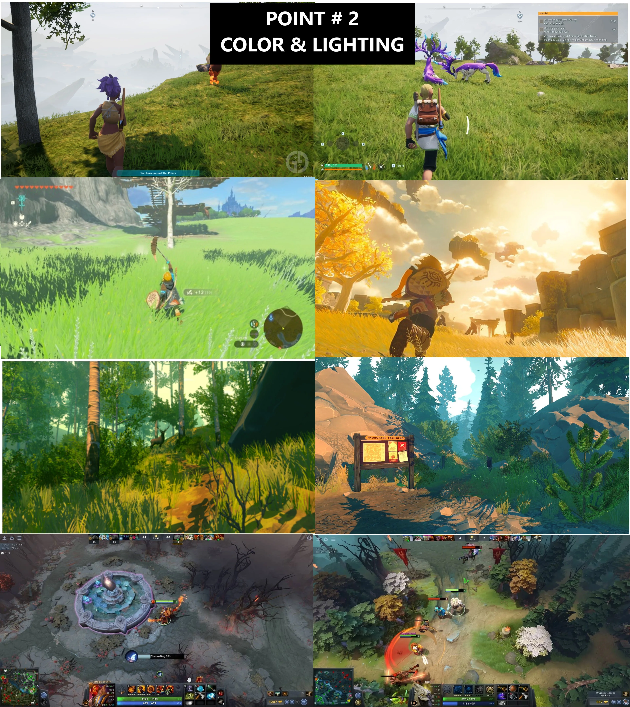
- **What:** A comparison sheet that **posterizes** each game to show its colour blocks. The left column is Palworld (realistic, muddy), and the right column is the better-art games.
- **Lesson read from the sheet:** The good examples (TotK golden field, Firewatch trailhead, Dota) have **few, large colour masses with clear warm-light/cool-shadow separation**. Palworld's realistic grass and foliage turn into noisy, low-contrast mush.
- **Take:** Design every view as **3–5 colour masses**. Warm light against cool shadow. No high-frequency texture noise. 🟢 (this is a rule, not an asset)

### U12: Palworld collage (vertical)
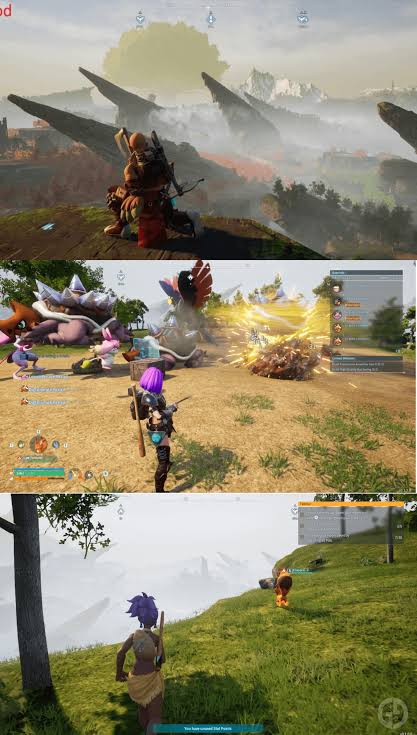
- Realistic grass with washed-out white haze (`#c6c6c2`, sat **0.31**, the lowest of the set). This is **the counter-example**: too grey and noisy, with flat lighting. The owner sent it alongside U11, which points out why it fails.
- **Take:** Avoid desaturated white fog and photoreal grass. 🔴 (this is what *not* to do)

### U13: BotW, Hyrule field panorama
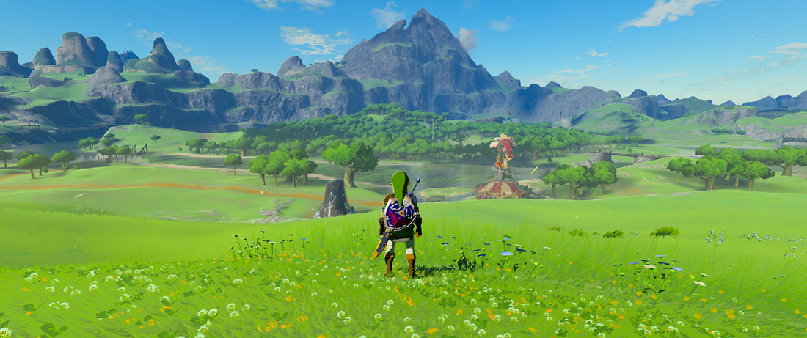
- **Grass:** A lime base, `#79b11e` (28% of the frame), with **instanced blades plus tiny white and yellow flower billboards**. Distant grass blends into a smooth colour field. Terrain uses broad soft rolls.
- **Trees:** Simple round canopies, nearly flat-shaded, read as dots.
- **Distance:** Mountains go blue-grey `#5e807a` → `#3a5f73`. The sky is clean `#67b7ce` with small soft clouds.
- **Take:** The **spawn meadow**: open rolling field, flower specks near the camera, smooth colour far away. 🟢

### U15: Palworld, riding view over valley
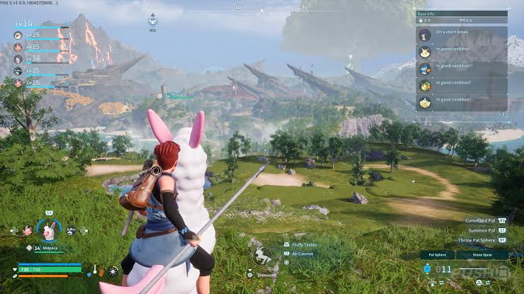
- A grey-blue haze (`#c6cddc`) flattens everything (sat 0.31). It has a good **elevated vista composition** (a ridge looking down on a valley, a giant tree on the horizon) but the wrong colour.
- **Take:** Keep the vista layout and the **giant world-tree landmark on the horizon**. Fix the colour with U04/U07 saturation. 🟢

### U16: Fortnite, sunset farm (Frenzy Fields)
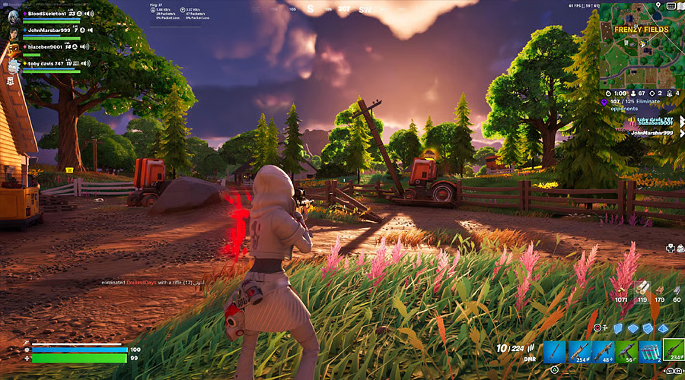
- **Light:** A **backlit low sun** behind trees. Glowing pink-violet cumulus against a deep purple sky (`#5b5357` top). Long shadows rake toward the camera.
- **Foliage:** Pink fluffy grass plumes catch the light (translucency).
- **Palette:** dusk earth `#7c4a40` `#683029` · dark green `#3f4832` · glow `#d8bd8a`. lum 75.
- **Take:** The **dusk version of our world before midnight**: purple sky, pink-lit cloud bellies, long raking shadows, translucent plants. 🟡 (bloom + translucency fake)

### U17: Fortnite, autumn sunset with timber cottage
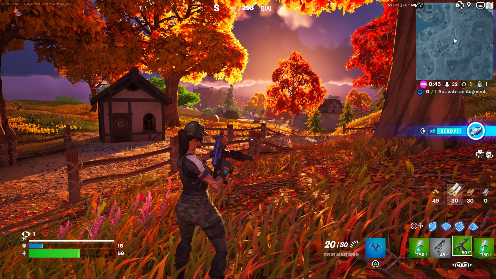
- **Light:** Low sun behind a maple. Leaves **glow red-orange from subsurface scattering**, with heavy bloom.
- **Palette:** red maple `#8f3517` `#881d0d` · deep shadow `#2d0f0b` · glow `#cdae6a` · violet sky ≈ `#5a3a6a`. sat **0.73**, the highest of the set.
- **Detail:** A half-timbered cottage (same family as Magic Moorland C07) and rustic rope-tied fence posts.
- **Take:** The **backlit translucent foliage** trick (add the light colour to leaves when the sun is behind them). Strong complementary contrast between violet sky and orange leaves. 🟢 (a cheap N·L back term in the shader)

### U18: Fortnite, pink blossom trees by a road
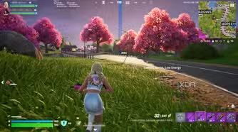
- Low-res. Clusters of **magenta-pink canopies** (`#71344a`) against a dusky lilac sky (`#7f7180`).
- **Take:** Pink-canopy avenue lining a road, which suits the pathway to the castle gate. 🟢

### U19: BotW, golden-hour field
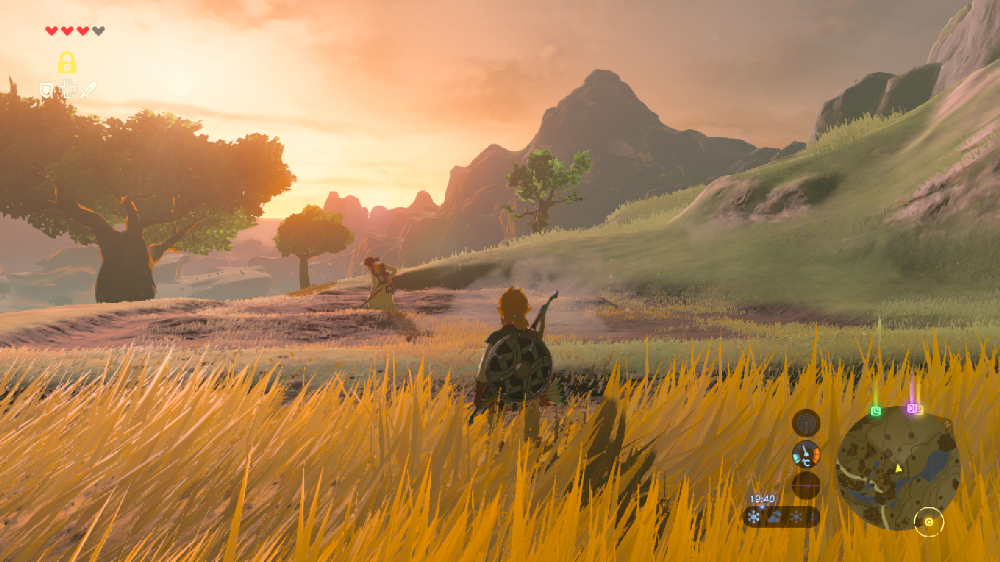
- **Light:** The sun is low and behind the tree at the left. **Bloom and haze turn the whole upper half peach** (`#fddbb2`, `#d6b092`). Distant rocks fade into warm haze.
- **Grass:** **Large triangular blades** in saturated amber `#c38131`, painted crisply, almost like paper cut-outs.
- **Trees:** The canopy has a **brush-hatch leaf texture** and a sun-rim on its edges.
- **Take:** Big paper-cut grass blades in the foreground (few, large, cheap), and warm backlit haze for dusk. 🟢

### U20: TotK, golden-leaf forest
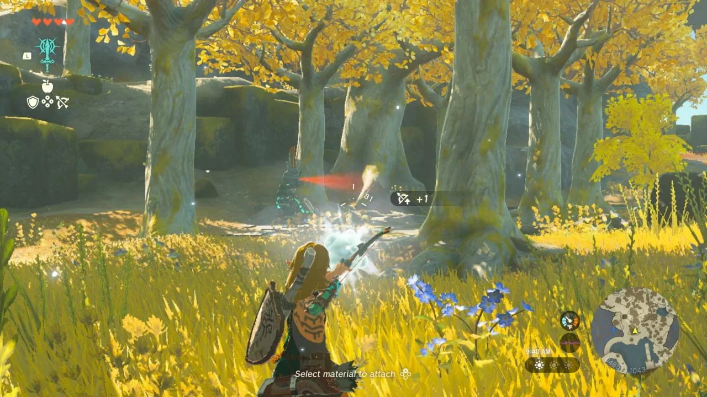
- **What:** Pale grey-green trunks with mossy yellow patches, golden canopy, yellow grass, and blue flowers.
- **Shading:** Soft cel. Trunks have **painted moss blotches** (`#a08d34`) with no bark detail. Light shafts appear as glowing particles.
- **Palette:** gold `#b3a241` `#d8c55d` · trunk grey-green `#677157` `#596653` · blue flower accent ≈ `#5a7ae0`. sat 0.44.
- **Take:** Trunks done as smooth cylinders with painted blotches (at night the blotches become our **glowing trunk patterns**). The blue flowers are a complementary accent in a gold field. 🟢

### Batch 2 (U21–U40, sent 2026-10-10): Zelda, Horizon, Biomutant and others

**Overall read:** This batch leans more realistic than batch 1. Horizon and Biomutant use full PBR with dense photo-detail textures, and their measured saturation is only **0.30–0.41**. They still look rich because of **value structure and atmosphere**: heavy volumetric haze, backlit low sun, warm/cool split. **Borrow their lighting, haze and composition, but not their texture detail** (🔴 on laptops). The Zelda shots (U21–U25) confirm the batch-1 recipe.

| ID | Image | What it shows | Shading / detail | Measured palette | Light & atmosphere | Take for the castle | Cost |
|---|---|---|---|---|---|---|---|
| U21 | 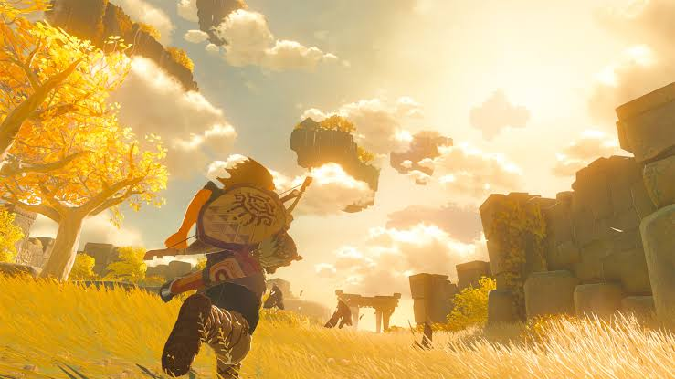 TotK, running toward floating islands | Low camera, golden grass, sky islands drifting in sun-lit cloud, stone ruin blocks | Soft cel, grass as **chunky blades**, islands = blocky stone with grass caps and hanging vines | gold `#e5a52a` `#f5c973` · cream sky `#fce5ac` `#fef7d8` · shadow `#725228`. lum **177** (brightest) | Sun **behind the islands**; bloom washes the sky to cream; islands go **silhouette with glowing cloud rims** | **Floating islands seen from below, backlit, with glowing cloud skirts.** Our hero shot for the island ring (night version: aurora behind) | 🟢 |
| U22 | 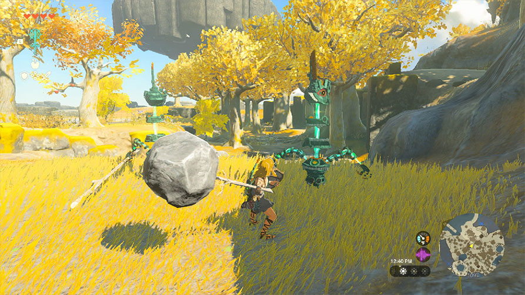 TotK, golden forest + Zonai construct | Pale trunks, gold canopies, a teal-glowing robot, giant floating rock overhead | Soft cel; the construct has **emissive teal lines** on dark green stone | gold `#efc84b` `#f5e072` · trunk grey `#5e6859` · olive `#797442` | Midday, soft shadows; huge overhead island casts scale | Emissive line patterns on dark stone = **castle trim and creature markings at night**. Floating mass overhead for awe | 🟢 |
| U23 | 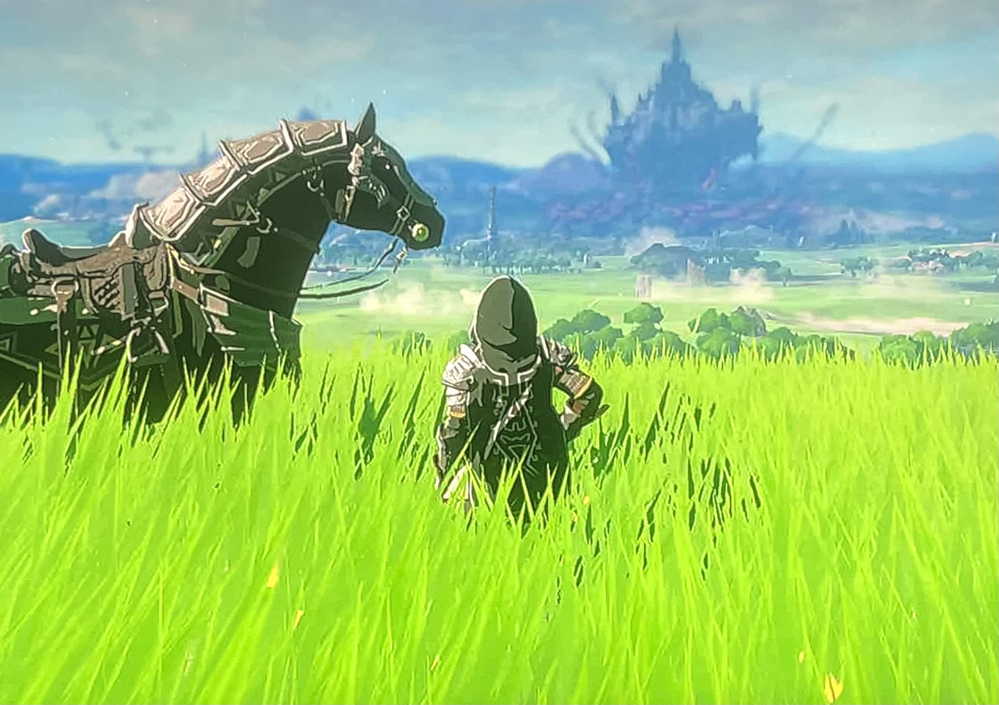 TotK, tall grass + Hyrule Castle far | Horse and rider in knee-high lime grass; castle a blue silhouette on the horizon | Grass = **big lime blades `#baf338`, dark gaps between them** (blades read as strokes) | lime `#9de31d` `#a5e632` · haze `#abcac0` · castle blue `#72a1af` | Distance goes **blue-grey and soft** fast; castle is pure silhouette | **Exactly our spawn-to-castle view:** vivid near grass, castle as a blue silhouette far away. Proof the castle needs a strong outline, not detail | 🟢 |
| U24 | 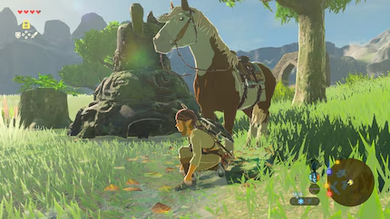 BotW, shrine with horse | Small; mossy stone, grass, lens flare | Soft cel, desaturated (0.33) | `#819c6c` `#3b462f` | Sun flare | Minor; skip | — |
| U25 | 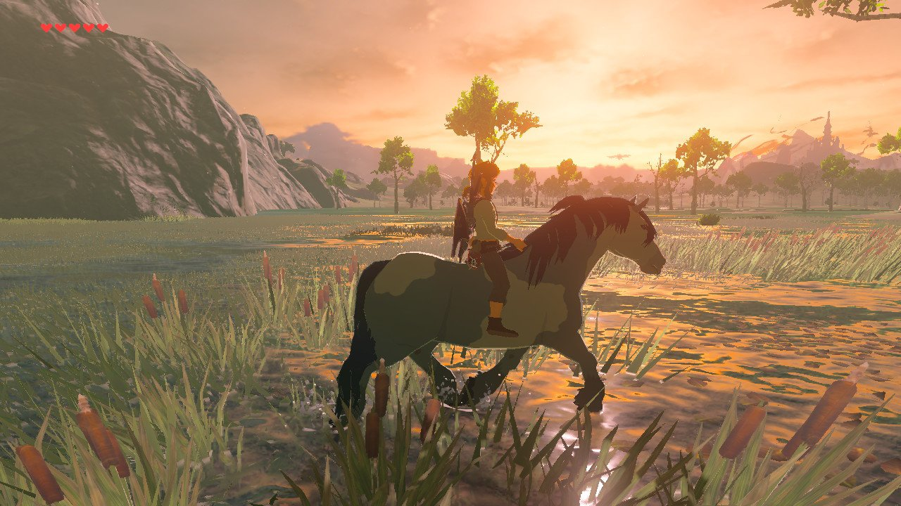 BotW, sunset ride through marsh | Wet ground mirrors a peach sky; cattails; silhouetted trees; castle far right | Cel horse with **rim light**, water = mirror of sky, cattail clumps as cards | peach `#fedaaf` `#e3a97d` · olive `#5c5841` · shadow `#433624` | Low sun, **long reflections on wet ground**, warm haze | **Shallow reflective water / wet ground** around the castle moat at dusk; rim-lit silhouettes | 🟡 (cheap fake: sky-tinted glossy plane) |
| U26 | 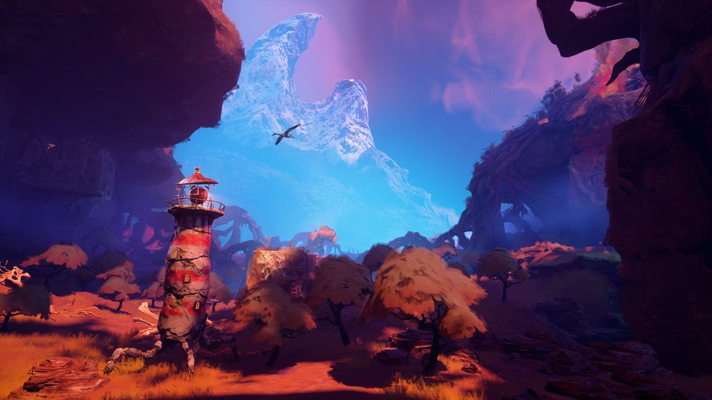 Stylized lighthouse canyon (game unidentified) | Red-striped crooked lighthouse, sugar-loaf snowy peak, mushroom-cap trees, dark canyon walls | Stylized PBR, **painterly sculpted rock**, trees with flat layered caps | ultramarine `#6ab1ef` `#7a73bd` · deep violet `#220f37` `#11031a` · rust `#a24142`. sat **0.68** | **Blue-violet backlight** through a canyon gap; foreground in near-black purple silhouette | **The best night/dusk colour reference so far:** violet shadows, cyan-blue glow in the gap, warm rust accents. Use it for our dusk sky and canyon framing | 🟢 |
| U29 | 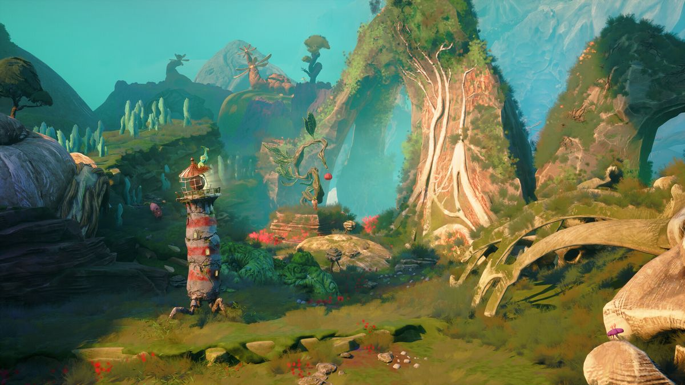 Same game, teal swamp | Lighthouse, giant root-arch tree, ribbed bone arches, cactus spires, red flowers | Same painterly sculpting; **teal fog fills the back** | teal fog `#56bbb5` · olive `#7b6529` · deep `#122422` | Strong **coloured fog (teal)** separating layers; sun patches on the ground | **Coloured fog** (not grey) as a layer separator; the root-arch tree is a natural **magic gate** idea | 🟢 |
| U27 | 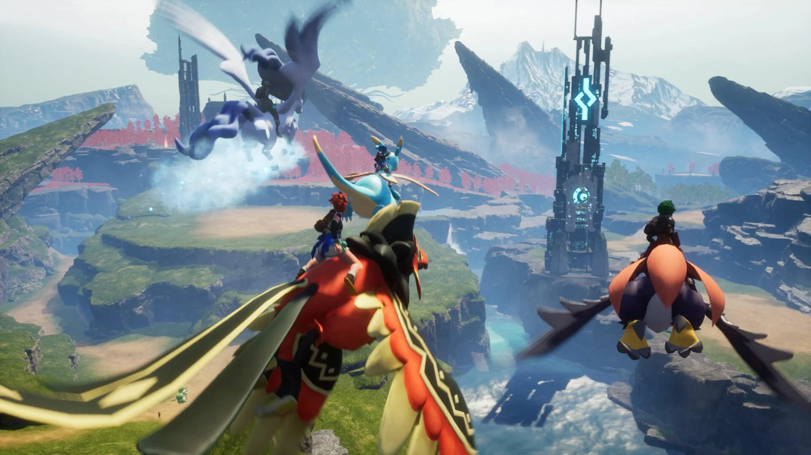 Creature riders over floating islands (Palworld-like) | Flat-topped grass islands, tilted rock slabs, glowing tech tower, red tree belt, giant world tree silhouette | Realistic PBR, haze-washed (sat 0.31) | blue-grey `#506f8c` `#7897a8` · haze `#e2e7df` | Grey haze; tower has **cyan emissive glyphs** | Layout only: **tilted rock slabs + flat islands + one glowing tower + world-tree silhouette**. Colour too grey | 🟡 |
| U28 | 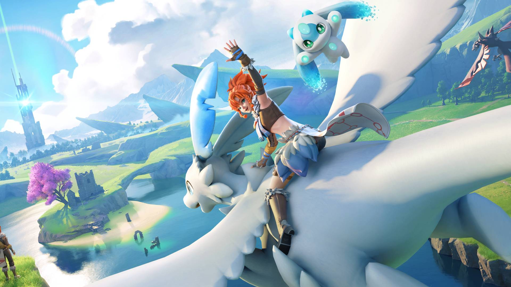 Key art: girl on white winged dragon | White fluffy dragon (Toothless-like light fury), pink tree by a ruin, rainbow beam from a tower, lagoon | Clean stylized PBR, soft subsurface on the creature | sky `#95d0e0` · white `#f7f8f7` · lagoon `#629eb7` | Bright, **glare + rainbow halo** | **The "light fury" mount** from the brief, and a pink blossom tree beside a ruined tower on an island. (Our creatures have no eyes) | 🟢 |
| U30 | 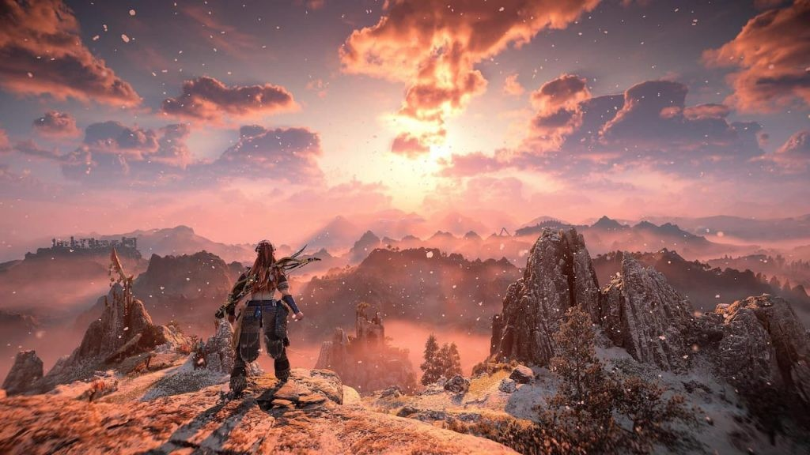 Horizon FW, pink sunset over snowy peaks | Layered ranges in pink fog, glowing cloud underside, falling snow | Full PBR | rose `#d5968d` `#f4c0ab` · mauve `#8e737b` · shadow `#3c2422` | Sun behind clouds → **hot cloud bellies**; **6+ fog layers** step back in value | **Layered depth: each ridge one step paler.** Floating particles (snow → our stardust) | 🟢 (cards + fog) |
| U31 | 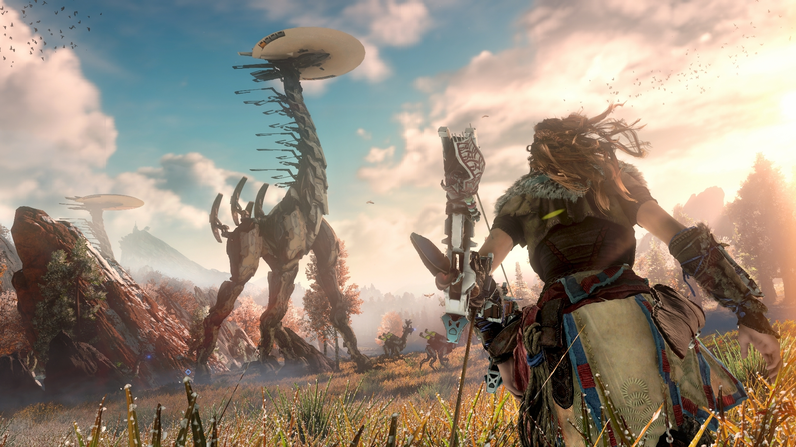 Horizon ZD, Tallneck | Giant mechanical creature with a dish head, low camera, birds, sun flare | PBR, dense texture | cream `#fcefd9` · rust `#967457` · sky `#869e9f` | Backlit sun, **god rays + haze** | **Giant gentle creature walking past as a landmark** (our winged unicorn or eyeless giant); bird flocks for life | 🟡 |
| U32 | 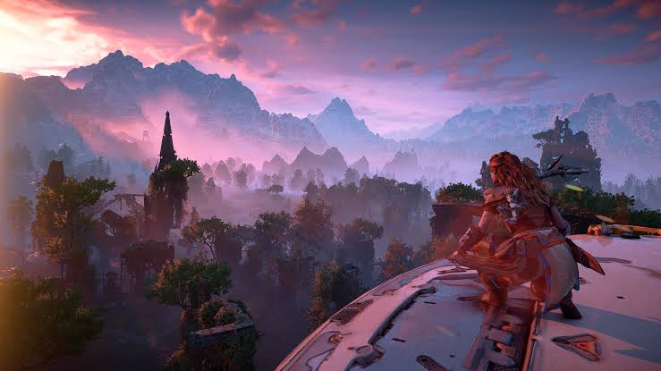 Horizon FW, purple dusk overgrown ruins | Gothic spire wrapped in trees, lilac mist valley, jagged peaks | PBR | lilac `#9c81ac` `#d2b0d5` · purple `#5e4c64` · dark `#22161a` | **Lilac fog fills the valley**; peaks catch pink light | **The dusk mood before midnight:** a gothic spire rising out of lilac mist. Very close to our castle brief | 🟢 |
| U33 | 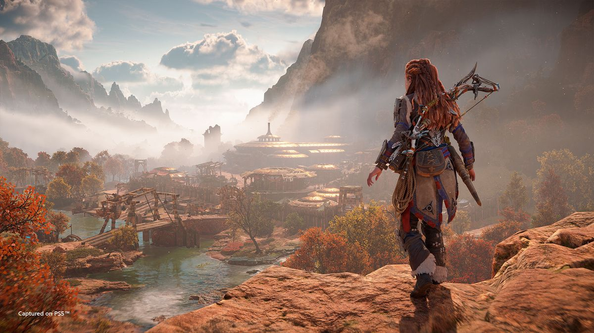 Horizon FW, canyon settlement | Domed tents, river, mist pouring through the canyon, sun shafts | PBR, high detail | warm grey `#8a7a70` · rust `#865139` · mist `#e3dbd3` | **Volumetric mist** in the valley, warm side light | Mist pouring between cliffs; settlement as one dense cluster | 🔴 volumetrics → fake with fog cards |
| U34 | 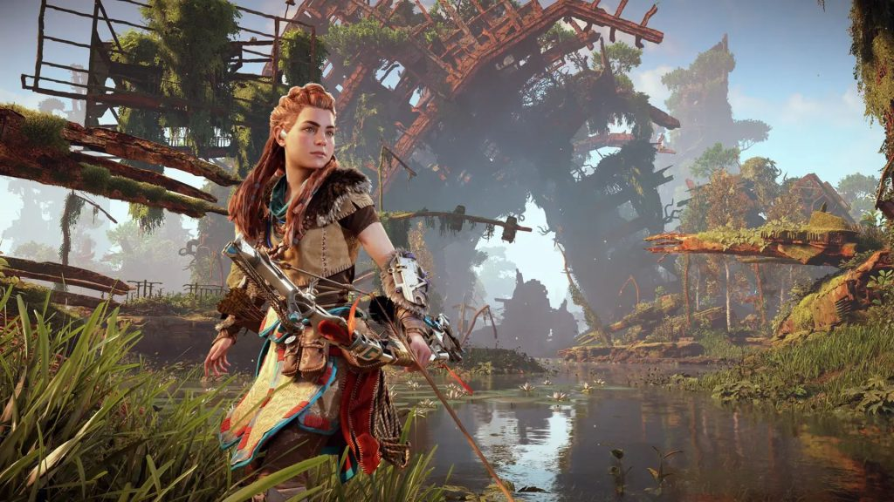 Horizon FW, swamp ruin | Rusted giant structure, lily pond reflection, reeds | PBR | `#6c5c4c` `#6e6f6a` | Soft haze | Lily-pad pond with reflections | 🟡 |
| U35 | 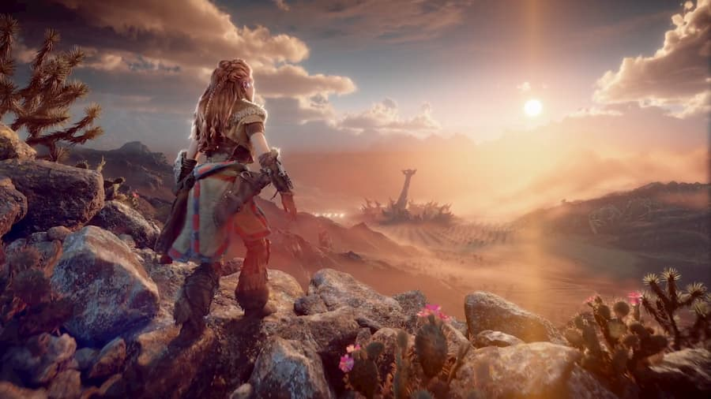 Horizon FW, desert sunset with sun disk | Rocky ledge, flowering cacti, distant ruined tower in hazy valley | PBR | dusk `#ac7660` `#e9c8ac` · shadow `#2c0e1c` | **Visible sun disk + light shaft**; warm haze | Ledge-overlook composition; sun shaft as a single additive card | 🟢 |
| U36 | 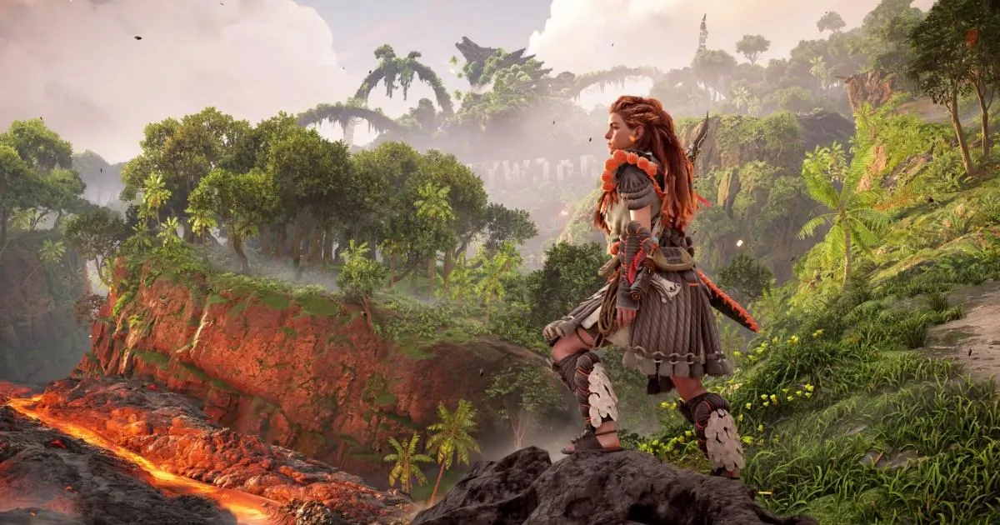 Horizon FW, jungle with lava | Red cliff, lava river glowing, arching ruin bridges in mist | PBR | olive `#494429` · mist `#eadbd6` · lava ≈ `#ff6a1a` | Emissive lava, hazy back | Arching bridges fading in mist; emissive river | 🟢 (emissive) |
| U37 | 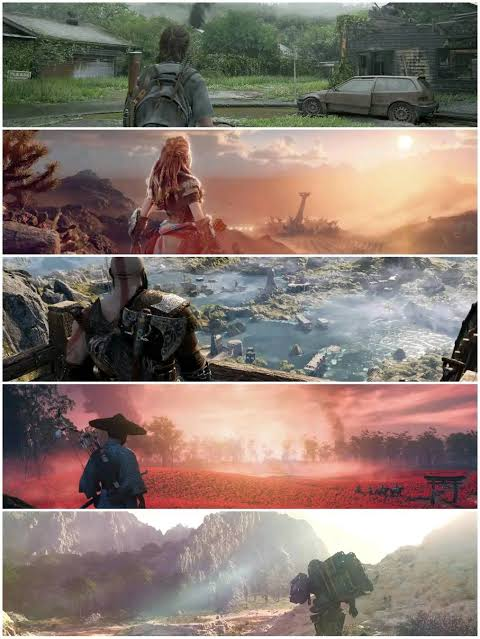 Collage: TLOU, HFW, GoW, Ghost of Tsushima… | Five "character from behind looking at a vista" frames | — | — | — | **Composition rule:** character in the lower third, back to camera, looking into a big lit vista. Use it for the welcome cutscene's opening frame | rule |
| U38 | 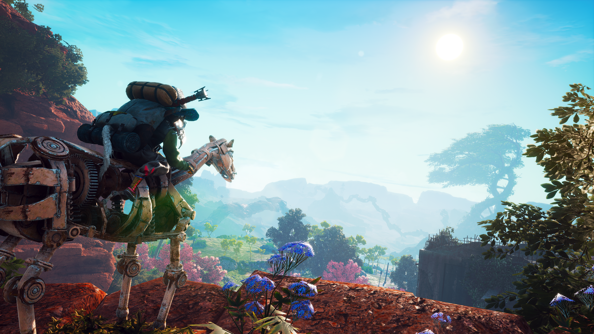 Biomutant, vista with mech horse | Red rock ledge, blue lilac flowers, pink trees, giant twisted tree silhouette, sun | PBR, high-detail rock | sky `#77d3e8` `#d1eaef` · red rock ≈ `#a04a3a` · flowers ≈ `#5a6af0` | **Bright aqua sky with sun glare**; distance washes to aqua | Blue-violet flower umbels (glowing at night); giant twisted tree landmark | 🟢 |
| U39 | 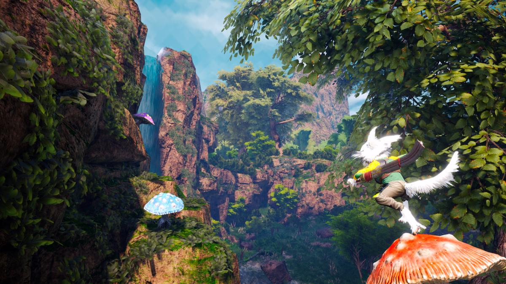 Biomutant, canyon with waterfall + mushrooms | Red rock canyon, ivy walls, giant red and blue mushrooms | PBR, dense ivy | dark `#3d5249` · rock `#877f64` | Shadowy, sky gap | **Giant glowing mushrooms** (blue spotted, red) as bioluminescent props | 🟢 |
| U40 | 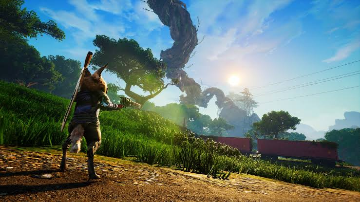 Biomutant, twisted spiral tree | A huge **spiralling trunk tree** on the horizon, power lines, grassy hill | PBR | sky `#4795be` `#86bedb` · grass dark `#0f190f` | Backlit sun flare | **A spiral world-tree on the horizon** as a second landmark opposite the castle | 🟢 |

**Batch 2 adds these techniques:**
- **T17 · Backlit silhouette islands with glowing cloud skirts** (U21). Islands are dark masses, and the clouds under them glow with the light behind. 🟢
- **T18 · Coloured fog layers** (U26 violet, U29 teal, U32 lilac, U30 rose). Use 4–6 depth steps, each paler and more tinted. The fog colour sets the mood per area. 🟢
- **T19 · Wet-ground / shallow-water mirror** (U25, U34). A glossy plane reflecting the sky gradient sells dusk cheaply. 🟡
- **T20 · Emissive line glyphs on dark stone** (U22, U27). Use these for castle trim, creature markings and portal towers. 🟢
- **T21 · Giant landmark silhouettes** (U23 castle, U31 Tallneck, U40 spiral tree). Each needs one strong outline and no detail. 🟢
- **T22 · Composition: back-turned character + vista** (U37). Use it for the cutscene opener. 🟢
- **Caution:** Horizon-level texture detail and true volumetric fog are 🔴. Fake the look with fog cards, a height-fog shader and a bloom pass.

### Batch 3 (U41–U60, sent 2026-10-10): Ghost of Tsushima, AC Shadows, cosy villages, night scenes

**Overall read:** This is the batch with **night and castle-on-a-hill** scenes, which is closest to our actual brief. Saturation is low on average (0.26–0.59, with many frames around 0.3). The richness comes from **one strong hue per scene against a neutral base**: red maples, pink blossom, pink sunset cirrus, gold lantern light. **Rule from this batch: one hero accent colour per area, and everything else calmer.**

| ID | Image | What it shows | Shading / detail | Measured palette | Light & atmosphere | Take for the castle | Cost |
|---|---|---|---|---|---|---|---|
| U41 | 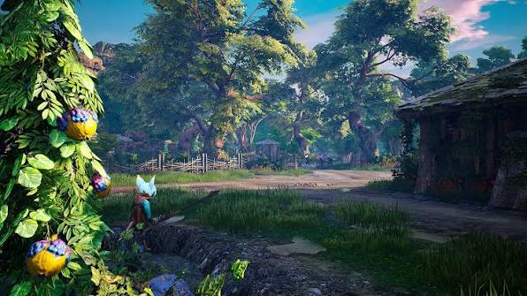 Biomutant, village path | Dirt road, huge broad trees, wooden hut, **round glowing berry-fruit** hanging from a vine | Stylized PBR, big leaf clusters | teal `#4d7882` · deep `#091214` · leaf `#a1ba9d` | Overcast-soft, sky glow through canopy | **Glowing fruit/orbs on vines** as bioluminescent props | 🟢 |
| U42 | 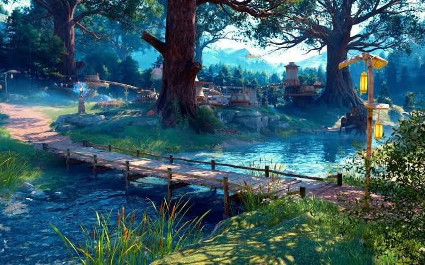 Fairy village with lantern bridge | Plank bridge over a turquoise stream, giant trees, **yellow paper lanterns on poles**, a glowing blue wisp, treehouse village | Stylized PBR, very painterly blue tone (sat 0.59) | river `#1a5d74` `#0b445f` · highlight `#c8e8e4` · lantern ≈ `#ffd05a` | Blue ambient + warm lanterns = **cool/warm night split** | **The pathway-to-castle mood:** a plank bridge over a glowing stream, lantern posts, giant guardian trees. Very on-brief | 🟢 |
| U43 | 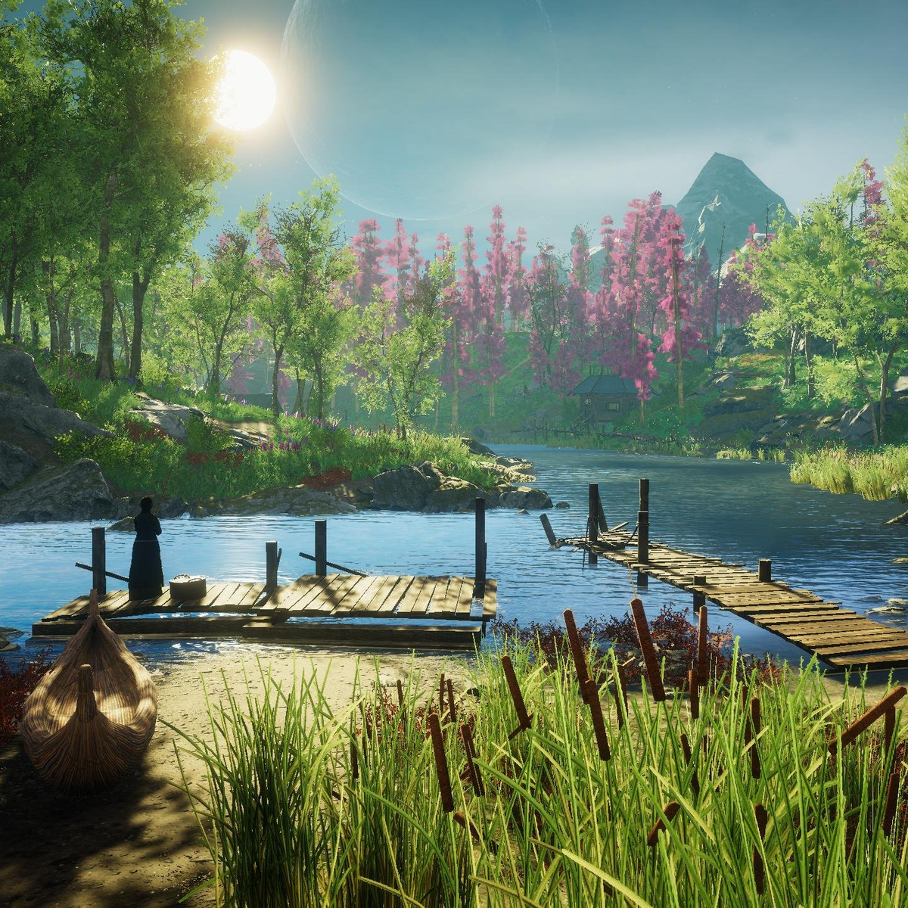 Lake docks, pink trees, giant moon | Wooden jetties, cattails, wicker boat, **pink conifers**, huge pale planet in a day sky | Stylized PBR, crisp sun | water `#648b79` · pink trees ≈ `#d0508a` · sky `#94b099` | Strong sun flare; **huge celestial body in sky** | Lake with docks below the castle; **a giant moon/planet in the sky** (great for the night) | 🟢 |
| U44 | 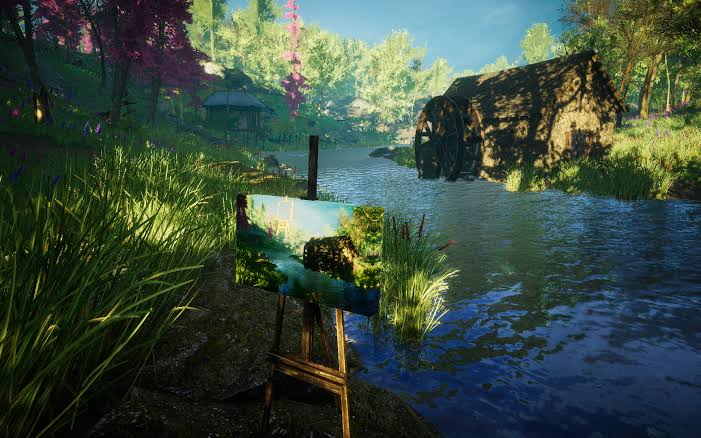 Water mill and easel | Stream, mill wheel, hut, magenta tree, an easel painting the scene | Stylized PBR | deep teal `#274544` · leaf `#a7c1a0` | Dappled light | Water mill as a cosy prop; **dappled light** (cheap: projected leaf-shadow texture) | 🟢 |
| U45 | 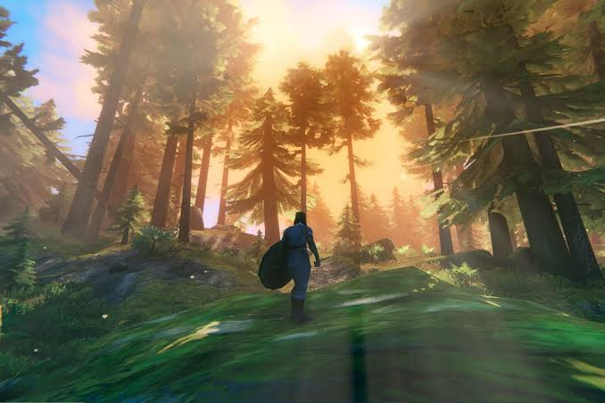 Valheim, sunlit pine forest | Tall pines, glowing gold haze between trunks, mossy ground | Low-res textures + **heavy volumetric fog**: proof that atmosphere beats texture detail | gold `#ecd8bd` `#bd976a` · moss `#404633` | Backlit, **god-ray haze between trunks** | **Valheim looks great with cheap assets because of fog and light.** Strong case for our approach | 🟢 |
| U46 | 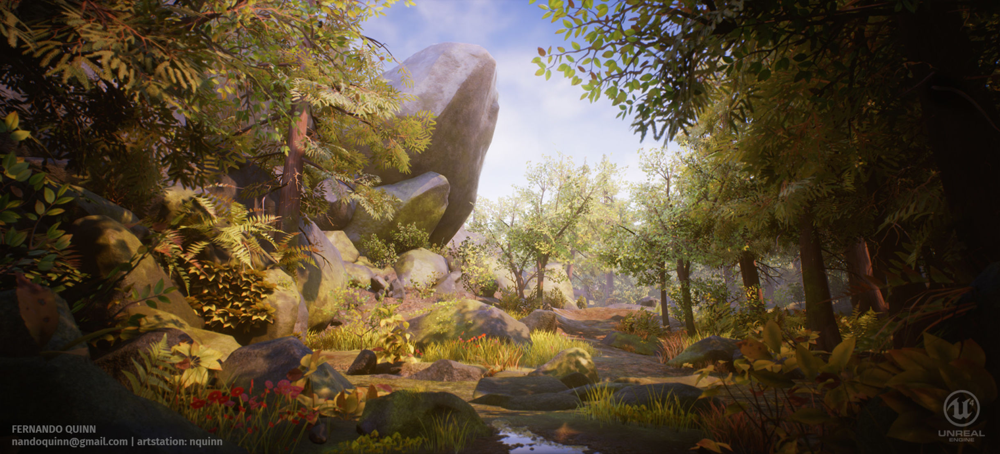 Fernando Quinn UE4 forest glade | Huge leaning boulder, ferns, poppies, stream | Stylized PBR, crisp leaf cards | olive `#988157` `#735933` · deep `#0e0905` | Warm low sun, **dark framing foreground**, bright mid | Leaf-card ferns + boulders; framing composition | 🟢 |
| U47 | 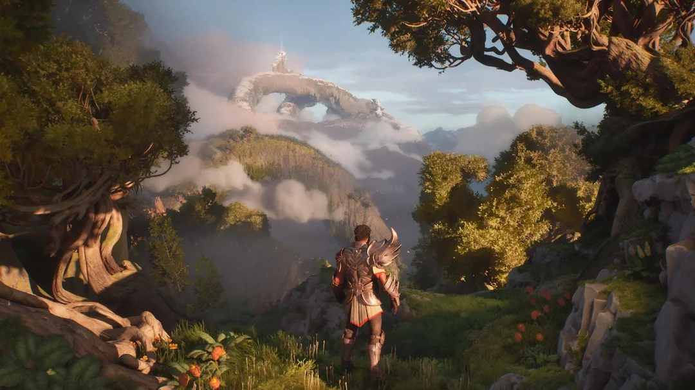 Fable, ridge view to arch island | Twisted trees frame a misty valley; a **natural stone arch with a tiny shrine on top**, clouds below | PBR | neutral `#9b8574` · mist `#b5b6b8` | Clouds **below the viewer** (sea of clouds) | **A floating stone arch with a glowing shrine** as a distant landmark; sea of clouds under the islands | 🟢 |
| U48 | 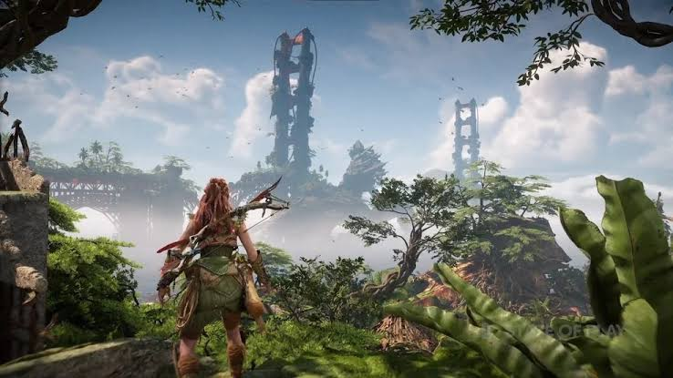 Horizon FW, jungle ruins | Overgrown towers in white mist, birds | PBR | mist `#b5bec9` `#d1d5db` | Mist layers | Towers fading into mist (same lesson as batch 2) | 🟢 |
| U49 | 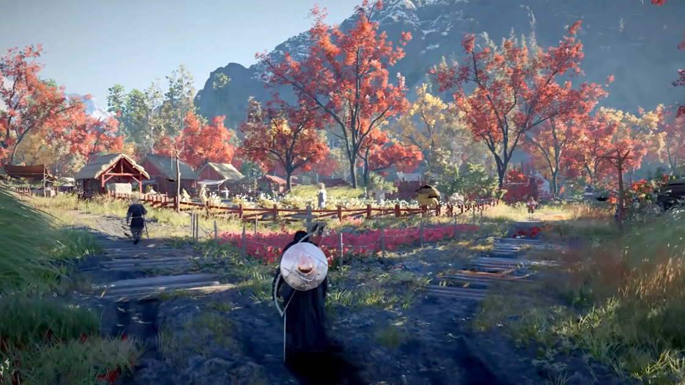 AC Shadows, autumn farm village | Thatched huts, **red maples and a red flower bed**, plank path | PBR | maple ≈ `#d04a2a` · blue shadow `#263a46` · sky `#8c9eb3` | Clear, cool shadows vs warm leaves | **Complementary pairing:** red/orange accents with blue-grey shadow | 🟢 |
| U50 | 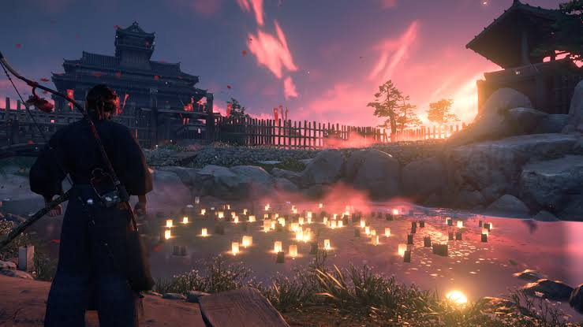 GoT, lantern pond at dusk | **Dozens of floating candle lanterns** on a pond, castle and fence behind, red embers drifting, pink-red sky | PBR | dusk `#98666b` `#e69a8d` · deep `#0a0c18` · candle ≈ `#ffc070` | Dark scene lit by **many tiny warm points** + pink sky glow | **Floating wish lanterns on the water at the castle**: direct match for our Wish Lanterns mini-game | 🟢 (instanced emissive quads) |
| U51 | 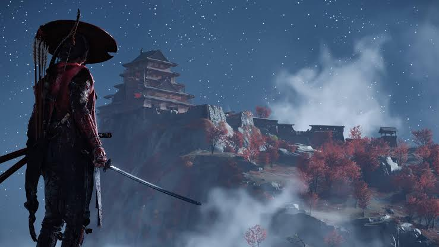 GoT, castle on a cliff under stars | Pagoda castle on a rocky bluff, **red maples**, mist rolling up, starry blue night | PBR | night blue `#3a5a7e` `#334b6b` · stars · maple ≈ `#a02020` | **Moonlit blue key**, mist glowing pale, castle in silhouette | **THE night hero shot**: castle on a high rock, mist rising from below, stars, one accent colour in the trees. Our castle reveal should look like this | 🟢 |
| U52 / U58 |  AC Shadows key art, valley + castle (U58 = square crop) | Overlook from a cherry tree: river valley, rice paddies, town, **white castle on a hill**, **falling petals** | Painted key art | sky `#91a6c8` · white castle · petals ≈ `#d06070` | Bright, **petals in the air** as foreground particles | **Layout of the whole world:** castle on a hill at the end of a river valley, town at its foot, overlook in the foreground. Falling petals = our stardust particles | 🟢 |
| U53 |  AC Shadows, pagoda garden | Pale sakura trees, lantern, red arch bridge, 5-tier pagoda backlit | PBR | blush `#e9dee8` `#c5a8a0` · bark `#342a25` | **Backlit soft haze**, petals drifting | Courtyard garden: blossom trees + stone lantern + arched bridge | 🟢 |
| U54 |  Rise of Ronin, rooftop over town at sunset | Clock tower, rooftops, orange trees, Mt Fuji in peach haze | PBR | peach `#f7d8b9` `#fbebca` · orange `#bc8b66` | **Monochrome peach haze**, sun disk | A high balcony view over the town: a vantage point on the castle | 🟢 |
| U55 |  GoT, deep blue sky + golden trees | Rocky hill with **bright gold trees**, pink flower field, deep blue sky gradient | PBR | sky `#1b4478` `#346795` · gold ≈ `#f0c030` · pink ≈ `#d080c0` | Clean, saturated sky gradient | **Gold trees on rocky tops + pink flower fields**: accent trees on the islands | 🟢 |
| U56 |  GoT, pampas grass at sunset | White pampas plumes bending in wind, pines silhouette, pink cirrus streaks | PBR | lilac sky `#8f93b4` · plumes `#dbcccc` · black `#04050a` | Low sun, **wind-swept grass**, pink streak clouds | **Wind-driven plume grass** that sways (vertex wind) + pink brushstroke clouds | 🟢 |
| U57 |  GoT, pink sunset over pampas | Same, more saturated pink-orange sky | PBR | `#d99e95` `#eabfa5` · navy `#2d3e58` | Pink/navy split | Dusk sky gradient reference: pink horizon → navy | 🟢 |
| U59 |  AC Shadows, torii on rocky overlook | Torii gate, pink tree, valley town in haze | PBR | blue-grey `#7d849b` `#5f6e88` | Hazy | **Gate on a ledge above a valley** (our arch gate placement) | 🟢 |
| U60 |  Snowy night fortress gate | Massive stone gatehouse with pagoda roofs, **warm windows**, bonfire, falling snow, deep indigo | Painterly 3D | indigo `#47477c` `#3a3b6d` `#22244b` · fire ≈ `#ff7030` | **Monochrome indigo night + warm window/fire accents** | **Night palette for the castle gate:** everything indigo, only the windows and fire warm. Falling particles | 🟢 |

**Batch 3 adds these techniques:**
- **T23 · Monochrome night + warm points** (U50, U51, U60). The whole frame stays in indigo/blue, and only the windows, lanterns and fires are warm. This is our night grade. 🟢
- **T24 · Floating lantern field** (U50). Instanced emissive quads on the water with a slight bob. 🟢
- **T25 · Falling petals / embers as foreground particles** (U52, U53, U50). Use 50–200 instanced sprites near the camera. 🟢
- **T26 · Wind-swept plume grass** (U56, U57). A white tip colour plus vertex sway. 🟢
- **T27 · One hero accent colour per area** (red maples U49/U51, gold trees U55, pink blossom U53). 🟢
- **T28 · Castle on a high rock with mist rising below** (U51, U52). Mist is 3–5 soft fog cards at the cliff base. 🟢
- **T29 · Dappled light** (U44, U46). A scrolling leaf-shadow texture multiplied onto the ground. 🟢

### Batch 4 (U61–U80, sent 2026-10-10): Ghost of Yōtei, Witcher, God of War, stylized forests, gothic night

**Overall read:** This batch is split between **stylized hand-crafted forests** (U68, U69, U70, U76: the closest match yet to a buildable web style) and **dramatic lit set pieces** (God of War night courtyard, gothic red night garden). The new idea here is **magic shown as light**: portals, runes on the ground, glowing spell strokes.
*Note:* U61, U62 and U63 carry PS5/4K watermarks. U61 looks like an AI-upscaled "fan render", so take its colours, not its detail.

| ID | Image | What it shows | Shading / detail | Measured palette | Light & atmosphere | Take for the castle | Cost |
|---|---|---|---|---|---|---|---|
| U61 |  Straw-hat ronin by a stream, red maple | Vivid green grass, **bright red maple**, red petals scattered on the grass, shrine on stone steps, misty hills | Over-sharpened, painterly grass strokes | grass `#175530` `#3c8c55` · haze `#e2e6d7` · red ≈ `#e02020` | Soft haze, light mist | **Red petals scattered on green grass**: a complementary ground decal. Shrine on steps behind water | 🟢 |
| U62 |  AC Shadows, red arch bridge garden | Vermilion arched bridge, stone lantern, small shrine, mossy dappled ground | PBR | moss `#323a2d` · sand `#ab9a74` · bridge ≈ `#b04a40` | **Dappled sunlight** through the forest | **Red arched bridge + stone lantern + moss**: a courtyard garden kit | 🟢 (dappled = projected texture) |
| U63 |  GoY, golden field + village + pink hills | Gold rice-grass foreground, thatched huts, lake, hillside of **pink-magenta trees**, castle on a far peak | PBR, saturated | gold `#c3af52` · sky `#5fdcfc` · deep `#102b48` | Clean bright sky | **Whole hillside in one accent colour (pink)** with the castle on top: the "hero hill" idea | 🟢 |
| U64 |  Witcher 3 Toussaint, cottage garden | Fence, pink blossom shrubs, red cottage, pond, castle far on the mountain | PBR, very saturated yellow-green (sat **0.76**) | lime `#8c9734` · olive `#585b10` · deep `#222f03` | Warm sun through leaves, bloom | **Fairy-tale cottage garden** with the castle in the distance; warm green grade | 🟡 |
| U65 |  FF XVI, meadow with **glowing spell strokes** | Red-orange calligraphic light ribbons on the ground, blue sparkles, wet reflective puddles | PBR + VFX ribbons | grass `#4f634e` · sky `#9db5d8` · ribbon ≈ `#ff5a3a` | Daylight; VFX additive | **Glowing calligraphy strokes on the ground**: exactly our "magic pathway that reacts to every step" (light trails spiralling from footsteps) | 🟢 (additive ribbon mesh) |
| U66 |  Cave mouth with waterfall and pink trees | Dark cave frame, cascading waterfall, mist, **tall pink-foxglove trees** against a cyan sky, rope bridge | PBR | dark `#0c1311` · sky `#a3dce7` · pink ≈ `#d070c0` | **Dark frame around a bright window** | **Cave-frame reveal**: walk out of darkness into a bright scene. Use it for an island entrance | 🟢 |
| U67 |  "Epic Colory Waterfall" (stylized UE) | Turquoise stream with stepping stones, magenta and teal canopies, white cliffs, waterfall | Stylized PBR, saturated | teal `#84ab94` · stone `#bbbaa8` · magenta ≈ `#c0305a` | Bright, soft | **Turquoise stream + stepping stones + magenta/teal trees** (complementary canopy colours) | 🟢 |
| U68 |  Stylized shrine waterfall (stylized UE) | Red torii in front of a waterfall, red maple, pink shrub, small red shrine, lanterns, flower meadow, dirt path | **Stylized hand-painted PBR**: chunky leaf-card canopies, soft cliffs, **clean painted water with white swirl foam** | grass `#5b734b` · cliff `#45544c` · maple ≈ `#e05a40` · lantern ≈ `#ffb040` | Soft overcast with warm lantern pops | **The best overall style target in batch 4**: painted water swirls, chunky trees, lantern dots, one red accent. Directly buildable | 🟢 |
| U69 |  Stylized forest (Lucas Fonseca?) | Huge twisted dark trunk, mossy log bridge over a blue river, **violet cliffs**, pink blossom tree, blue mist | **Hand-painted stylized**: leaf clusters with painted edges, faceted rocks, crisp shadows | shadow plum `#170410` `#302129` · haze `#898fa0` · pink ≈ `#d090d0` | **Purple-blue shadow** fill, warm sun on leaf tops | **Shadows in deep plum, distance in blue-violet, warm light on leaf tops.** This is our dusk palette in a buildable style | 🟢 |
| U70 |  Life Beyond concept art | **Giant glowing purple portal**, floating rock islands, mushroom-cap trees, waterfalls, a lightning beam, a silhouetted figure | Painted concept | violet `#6f6583` `#614661` · deep `#151012` · glow ≈ `#c080ff` · beam cyan ≈ `#60e0ff` | Magenta-violet haze, **light beams from the sky** | **Portal to the floating islands** + mushroom-cap trees + a **sky beam** marking a destination | 🟢 (emissive shader + noise) |
| U71 |  Uncharted 4, overgrown room (Gabe Betancourt lighting) | Light pours through a collapsed roof onto ivy and white flowers; leaded windows glow gold | PBR | moss `#626d59` · dark `#0b0f09` · window ≈ `#e0c060` | **A single shaft of light into a dark room** | **Castle interior hall:** overgrown floor, light shaft from above, **gold-glowing leaded windows** (our stained glass) | 🟢 (additive shaft card) |
| U72 |  God of War, Nidhogg entrance at night | **Red ivy cascading** over stone pillars, green carved arched door, warm brazier lamps, night sky | PBR, dense foliage cards | night `#121c1b` · ivy ≈ `#e03030` · lamp ≈ `#f0a050` | **Moonlight blue + red accent foliage + warm lamps** | **Night castle entrance:** carved arched door framed by cascading glowing ivy, lamps on each side. Swap red for our bioluminescent pink/cyan | 🟢 |
| U73 |  God of War, red birch forest | White birch trunks, crimson canopy, amber grass, **blue flowers**, god rays | PBR | red `#865449` `#6a2e26` · amber · blue flower ≈ `#4a50e0` | **God rays through fog**, backlit canopy | **White trunks + red canopy + blue flowers**: the strongest three-colour scheme in the set | 🟢 |
| U74 |  Bone-dragon camp at sunset | Birch trees, golden grass, a giant **dragon skeleton**, campfire, low sun | PBR | amber `#98501c` `#b47641` · deep `#1c0b04` | Low sun, everything amber (sat 0.71) | Golden-hour monochrome; a giant ancient skeleton as a landmark (maybe not for a birthday!) | 🟢 |
| U75 |  Valheim, autumn path | Red canopies, golden grass, **pink mushroom stepping path**, banner tent | Low-poly + fog | gold `#cbad71` · teal shadow `#0c2227` | Haze + sun shafts | Mushroom stepping stones along a path | 🟢 |
| U76 |  Valheim, giant fallen tree overhead | Bright grass, blue sky, **colossal tree trunk arching across the sky** | Low-poly assets + great lighting | grass `#4c6f43` · sky `#58a1a0` | Clean | **A colossal arching tree over the world** (Valheim proves low-poly can look grand) | 🟢 |
| U77 |  **Gothic red night garden** (UE scene) | Gothic spires and tracery fences, red-orange maples, **glowing rune circle with a lectern**, pink crystal clusters, lamp posts, a dark dome | PBR, **heavy warm grade** | deep red `#38120b` `#691308` · amber `#8b502e` · cyan rune ≈ `#40e0d0` | Night, everything lit warm red/orange; **cyan magic circle** contrasts | **The nearest match to our gothic castle at night**: tracery railings, spires, lamp posts, a **glowing summoning circle on the cobbles**, crystals. Use it with our indigo/pink palette instead of red | 🟢 |
| U78 |  Predecessor, **ruin portals over water** | Stone ruins with carved round medallions, **blue-violet swirling portals**, still reflective pool, golden trees | PBR | stone `#887464` · portal ≈ `#7060ff` | Warm sun vs cool portals | **Portal gates over a reflecting pool**: our island travel portals | 🟢 |
| U79 |  Fantasy desert ruins with teal tower | Huge carved teal stone tower, stairs, warm sun, sci-fi glowing seams | PBR | sun `#fef4e3` · rust `#762c12` · teal ≈ `#40a0a0` | Warm sun vs teal tower | **Carved monolithic tower with glowing seams**; warm/teal contrast | 🟡 |
| U80 |  Overgrown temple gate with **green crystal orb** | Arched ruin frame, glowing green orb on a pillar, purple trees | Stylized PBR | violet `#8a7496` `#b8a1b4` · deep `#110611` | Violet dusk | **Glowing orb on a pillar** inside an arch, violet foliage | 🟢 |

**Batch 4 adds these techniques:**
- **T30 · Glowing ground runes / spell strokes** (U65 ribbons, U77 circle). Additive ribbon meshes or decals that fade in where the player steps. This is our **interactive magic pathway**. 🟢
- **T31 · Swirling portal surface** (U70, U78). A disc with an animated noise shader, fresnel edge and additive bloom. 🟢
- **T32 · Cascading glowing ivy/foliage over architecture** (U72). Alpha-card curtains with a small emissive tint at night. 🟢
- **T33 · Light shaft into a dark interior** (U71). One additive cone card plus dust motes. 🟢
- **T34 · Painted water with white swirl foam** (U68). A flat stylized water shader with scrolling swirl texture, no reflections. 🟢
- **T35 · Dark-frame reveal** (U66 cave, U69 branch canopy). The foreground is near-black and frames a bright midground. 🟢
- **T36 · Three-colour scheme: white trunk / red canopy / blue flowers** (U73). For us, pale trunk / pink canopy / cyan glowing flowers. 🟢
- **Proof point:** Valheim (U75, U76) gets a grand look from low-poly assets with good fog and light. That's our model for laptops.

### Batch 5 (U81–U100, sent 2026-10-10): halls, cave temples, glowing ruins, cities on waterfalls

**Overall read:** This batch is mostly **painted concept art** with heavy atmospheric haze, many waterfalls and architecture fused with cliffs. It confirms the layout ideas: **a castle built into or onto cliffs with waterfalls pouring off**, **gothic arches glowing in a cave**, and **glowing wisps over still water**. Saturation is low (0.19–0.48) because mist washes most of these frames. Their beauty comes from **value layering**, which is cheap for us.

| ID | Image | What it shows | Shading / detail | Measured palette | Light & atmosphere | Take for the castle | Cost |
|---|---|---|---|---|---|---|---|
| U81 |  Classical hall with **magic mirror** | Coffered ceiling, columns, statues, braziers, a glowing oval mirror on a dais, **Greek-key mosaic floor**, sunlight pouring in | PBR | slate `#3e4855` `#203142` · warm stone `#886766` · sun `#eee3d9` | **Warm sunbeam vs cool shade**, fire bowls | **The welcome-cutscene room:** a mirror portal on a round patterned dais, flanked by fire bowls. Floor ring ornament = our Islamic geometric band | 🟢 |
| U82 |  Ratchet & Clank, orange alien town | Domed buildings, palm trees, red-orange ground plants | Stylized PBR, saturated (0.67) | orange `#db853c` `#ac5426` · light `#f8e392` | Monochrome orange haze | Domed roofs as a shape idea; one-hue zone grading | 🟢 |
| U83 |  Hob, curved stone walkway | Thick rounded stone walls with **inlaid copper trim lines**, giant chain, mushroom forest beyond | **Chunky stylized**, painted moss patches, bevelled edges | copper `#7f5d3c` · mint sky `#ace3d1` · stone | Soft daylight | **Chunky bevelled stone with metal trim inlays**: a cheap, readable castle-wall style | 🟢 |
| U84 |  Overgrown gothic ruin with **cyan rune** | Carved stone tablet with glowing cyan lines, moss boulders, autumn trees, god rays, falling motes | PBR | moss `#4f604e` · deep `#030c09` · rune ≈ `#60e0f0` | **God rays through mist**, floating dust | Carved stones with **glowing cyan inlay lines** (our trunk/wall patterns); god-ray cards | 🟢 |
| U85 |  Teal enchanted grove hall | Root-arch tunnel, teal light, a **cyan crystal obelisk**, white glowing coral plants, purple glowing mushrooms | PBR, dark (lum 36) | teal glow `#42a4ad` `#6bc2c6` · black `#020200` · violet ≈ `#7040e0` | **Monochrome teal night + violet accent** | **The bioluminescent forest at night**: exactly our brief. Root arches, glowing crystal, white glow-plants, purple mushrooms | 🟢 |
| U86 |  Painted cave with **golden gothic arches** | Elven arches glowing gold inside a green cave over a dark lake, candles/sails on water, waterfall | **Loose painterly strokes** | green `#496553` `#29483e` · gold ≈ `#e0d080` | Light from the cave mouth, gold glow | **Golden gothic arch silhouettes** as a glowing landmark over water; floating candles | 🟢 |
| U87 |  Waterfall cavern with ring sculpture | Cloaked figure, many waterfalls, a giant ring structure, orange lights, turquoise pool | Painterly | teal `#748c83` · light `#c3e6e6` | Cool light shafts from above, warm small lights | Waterfall curtain framing a ringed monument | 🟢 |
| U88 |  Forest temple with green dome | Small domed white shrine in a sun-dappled forest, a figure in the foreground, blue flowers | **Painterly, square brush strokes** | green `#607c51` `#afd287` · deep `#121207` | **Dappled sun patches** on the ground | Domed shrine in a forest clearing; dappled light patches (T29) | 🟢 |
| U89 |  Stylized **portal shrine** | Ruined stone pavilion with vines, a glowing cyan water-portal inside, steps, yellow flowers | **Flat painted stylized**, Ghibli-like | teal `#244151` `#3f6e7a` · grass `#aac78a` · portal ≈ `#80f0ff` | Soft, portal glows | **Island-travel portal in a vine-covered pavilion**: the simplest, most buildable portal design | 🟢 |
| U90 |  Painted valley with **blue dragons** | Waterfall cliff, rock ledge, winding rivers, twin butte, dragons flying | Painterly | sky `#8da1a7` · stone `#8c846b` · green `#5b5949` | Clear daylight | **Flying winged creatures circling the valley** (our winged unicorns); winding river layout | 🟢 |
| U91 |  Floating rocks over a lake (stock art) | Rock spires, **small floating stones**, stairs to a stone pillar, misty lake | Painted (stock watermark) | haze `#bed4ee` `#dfe7f4` · rock `#70615c` | Pale lavender haze (sat 0.22) | **Small floating rocks** around a landmark; stairs to a monolith | 🟢 |
| U92 |  Ghibli-style hiker + castle on a peak | Boy on a path, green hills, blue flowers, a castle city on a towering central peak, big cumulus | Painterly (AI look) | blue `#3d7596` · grass `#8ba69c` · deep `#0d1914` | Bright, big clouds behind the castle | **Same arrival shot as U02/U23:** walking a path toward a castle on a tall peak | 🟢 |
| U93 |  Eternal Strands (Maxime Desmettre) | Massive castle gate with **pink banners**, a giant golem in mist, autumn tree, sun shafts | **Painterly brush concept** | blue-grey `#404956` `#486b87` · banner pink ≈ `#d04080` | Cool shadow, warm light shafts | **Tall hanging banners in our pink/magenta** on castle walls; giant gentle creature beside the gate | 🟢 |
| U94 |  Temple in a cliff with **light beam** | Carved temple face in a huge rock, **red umbrella-canopy trees**, a pink-violet energy beam, lily-pad pools | PBR concept | grey `#696c64` · red ≈ `#c02020` · beam ≈ `#c060ff` | Hazy bright sky, magic beam | **Umbrella-canopy trees** (flat-topped, red/pink) + **lily-pad pools** + magic beam | 🟢 |
| U95 |  Town on a **waterfall cliff** | A medieval town on a rock above huge falls, turrets with conical roofs, arched stone bridge, lake | PBR | blue haze `#6886a8` `#91a7bf` · roofs ≈ `#c06030` | Hazy blue distance | **Castle perched on a cliff edge with a waterfall pouring below** + arched stone bridge | 🟡 |
| U96 |  Teal-roofed palace on waterfalls (Du Zhen) | Tiered teal roofs, mushroom canopies, many waterfalls dropping off island edges, airships | Painted concept | blue `#637ea8` · teal roof ≈ `#40a0a0` · mushroom peach ≈ `#e0a080` | Soft, misty spray | **Best floating-island palace reference:** a palace on an island with **waterfalls falling off its edges into mist**, giant mushroom accents | 🟢 |
| U97 |  Techland jungle ruins | Ruined temple towers, purple flowers, waterfalls, mist, figure on a ledge | Painted concept | blue-grey `#425158` · purple ≈ `#a050c0` | Thick mist layers | Purple flower accents on ruined stone; layered mist | 🟢 |
| U98 |  Stepico rock platform with rope bridges | A round carved stone pillar-top, rope bridges to cliffs with **glowing painted glyphs**, mist, light beam | Painted | stone `#aeb7ab` · glyph pink ≈ `#e04090` / cyan ≈ `#40c0e0` | Bright mist, sun shaft | **Rope bridges between floating islands** + glyphs painted on cliffs | 🟢 |
| U99 |  Mossy swamp with **teal wisps** | Giant mossy roots, still dark water, floating teal light orbs | Painted | moss `#5c6750` · black `#030302` · wisp ≈ `#40e0d0` | Dark, misty | **Floating teal wisps over still water**: cheap emissive sprites | 🟢 |
| U100 |  Red canyon with giant planet (Chris Radsby) | Red-leaf cliffs, a huge planet filling the sky, floating tower with a ring, misty lake | PBR | red `#834f52` · light `#cfb3af` · deep `#051014` | Pink haze, planet as light source | **Giant planet/moon filling the sky** behind a floating tower | 🟢 |

**Batch 5 adds these techniques:**
- **T37 · Waterfalls pouring off island edges into mist** (U95, U96). A scrolling alpha strip + a mist card at the base. 🟢
- **T38 · Glowing inlay lines in carved stone** (U84, U83 copper trim). An emissive mask in a trim sheet. 🟢
- **T39 · Hanging banners** (U93). Cloth planes with vertex wind; ours are pink/gold with a crest. 🟢
- **T40 · Floating wisps and small floating stones** (U99, U91). Instanced sprites/meshes with a sine bob. 🟢
- **T41 · Mirror/portal on a round patterned dais** (U81, U89). For the welcome cutscene and island travel. 🟢
- **T42 · Monochrome teal night + violet accent** (U85). The bioluminescent forest grade. 🟢

### Batch 6 (U101–U120, sent 2026-10-10): Trine-style fairy tale, stylized towns, night plateau, floating masses

**Overall read:** This batch moves the target toward **fairy-tale storybook fantasy**. Many frames look like the Trine series: **pink and violet fog, low sun flaring through the haze, ornate castles, and oversized mushrooms used as lamps**. Next to those sit **stylized "chunky" towns** (U102, U103, U104), a **night celebration plateau** (U106), and **painted floating landmasses** (U116, U119). Saturation runs from 0.30 to 0.63. The pink-fog frames (U109–U113) score only 0.41–0.50 because fog washes them, yet they read as rich because the fog itself is coloured. That is the main lesson of the batch.

| ID | Image | What it shows | Shading / detail | Measured palette | Light & atmosphere | Take for the castle | Cost |
|---|---|---|---|---|---|---|---|
| U101 |  Teal foggy sci-fi cavern city | Towers fading into fog, **red weeping trees** in the foreground, small warm ground lights | PBR, low contrast | teal `#6295a2` `#416c80` · deep `#19212c` · light `#96bdbe` | **Thick single-hue teal fog** with depth layers, tiny warm lights | Fog in one hue with **one complementary foliage accent** (red on teal) | 🟢 |
| U102 |  Stylized lumber village | Timber houses on stilts, plank walkways, rope pulleys, **faceted low-poly pines**, logs | **Chunky stylized, flat-shaded facets**, bevelled planks | cream sky `#e9edf5` · timber `#c98560` `#ac6342` · grey `#7d8584` | Warm sun, soft depth of field on the background | Plank-and-rope kit for **docks and bridges between islands**; faceted pines are very cheap | 🟢 |
| U103 |  Stylized pastel town plaza | Leaning pastel houses, striped awnings, a gothic chapel, **puffy cloud-shaped tree cards**, a round pool | **Hand-painted stylized**, exaggerated tilts | teal `#528384` `#6fc1c3` · sand `#cbb398` `#a5876a` | Soft cyan haze, warm stone | **Town at the castle's foot** (U52 layout) in this style. Bent, leaning walls give charm at no cost | 🟢 |
| U104 |  Four-game collage | (1) gothic graveyard, (2) **purple crystal on an ornate gold ground circle**, (3) round wooden arena, (4) cobbled square with a fountain | Mixed stylized | navy `#110f33` `#1a3563` · gold `#ebc88f` · rust `#ca724c` | Varies | Panel 2 is a **plaza centrepiece**: a giant crystal on a patterned floor medallion. Panel 3 suits a **mini-game arena** | 🟢 |
| U105 |  VR **rune stone portal circle** | A ring of chunky carved stones with **glowing gold runes**, a carved round floor disc, a pagoda on a cliff, sunset fog | **Chunky stylized**, rounded bevels | stone `#6a4242` `#37262f` · cream `#e4ddc1` · glow ≈ `#ffd060` | **Backlit sunset**, fog below the cliffs | **Island-travel portal design #2**: a standing stone ring with emissive runes around a carved disc. Fits Islamic geometry if the runes become star patterns | 🟢 |
| U106 |  **Night plateau with glowing balloons** | Round stone dais, glowing pink lantern-balloons, planets and moons in the sky, a pink crystal, warm lit stalls and huts, a sea inlet | **Stylized, soft painted**, clean shapes | navy `#32446c` `#131c34` · black `#0c0e1c` · warm `#e3d4b2` · pink ≈ `#ff90c0` | **Starry night, warm hut lights, pink glow accents** | **The celebration plaza at midnight**: a round dais for the welcome and the party, glowing balloons rising, planets in the sky. Matches our palette almost exactly | 🟢 |
| U107 |  Giant purple mushroom tower | A tower under a giant purple mushroom cap, floating balloons, rock pillars, a sea of cloud | Flat painted cartoon | cream `#eae9df` · violet `#614651` · sky `#a1d6e1` | Bright day, soft | **Mushroom-cap house** for a whimsical island; balloons drift between islands | 🟢 |
| U108 |  **Tree arch framing a floating island under a glass dome** | Dark purple tree roots form a round window; through it a small island floats inside a glass bubble, with hanging lanterns | **Painterly**, silhouette framing | plum `#31313a` `#473351` · pink `#ac82b1` `#7c4b74` · light `#cbd7e6` | Bright backlight through the frame, dark violet foreground | **Composition rule: frame the hero view with a dark organic arch.** Glass-dome island = a **snow-globe island** idea | 🟢 |
| U109 |  Pink fog canyon, flying machine | Hovering lantern device, rock ledges, **dense pink fog** | Stylized PBR, soft | pink `#e180a2` `#c06b8b` `#b04e70` · lilac `#e2b0d2` · deep `#3e243d` | **Fog coloured hot pink**, glowing particles | **Pink fog as a zone grade** (a "rose island") | 🟢 |
| U110 |  Ruined arch, red-leaf trees, lilac haze | Broken stone arch, crimson round trees, a wrecked boat, tall pale statues in the distance | Stylized PBR, chunky blocks | lilac `#b9adef` `#d5c6ed` · plum `#2b013c` · crimson `#6c2151` | **Lilac haze**, distant shapes as pale silhouettes | **Ruin arch with crimson trees** in lilac haze; giant faded statues for scale | 🟢 |
| U111 |  **Lighthouse beam across a pink canyon** | A lighthouse throwing a bright beam over pink fog, blue-violet cliffs, a character small in the foreground | Stylized PBR | navy `#19193f` · pink `#fdc5e7` `#ef87b0` · blue `#183b7a` | **Visible light beam** through coloured fog | **A lighthouse or castle beacon sweeping a beam** at night, cheap as an additive cone mesh | 🟢 |
| U112 |  Beach at sunset with a rainbow | Curved palms, wet sand, sea, a rainbow, game HUD | Stylized PBR | rose `#dc8f9d` `#bd7186` · violet `#856289` · peach `#f5d1b4` | Low sun, **rose-violet grade**, rainbow | A **beach island** graded rose-violet; rainbow as a sky card after the birthday reveal | 🟢 |
| U113 |  **Castle walkway at sunset, mushroom lamps** | Stone path with rope rails, ornate spired castle in silhouette, **glowing mushroom lamps**, flare and haze | Stylized PBR, ornate | peach `#fee3d4` · black `#090314` · plum `#32243f` `#57303c` | **Sun flaring through haze behind the castle**, dark foreground silhouettes | **Arrival walkway**: rope-railed path with mushroom lamps, castle backlit. Strong dusk shot | 🟢 |
| U114 |  Fairy-tale castle bridge with god rays | Turreted castle on a stone arch bridge over a misty gorge, lime moss, light shafts | Stylized PBR, rich | blue `#59679e` · brown `#896d65` `#28160d` · moss ≈ `#a0d040` | **Strong god rays**, mist in the gorge | **Castle bridge over a misty gorge**: gives the castle a grand approach | 🟢 |
| U115 |  Bubble dome over a lighthouse | A huge translucent blue sphere over a tower on rocks, blue sky | Stylized PBR | blue `#3998f9` `#7ccdfc` · slate `#2f3f41` · white `#dceafc` | Bright day, **fresnel-glowing dome** | **Fresnel bubble shield** over an island or the castle before midnight, which "pops" at the reveal | 🟢 |
| U116 |  **Castle beneath a floating landmass** | A huge dark mass overhead with waterfalls and falling rocks, a crystalline castle below, cloud sea, small houses on rocks | **Flat painted, cel-like**, strong outlines on rocks | cyan `#73f4f6` `#5fcfe1` · navy `#0e2c53` · violet `#4d4475` | Bright cyan, foam clouds | **An inverted island above the castle** with water falling from it. Big, memorable silhouette | 🟢 |
| U117 |  Giant flying fish over rock arches | Painted desert of rock pillars and arches, a huge fish creature in the sky | Painterly, bold shapes | blue `#758ad6` · rose `#be8c85` · plum `#31191f` | Warm side light, blue sky | Rock-arch silhouettes only. **The creature has big eyes, so it breaks the "no eyes" rule.** Do not use it | 🟢 |
| U118 |  Aerial view of a lighthouse island | Sea of islands and cliffs, a tower with a light ray, blue haze | Stylized PBR | blue `#4986fa` `#85a1f1` · navy `#0a2043` | **Blue aerial haze**, sun ray | **Map/flying view of the island ring**: each island marked by a tower beacon | 🟢 |
| U119 |  **Floating islands with glowing blue crystal plants** | Terraced orange rock islands with bonsai-like trees, **clusters of glowing blue crystal flowers**, ruins and arches behind | Stylized PBR, soft | teal `#7bc1ae` · slate `#506e82` `#33485d` · crystal ≈ `#a0c0ff` | Soft teal haze | **Island biome:** terraced rock, bonsai trees, glowing crystal shrubs. At night the crystals become the light source | 🟢 |
| U120 |  Dragon in a blue light-shaft river cave | A horned eastern dragon coiled over a river, strong light shafts, a warrior seen from behind | PBR, high detail, dark (lum 70), sat 0.63 | blue `#3e6a8a` `#275373` · black `#031019` · light `#709bb5` | **Monochrome blue, god rays** | Lighting only (one blue hue + light shafts). The PBR detail is too heavy for us | 🟡 |

**Batch 6 adds these techniques:**
- **T43 · Coloured fog as the main grade** (U109, U110, U111). Pink, lilac or teal fog per zone rather than grey. One `scene.fog` colour per island, crossfaded on travel. 🟢
- **T44 · Visible light beams** (U111, U118, U114). Additive cone or quad meshes with a soft gradient, slowly rotating for a beacon. 🟢
- **T45 · Mushroom lamps along paths** (U113, U107). Instanced mushroom mesh with an emissive cap. 🟢
- **T46 · Rune stone ring portal** (U105). Chunky stones with an emissive rune mask around a carved floor disc. 🟢
- **T47 · Fresnel bubble dome** (U115, U108). A transparent sphere with a fresnel rim shader. 🟢
- **T48 · Dark organic arch framing a hero view** (U108, U113). Placed at the spawn or a lookout. 🟢
- **T49 · Glowing balloons / lanterns rising at night** (U106). Instanced emissive sprites with a slow upward drift. 🟢
- **T50 · Inverted floating landmass with waterfalls** (U116). One big mesh + T37 waterfalls falling down from it. 🟢

### Batch 7 (U121–U140, sent 2026-10-10): ice palaces, portal dais overlooks, floating castle, classical temples

**Overall read:** This batch gives us **the castle itself** and **the island-travel hub**. Two frames show a **pink-white ice palace** with pointed pink-lit turrets, heart-shaped windows and crystal spikes (U128, U129). That is the closest match yet to a princess birthday castle. Three frames show a **round portal dais on a cliff edge** with an ornate gold gate frame, a lamp-post railing and a giant statue across a misty gorge (U134, U136). Two frames show a **castle on a floating island with a halo of orbiting rubble** (U137, U138). Saturation is low (0.12–0.40 in most frames) because these are pastel and misty. They stay readable because of **value layering and one hue per frame**, the same lesson as batch 5. U140 is the same shot as U114.

| ID | Image | What it shows | Shading / detail | Measured palette | Light & atmosphere | Take for the castle | Cost |
|---|---|---|---|---|---|---|---|
| U121 |  Tropical beach, mossy sea stacks | White sand, turquoise surf, palms, magenta flowers, red coral plants, giant vine-covered rock pillars; robot beasts | Painted key art, high detail | sky `#9bc1cd` `#61b1d1` · sand `#d7e7ed` · jungle `#1c2b1f` · coral ≈ `#d03040` | Bright day, haze between the stacks | **Beach island:** sea stacks wrapped in hanging vines, red coral as one accent. The robot creatures have eyes, so leave them out | 🟢 |
| U122 |  Garden pool among carved rock houses | Reflecting pool with lily pads, wide steps, carved stone arches, **cobalt-blue crystal flowers**, orange blossoms, rock spires | PBR, dark (lum 76) | moss `#323629` `#565348` · black `#060a0a` · blue ≈ `#3040d0` | Soft overcast, reflections | **Courtyard reflecting pool** with steps up to a gate; blue crystal-flower clumps as accents | 🟢 |
| U123 |  Ruins inside a broken rock bowl | A jagged ring of cliffs cups a temple and orange trees, white towers on pillars, mist, a glyph post, a tiled path with inlaid red lines | Stylized PBR | sky `#7ba6b7` `#dbeaf1` · stone `#7e6f59` · deep `#11100a` | **Backlit haze**, mist pooling in the bowl | **An island shaped as a cupped rock crown** with a temple inside; red inlaid lines on paving | 🟢 |
| U124 |  **Two friends overlook a beacon** | Carved ram statues on stacked-stone pillars, arched cliff facade, orange pines, mist sea with rock spires, a **violet-pink light pillar** rising from a far peak | Stylized PBR, saturated (0.53) | blue `#3074a0` `#518eb6` · warm `#cc9460` · pink glow ≈ `#e070c0` | Strong blue sky, **pink beacon bleeding into the mist** | **Destination beacon:** a coloured light pillar on each island (T44). Friends seen from behind = co-op mood | 🟢 |
| U125 |  Ice canyon with crystal spikes | Frozen river, pink-lit snow walls, clusters of long ice shards, a ruined bridge beam | Stylized PBR, low sat (0.25) | pink `#e9b1a6` `#fbd2c9` · mauve `#916278` · shadow `#563f63` | **Pink low sun on snow, violet shadows** | **Snow lit pink with violet shadows**: the exact warm/cool split for a winter island | 🟢 |
| U126 |  Ship frozen in a giant ice crystal | A galleon locked in blue ice spikes, glowing cyan core, frozen lake, pink clouds, snowy mountains, birds | Painterly concept | ice `#6990c6` `#425b88` · lilac `#b5b9d6` · pink `#d7c2d1` | Pink sky, **ice glowing from inside** | Ice with an emissive cyan core; a frozen-ship landmark for a winter island | 🟢 |
| U127 |  **Snow castle under an aurora** | Round-towered fortress on a snowy hill, teal aurora ribbons, falling snow, a warm glowing window, banners, a stone monument | PBR, dark, **sat 0.67** | teal `#1d6884` `#3486a2` `#4aa6bf` · navy `#0f212f` · window ≈ `#ff7030` | **Teal aurora night, one warm window** | **Our aurora** reference: ribbon cards in teal over a night castle, with only the windows warm. Falling snow particles | 🟢 |
| U128 |  **Pink palace balcony overlook** | Round balcony with a curved bench (two figures), Art-Nouveau iron curls, **turrets with heart-shaped windows glowing pink**, crystal spikes, snowy peaks, pink-violet sky | Stylized PBR, pastel (0.27) | lilac `#d7c9ea` `#cfb0da` · violet `#928cb0` · plum `#513b53` · pink sky `#c895d2` | **Pink dusk sky**, lilac haze over the mountains | **The birthday balcony**: a bench for two overlooking the valley, heart windows glowing pink. Strong candidate for the post-cutscene scene | 🟢 |
| U129 |  **Pink-white ice palace with star trails** | White palace with blue roofs, pointed turrets lit pink inside, grand stairs, iron arch gates, crystal spikes, a frosted tree, snowman, circular star trails | Stylized PBR | lilac `#bdb0d1` `#dcd2e5` · indigo `#1e204f` `#4c4a7e` · blue `#5474ae` · pink glow ≈ `#ff90c8` | **Twilight with circular star trails**, pink glow from windows | **Castle silhouette target:** white walls, blue roofs, pink-glowing turret tops, grand stairs, iron gates. Star-trail sky after midnight | 🟢 |
| U130 |  **Glowing white tree in a Persian courtyard** | Carved sandstone columns, a white-blossom tree with a golden glowing trunk, white flower bushes, statues, purple mountains | Stylized PBR | violet sky `#545a86` · sand `#dfb294` `#ac7c70` · dark `#131512` | Dusk violet sky, **tree glows gold** | **Courtyard centrepiece:** a white wish tree with a gold-glowing trunk, Persian columns fit our Islamic theme | 🟢 |
| U131 |  Stylized Greek temple on a golden meadow | Temple with pediment, blue banners, a golden harp, cypress trees, **yellow grass with blue flower specks** | **Clean stylized, soft shapes** | lilac sky `#b8b4cc` · gold `#bf965f` `#d2af85` · blue `#9eafcb` | Pastel dusk, soft | **Yellow field + blue flower specks**: a clean two-colour meadow (T7). Blue banners on columns | 🟢 |
| U132 |  Ivy-covered rotunda with eagles | Domed arch pavilion with gold ironwork, statues, eagle sculptures, fire inside, a volcano | Stylized PBR | blue `#49a0f7` `#89c9fb` · violet stone `#584d64` `#735b7f` | Bright sky, warm fire inside | **Domed pavilion** with ivy and fire bowls; works as an island shrine | 🟢 |
| U133 |  **Rose-garden arcade with mosaic floor** | Arched gothic arcade, potted rose trees, hanging pink flowers, a **patterned mosaic floor**, a gate at the end, floating paper shapes | Stylized PBR | rose `#b08977` `#816154` · cream `#e8dbcd` · dark `#2f1815` · pink ≈ `#f08080` | Soft bright | **Formal courtyard**: arches + rose trees + a geometric mosaic floor that leads to a gate. Matches our Islamic-pattern floor idea | 🟢 |
| U134 |  **Round portal dais on a cliff (top view)** | Circular stepped platform, **ornate gold gate frame** on an inlaid ring, lamp posts on the railing, market stall, trees, gorge with aqueduct and giant statue | Stylized PBR, **dappled shadows** | stone `#cac7c6` `#867783` · brown `#26190e` · lilac distance `#9ba3ad` | Sun through trees, **lilac distance** | **The island-travel hub**: a round dais with a golden gate, rail lamps, stall next to it | 🟢 |
| U135 |  Village plaza with a magic fire circle | Cobbled plaza, a ring of carved stone around a glowing gold fire, a moon-gate arch, tiled-roof houses, trees, players | PBR, low sat (0.23) | stone `#bcbca9` `#796e5c` · shade `#444849` · fire ≈ `#ffb040` | Warm low sun, hazy hills | **Social plaza:** a circular fire pit as the gathering spot for voice chat; moon-gate arch | 🟢 |
| U136 |  **Portal dais with a giant statue (wide)** | Same dais from the front, a colossal robed statue on a rock spire, a **blue wind ribbon** spiralling around the spires, aqueduct, cloud sea, snowy peaks | Stylized PBR | pale blue `#c4e3f2` `#9fcddd` · teal `#7aa9b3` · moss `#44614b` | Bright haze, layered depth | **Hero overlook:** giant statue across the gorge, a coloured ribbon spiral as a guide line (cheap trail mesh) | 🟢 |
| U137 |  **Castle on a floating island with orbiting rubble** | A gothic castle on a floating rock, a ring of debris swirling around it, a glowing green halo above, roots hanging below, mist | PBR, pastel (sat 0.12) | white `#e4e1df` `#f3e9e3` · stone `#93847d` · shadow `#6f5e53` | **Bright white mist**, orange autumn trees as the accent | **Floating castle island** with rocks orbiting it and a halo ring above | 🟢 |
| U138 |  Same castle with an aqueduct | Arched aqueduct leading to the floating castle, falling rocks, red tree, mist | PBR | grey `#bdaca8` `#d8ccca` · dark `#292518` | Hazy, halo glow | **Arched bridge reaching a floating island** | 🟢 |
| U139 |  Golden city in a haze | Vertical frame: a walled city of golden domes and spires, autumn trees, gold-leaf branches, a dragon | PBR, high detail | gold `#e8cdb0` `#d6b18f` · brown `#573e36` | **Gold haze**, sun through leaves | Gold-domed roofs; mood only. Detail level is too high for us | 🟡 |
| U140 |  Fairy-tale castle bridge (same as U114) | Duplicate of U114 | — | same as U114 | — | See U114 | — |

**Batch 7 adds these techniques:**
- **T51 · Turret tops glowing from inside** (U128, U129). An emissive window mask on the turret caps; pink at night. 🟢
- **T52 · Aurora ribbon cards** (U127). Curved strips with a vertical gradient and a scrolling noise alpha, additive. 🟢
- **T53 · Orbiting rubble halo** (U137, U138). Instanced rocks on a slowly rotating ring around a floating island. 🟢
- **T54 · Spiral ribbon guide line** (U136). A trail mesh with a scrolling texture curling round the spires toward a destination. 🟢
- **T55 · Ice with an emissive core** (U126, U125). Faceted crystal mesh, fresnel rim, a cyan emissive centre. 🟢
- **T56 · Dappled shadow cookie** (U134). A projected leaf-pattern texture on the ground under trees, no real shadows. 🟢
- **T57 · Circular star trails** (U129). A sky-dome texture of concentric arcs, slowly rotating. 🟢

### Batch 8 (U141–U160, sent 2026-10-10): winged palace, sunset valleys, plazas with a central spire, cosy interiors

**Overall read:** This batch covers three things. **Castle variants**: a white winged glass palace (U141), white cliff castles in pink haze (U144), and a purple painted sunset valley (U143). **Town squares** built around a single tall centre piece: a light spire (U151), a statue fountain (U157) and a domed palace with fireworks (U155). The **first interiors**: a stained-glass attic (U160) and a library (U159). The single best frame for a buildable stylized look is **U152**: a hillside town at dusk, blue-shadowed, with warm windows and golden domes on the summit. Several frames are hidden-object game art (U153–U159). They are dense with props, so we take their colour and layout but not their clutter. U158 is the same image as U153.

| ID | Image | What it shows | Shading / detail | Measured palette | Light & atmosphere | Take for the castle | Cost |
|---|---|---|---|---|---|---|---|
| U141 |  **White winged glass palace by a lake** | Ivory palace of glass towers and filigree, **giant sculpted wings** on the facade, an arched bridge, a reflecting river, snowy peaks, a figure seen from behind holding light | PBR, realistic terrain | ivory `#cfcdc8` `#b7b7b4` · olive `#5d5a48` `#383724` · dark `#211b0f` | Soft daylight, haze on the mountains | **Wings on the castle facade** (fits our winged-unicorn theme); a slim glass-and-filigree tower style. Arrival framing like U02 | 🟢 |
| U142 |  Sunset valley of castles and balloons | Hill overlook path, autumn trees, wagons, a misty valley holding several castles, **hot-air balloons** | AI-painted look, warm | gold `#edc18b` `#b68a63` · rust `#834c31` · grey `#7c8587` | **Low sun into valley mist** | **Overlook layout:** a path ending at a ledge with the whole valley below; balloons drifting in the sky | 🟢 |
| U143 |  **Purple sunset castle valley** | Castle on a crag, waterfalls, a winding river, pines, a campfire with a **glowing crystal**, falling embers | Painted, saturated (0.51) | violet `#554376` `#2d1f3e` · peach `#e7aba2` · rose `#ac6f90` `#914d6f` · black `#090611` | **Violet sky, peach sun, pink-rimmed peaks** | **Dusk palette for the castle valley**: violet → peach, pink rims. Very close to U26/U32 | 🟢 |
| U144 |  White castle in a rose haze | Tall white castle on a cliff, ruins and spires in mist, a blazing light on the right | PBR, misty (0.28) | rose `#dcaeb2` `#c99497` · plum `#633b43` · warm `#fbdaba` | **Rose fog, blinding light source** | White castle on a cliff lit rose; a **"golden light" landmark** at the horizon | 🟢 |
| U145 |  Ruined aqueduct arches at night | Broken arches over water, a tall tower lit by a gold glow, starry sky, faint rainbow, a knight | PBR, dark | blue `#435672` `#848bac` · black `#101011` | Starry night, gold glow on one side | **Ruined arches against the stars**: a quiet night spot | 🟢 |
| U146 |  Overgrown castle under a green portal | Gothic castle in a forest valley, red and gold trees, a **swirling green sky portal** | PBR, dark | brown `#241e19` `#615042` · mint sky `#b0c8c4` · portal ≈ `#40e0b0` | Overcast, green glow | Sky portal swirl over a castle (pairs with U137's halo) | 🟢 |
| U147 |  Jungle pools and waterfalls | Turquoise pools stepping down, mossy rocks, palms, **red flower carpets**, a far tower | PBR, high detail | moss `#64674d` · turquoise ≈ `#40c0b0` · red ≈ `#d03030` | Bright haze | **Stepped turquoise pools with small falls** for a garden island; red flower drifts as the accent | 🟡 |
| U148 |  **Stylized island village at night (level design)** | Chunky stacked-rock island, plank dock, two cottages with warm windows, a lantern-lit path, gravestones, fences, foam around rocks | **Stylized low-poly, chunky rocks**, sat 0.58 | blue `#255273` `#0f3c59` · navy `#021c2c` · warm windows ≈ `#ffc070` | **Blue night, warm lantern pools**, white water foam | **Buildable night island blockout**: chunky rocks + dock + 2 cottages + lantern path. Exactly our budget | 🟢 |
| U149 |  Stylized timber houses at dusk | Tall half-timbered houses, **blue scalloped roof tiles**, warm windows, chimneys, lamps | **Hand-painted stylized**, bevelled | blue `#5879ab` `#6a91bd` · plum `#402f3d` · warm ≈ `#ffb050` | Blue dusk, warm windows | **Town house kit** for the castle's village: blue scalloped roofs, warm glowing windows | 🟢 |
| U150 |  Arcade courtyard with a sword monument (split day/night) | Arched cloister with round geometric medallions, curved terracotta stairs, a glowing blade monument, carved swirl floor discs | Stylized PBR, anime | terracotta `#c78551` `#a77043` · cream `#e4ccae` | Day/night comparison | **Arcade with round medallions** (our Islamic star roundels) and a stepped ring stair | 🟢 |
| U151 |  **Plaza with a central light spire** | Sand arcades with domed towers, a tall white spire with a blue light beam, stepped dais, serpent statues, **concentric spiral floor rings** | Stylized PBR, anime | sand `#d5ab89` `#e4ccad` · blue `#3e769c` `#265f88` | Bright day, beam from the spire | **Central plaza:** a tall spire with a beam as the world's landmark; concentric rings in the floor lead to it | 🟢 |
| U152 |  **Hillside dome town at dusk** | Terraced Mediterranean houses climbing to a hilltop of **golden domes and clock towers**, canals with bridges, lamp posts, flower beds, warm windows | **Clean stylized, soft painted**, sat 0.51 | blue `#80b2d4` `#508fbe` `#195b8b` · navy `#0e2d4d` · gold domes ≈ `#f0b040` · warm ≈ `#ffc070` | **Blue hour: cool blue shadows, sunlit peach on the tops, warm windows** | **The town at the castle's foot**: stairs, canals and lamps climbing to the castle. Best lighting reference for our dusk town | 🟢 |
| U153 |  Autumn mansion with balloons | Peach mansion with a glass dome, balloon bunch at the door, gold tree, vintage car, crates | Painted hidden-object, prop-dense | gold `#b48d5c` · peach `#e4d9b6` · brown `#6c4a2f` | Warm autumn sun | **Balloons on doorways** for party decor | 🟢 |
| U154 |  Townhouse garden with mosaic paving | Caryatid portico, rose beds, cypresses, a **compass-pattern mosaic** in the paving, statue | Painted hidden-object | stone `#a79480` · green `#456149` · cream `#d9d0b8` | Bright day | Mosaic medallion in the path; rose beds by doors | 🟢 |
| U155 |  **Palace square at dusk with fireworks** | Domed palace, glowing globe lamp posts, balloons, kite, **fireworks**, constellations drawn in the sky, ornate iron benches | Painted, detailed | dusk blue `#445a7a` `#223449` · lilac `#bba6a6` · warm lamps ≈ `#ffe0a0` | **Lilac-blue dusk, warm globe lamps** | **Birthday night square:** globe lamps, fireworks over the dome, **constellation lines in the sky** (could spell her initial) | 🟢 |
| U156 |  Floating city with an airship (BioShock Infinite) | Sky city, airship, giant statue, hot-dog cart, flowers, buildings floating in the clouds | Stylized PBR, bright | peach `#cb9a82` `#eccdaf` · blue `#8297b1` | **Hazy bright sun, cloud sea** | Floating buildings in the background; an airship as a travel option between islands | 🟢 |
| U157 |  Old-town street with a statue fountain | Brick houses, a pointing statue on a fountain, cobbles, yellow car | Painted hidden-object | brick `#a87d6b` `#b8a198` · grey `#3c4447` | Sun shafts | Fountain with a statue as a square's centre | 🟢 |
| U158 |  Same as U153 | Duplicate of U153 | — | same as U153 | — | See U153 | — |
| U159 |  Gothic library room | Rib-vaulted ceiling, blue brick walls, bookshelves, armchairs, a desk, gift boxes with red ribbons | Painted hidden-object | brown `#73503e` `#9f6b44` · dark `#381918` | Warm interior, cool windows | **Gift boxes with red bows** as collectibles; vaulted room shape | 🟢 |
| U160 |  **Attic with a round stained-glass window** | Wooden attic, a **round rainbow stained-glass window** throwing coloured light on the floor, plants, a crystal ball, bed, rug, cushions | **Stylized, warm**, sat 0.57 | wood `#99553f` `#b98465` · dark `#130604` · cream `#e4c39f` | **Coloured light from the window** onto the floor | **Stained-glass rose window casting coloured light** for the castle's interior (a projected texture, no real light). A cosy room for her | 🟢 |

**Batch 8 adds these techniques:**
- **T58 · Blue-hour grade** (U152, U149, U148). Cool blue shadows, peach light only on the highest surfaces, warm emissive windows. The cheapest beautiful lighting setup. 🟢
- **T59 · Stained-glass light on the floor** (U160). A coloured decal or projected texture under each window, with no real light. 🟢
- **T60 · Fireworks and constellation lines** (U155). Particle bursts plus line segments between star sprites. 🟢
- **T61 · Concentric floor rings leading to a centre piece** (U151, U150). A floor texture or decal around plazas. 🟢
- **T62 · Facade wings** (U141). One sculpted mesh pair, mirrored. 🟢
- **T63 · Globe lamp posts** (U155, U152). An instanced mesh with an emissive sphere. 🟢

### Batch 9 (U161–U180, sent 2026-10-10): stylized desert towns, lace-trimmed pink houses, painted cities, cel-shaded towns, interiors

**Overall read:** This batch is mostly **stylized game environments** rather than painted concept art, so a lot of it can actually be built. Three groups matter. **Warm stylized desert / Middle-Eastern towns** (U177, U178, U179): chunky orange rock, sand plazas, arched windows, **coloured cloth canopies strung across the street**, and Greek-key and star roundels. These fit our Islamic-geometric brief better than anything so far. **Ornate pastel facades** (U180, U176): carved wooden lace trim, onion-curve gables, floating rock fragments in a dusk sky, strings of small teal lights. **Painted stylized cities** (U165–U168) show how **visible brush strokes and simple block shapes** read as rich. The cel-shaded Hi-Fi Rush / Bomb Rush frames (U169–U173) are too urban and loud for our mood, but their outline-free flat cel shading is the cheapest look of all. The four interiors (U161–U164) are realistic, prop-heavy rooms, so we take only their warm lamp lighting.

| ID | Image | What it shows | Shading / detail | Measured palette | Light & atmosphere | Take for the castle | Cost |
|---|---|---|---|---|---|---|---|
| U161 |  Gothic hotel lobby (hidden-object) | Rib-vaulted ceiling, ring chandeliers with candles, stone walls, sofas, gallery balcony | Painted, prop-dense | brown `#9e7760` `#482d25` · warm `#d2a584` · deep `#320f0b` | Warm candle light, cool snowy windows | **Ring candle chandeliers** in a vaulted hall; warm inside vs blue window light | 🟢 |
| U162 |  Decorated living room | Crystal chandeliers, panelled walls, fireplace, tree, gifts, balloons | Painted, prop-dense | taupe `#968477` `#846554` · dark `#1c0d0c` | Warm lamps | **Tiered crystal chandeliers**; balloons tied to walls for the party room | 🟢 |
| U163 |  Detective office (UE stylized) | Green walls, desk, arched rainy window, green lamp | Stylized PBR | olive `#655b50` `#434541` · warm `#a99572` | **Blue window light vs one warm desk lamp** | Two-temperature interior lighting | 🟢 |
| U164 |  70s wood-panel room | Desk, record player, floor lamp, shelves | PBR, dark (lum 36) | wood `#5d3925` `#2c1209` · lamp `#b28962` | One warm floor lamp | Mood only | 🟡 |
| U165 |  **Painted eco city plaza** (Devil in Disguise) | Terraced plaza, cone cypresses, planter boxes, green-tiled towers, monorail, awning shops, a dog | **Painterly, visible brush strokes, simple blocks** | teal `#26b2c8` `#77bbb2` · sand `#c3b181` · brown `#96633f` | Bright day, cyan haze | **Brush-stroke textures on simple blocks** look rich. Terraced plaza with cypress cones | 🟢 |
| U166 |  Eco city, second view | Same city from higher, more towers and planters | Painterly | mint `#d3e9d8` `#9fd1cf` · brown `#9e674f` | Pale cyan haze | Same lesson; distant towers fade to pale mint | 🟢 |
| U167 |  **Overgrown ruins at golden sunset** (Hyper Light Breaker) | Broken bridge, cracked road, flooded pools, lime grass, vines, a violet-shadowed river | **Painterly, chunky flat shapes** | gold sky `#e6d885` `#d8b18d` · violet shadow `#272f49` `#4d5e66` | **Yellow sky, violet shadows, lime grass**: strong complementary grade | **Gold/violet split** for a dusk ruin island; flooded pools with lily pads | 🟢 |
| U168 |  **Overgrown street with a giant tree** (Hyper Light Breaker) | Lime grass over pavement, a huge tree arching over the street, red awnings, string lights, sun at the end | **Painterly, big flat grass shapes** | lime `#8bba31` `#789c3c` · gold `#dad682` · dark `#312c28` | **Sun at the end of the street**, warm haze | **Path leading to a bright opening** (composition); giant tree arching over a path; string lights | 🟢 |
| U169 |  Hi-Fi Rush aerial city | Neon platforms, a giant V tower, flat blue sky, cloud strokes | **Flat cel shading, outlines** | blue `#0e78da` `#7fb5df` · grey `#cbd1e2` | Flat bright day | **Graphic cloud strokes** in the sky; flat cel shading | 🟢 |
| U170 |  Hi-Fi Rush plaza stairs | Wide stairs to a giant statue, banners, neon screens | Flat cel, outlines | navy `#2c2947` `#0e2c47` · pink ≈ `#e040a0` | Shadowed foreground, lit stairs | **Wide stairs up to a landmark** with banners on both sides | 🟢 |
| U171 |  Bomb Rush Cyberfunk, sunset city | Graffiti skater, overpasses, red railings, tiled buildings, painted clouds | **Flat cel, hard shadow edge** | sand `#b88d62` `#fddda3` · dark `#0f1a19` | Warm sunset, flat painted clouds | Hard two-tone shadows on buildings | 🟢 |
| U172 |  Bomb Rush Cyberfunk, teal city | Teal and red towers, drone, blue sky, cartoon clouds | **Flat cel, saturated (0.68)** | teal `#0b5b6b` `#062f3c` · navy `#021624` | Bright, hard shadows | Too urban; shows that **2 hues + cel shading** is enough | 🟢 |
| U173 |  **Hi-Fi Rush night park with a globe fountain** | A round park with a glowing golden globe sculpture, hedges, lamp posts, banners, a roller-coaster, starry sky | Flat cel | plum `#2b212c` `#482a3e` · gold `#c2b683` | **Night with warm lamps and a glowing centrepiece** | **Round night plaza with a glowing centrepiece and a ring of lamps** (pairs with U106, U155) | 🟢 |
| U174 |  **Lilac castle with pink and orange trees** | Purple castle on a cliff, giant cumulus clouds, pink and orange round trees, a stair up a rock, a stone path | **Flat painted, saturated** | blue `#5c9cc7` `#384b6f` · lilac `#ac9eaa` · pink ≈ `#f090c0` · orange ≈ `#f0a030` | Bright day, blue haze | **Day version of our castle valley**: lilac castle, pink and orange blossom trees, big clouds. Good for the pre-midnight daytime look | 🟢 |
| U175 |  Girl reaching toward a sky beast | Ruins, a giant stone wolf-shaped ship in a violet sky, a red butterfly, glowing hand | Painterly | lilac `#a8aad9` `#bfc1dc` · plum `#392c5d` · moss `#2d4734` | **Violet haze, glow on the hand** | Violet sky haze; a magical glow on the player's hand as an interaction cue | 🟢 |
| U176 |  **Stylized brick street** (Overwatch-like) | Brick walls with stone corner quoins, balconies with flower pots, hanging ivy, lantern brackets, cobbles, rail tracks | **Hand-painted stylized PBR, chunky bevels** | brick `#bb7e5f` `#985b46` · cream `#eac997` · shade `#53443e` | Bright day, soft shadows | **Town building kit**: chunky stone quoins, flower balconies, hanging ivy, curly lantern brackets | 🟢 |
| U177 |  **Stylized desert fountain** | A carved stone face spouting water into a turquoise pool, palms, orange domed rocks, ferns, rune pillars | **Stylized PBR, hand-painted, soft** | orange `#ef9655` `#f7c38c` · teal pool ≈ `#40b0d0` · dark `#211610` | **Warm sun, blue sky, crisp palm shadows** | **Stylized water** (flat turquoise, white foam streak). Spout fountain for the courtyard, without the face | 🟢 |
| U178 |  **Desert temple courtyard with a Greek-key roundel** | Sand tile plaza, a big circular gate medallion with key-pattern rings, stairs, columns, palms, pools on the sides | **Stylized PBR**, clean | sand `#fbcfa8` `#deaa7d` `#d18c5d` · slate `#4d5066` | Low sun, long shadows, purple sky | **Gate design:** a huge round patterned medallion over the door, wide stairs, symmetric plaza. Swap Greek key for an Islamic star | 🟢 |
| U179 |  **Desert canyon bazaar with cloth canopies** | Orange rock arch, terraced sandstone houses, **yellow, purple and green cloth sails strung across the street**, bunting, rugs, pottery, warm haze | **Stylized PBR, rich (0.60)** | orange `#ba7945` `#904131` · cream `#cfb292` · deep `#490a07` · purple cloth ≈ `#a050c0` · yellow cloth ≈ `#f0c030` | **Sun haze down the street**, wind motes | **Bazaar street for the town**: cloth canopies and bunting give colour for almost no geometry. Arched windows and patterned rugs fit the Islamic theme | 🟢 |
| U180 |  **Pink house with carved lace trim** | Peach plaster houses with white carved wooden window frames and eaves, red window frames, floating rock fragments, a dark dusk sky, teal string lights, patterned vases | **Stylized PBR, painted plaster wear** | peach `#b1908d` `#c9aca4` · rose `#8d5e5d` `#b0786f` · plum `#503f4f` · light ≈ `#60e0c0` | **Dusk, teal fairy lights** | **Ornament target for houses:** white lace trim on pastel walls, teal string lights, floating rock debris. Very close to our pink palace mood | 🟢 |

**Batch 9 adds these techniques:**
- **T64 · Cloth canopies and bunting** (U179). Curved planes strung between buildings with gentle vertex wind; strong colour for almost no cost. 🟢
- **T65 · String fairy lights** (U180, U168). A curve of instanced emissive dots between two points. 🟢
- **T66 · Lace trim cards** (U180). Alpha-cut trim strips on eaves and windows. 🟢
- **T67 · Big round patterned gate medallion** (U178). One textured disc with an emissive pattern at night. 🟢
- **T68 · Gold sky / violet shadow split** (U167). Warm directional light + violet hemisphere ground colour. 🟢
- **T69 · Brush-stroke textures on simple blocks** (U165, U167). Painted detail in the texture, low-poly geometry. 🟢

### Batch 10 (U181–U200, sent 2026-10-10): Overwatch Oasis arches, cosy stylized villages, floating dioramas

**Overall read:** Three useful groups. **Overwatch's Oasis map** (U181–U183, U185) is the clearest **Islamic-architecture-in-a-stylized-game** reference so far: pointed and cusped arches, carved column capitals with blue painted bands, star-pattern lattice windows glowing gold, pink-lilac dusk skies with huge soft clouds. Overwatch is built to run on modest PCs, so this is proof that the style fits our budget. **Cosy stylized villages** (U192–U196) show the "chunky, slightly exaggerated" kit at its best: curved swirl ferns, timber frames with painted runes, bunting and lanterns strung across streets, a cottage tucked under a mossy rock. **Floating dioramas** (U197–U199) show how a small island reads as a complete little world: a cliff skirt below, a waterfall dropping off the edge, stained-glass light on the floor, a blossom tree overhead. U187 is the same image as U186.

| ID | Image | What it shows | Shading / detail | Measured palette | Light & atmosphere | Take for the castle | Cost |
|---|---|---|---|---|---|---|---|
| U181 |  **Oasis arcade (Overwatch)** | Pointed-arch arcade, carved capitals with **blue painted bands and zigzag trim**, a star-patterned vaulted ceiling, a balcony over terraced gardens | **Stylized PBR, clean bevels, soft painted gradients** | sand `#a4644a` `#7d4735` · cream `#edd5c0` · blue band ≈ `#3060a0` | **Warm bounce light under arches**, pink sky | **The castle's inner arcade**: pointed arches, blue-band capitals, a patterned ceiling. Exactly our Islamic + gothic mix | 🟢 |
| U182 |  Oasis tower door with palms | A tall stepped-arch doorway in a smooth peach tower, palms in planter beds with orange flowers, pink clouds | Stylized PBR, smooth surfaces | peach `#d79b7f` `#eed9c7` · rust `#653022` | **Pink-gold dusk, big soft clouds** | **Stepped (nested) arch doorway**; planter beds with flowers along a terrace | 🟢 |
| U183 |  **Oasis plaza at sunset, glowing star lattice** | Tall facades with **gold-glowing eight-point star lattice windows**, a cusped arch, a giant pierced canopy with star cut-outs, palms | Stylized PBR | peach `#cb8669` `#e7ba95` · plum `#6c433e` · glow `#fcfad9` | **Sun flaring behind lattice**, warm glow through patterns | **Star-lattice windows lit from behind** (emissive texture). At night the castle walls glow in Islamic star patterns | 🟢 |
| U184 |  Gothic bridge tower at night (stylized) | Brooklyn-bridge-like stone towers with pointed arches, lamps, starry sky, lit windows | Stylized PBR | blue `#1d3d67` `#355174` · grey `#3e4155` · lamp ≈ `#ffb050` | **Blue night, warm lamp pools** | **Gothic arch gate towers on a bridge** for the castle approach (pairs with U114) | 🟢 |
| U185 |  **Twisting tower under a pink-violet starry sky** | A spiral-stacked tower, misty falls, terraced garden islands with palms, a hover vehicle, stars appearing | Stylized PBR | pink `#e9c0d3` `#d0a3bb` · violet `#6975b5` `#6b5b8a` | **Dusk-to-night gradient, stars fading in, mist** | **Exact dusk sky gradient** for just before midnight: pink horizon to violet with stars. Terraced garden islands | 🟢 |
| U186 |  **Lit pagoda under a violet moonlit sky** | Pagoda with warm windows, a pine silhouette, full moon behind clouds, stars | Stylized PBR, dark (lum 51) | indigo `#303069` `#43417c` · black `#16100e` · windows ≈ `#ffc070` | **Violet night, warm windows, moon halo** | **Night grade target** alongside U60: indigo-violet sky, black tree silhouettes, warm windows only | 🟢 |
| U187 |  Same as U186 | Duplicate | — | — | — | See U186 | — |
| U188 |  Golden neon temple city at night | Red pagoda buildings, a huge golden glowing statue screen, neon, bridges | Stylized PBR, sat 0.58 | navy `#023149` · gold `#f7dda4` | Night, gold glow | One giant golden glow as a centrepiece; too busy for our mood | 🟡 |
| U189 |  Venice plaza (Overwatch) | Pink brick and blue-tiled houses, green shutters and awnings, a bell tower, a well, striped mooring poles | Stylized PBR | teal sky `#70c7d3` · brick `#563e46` `#695b61` | Bright day | **Wellhead in a square**, striped poles, a tall bell tower as a landmark | 🟢 |
| U190 |  Paris street at pink dusk (Overwatch) | Mansard-roof house, ornate iron railings, glowing lanterns, hot-air balloons, Eiffel Tower in haze | Stylized PBR | pink `#f8ddd9` `#c5a1a9` · brown `#71504b` | **Soft pink haze**, warm lanterns | **Pink haze + lanterns + balloons**: the pre-midnight town mood | 🟢 |
| U191 |  Sci-fi ruins on red sand | Fluted towers, cables, rubble, a camp desk | PBR, realistic | grey `#87706b` · red sand ≈ `#a05040` | Overcast | Not our style | 🔴 |
| U192 |  **Ruined gothic arch in an orange meadow** | Stone archway with a quatrefoil window and niches, stone steps, orange grass with white daisies, **blue flower silhouettes** in the foreground, painted clouds, falling leaves | **Stylized, painted grass cards, soft dappled shadow**, sat 0.61 | orange `#e79b54` · dark `#431c04` · sky `#1691cc` · cloud `#e1e3e1` | **Orange vs blue complementary**, wind streaks | **Hero ruin gate**: arch + steps on a meadow. Complementary meadow (warm grass, blue flowers). Wind streak lines | 🟢 |
| U193 |  **Stylized village house with swirl ferns** | Timber house with chunky red beams, **glowing pink swirl runes** on the door, ivy, a dirt path, giant curled fern sprouts, mushrooms, a dock with a boat, mountains | **Chunky stylized PBR, hand-painted** | sky `#c3e1fc` · timber `#ac7462` · dark `#112018` | Bright soft day, aerial haze on mountains | **Same artist family as C01 (Magic Moorland)**: chunky timber, emissive swirl runes on doors, curled ferns. Directly buildable | 🟢 |
| U194 |  **Timber village street with bunting** | Half-timbered overhanging houses, purple tile roofs, a tower, **purple and blue bunting**, laundry lines, apple carts, shop signs | **Stylized PBR, chunky** | wood `#735144` · dark `#312926` · green `#3c483b` · purple roof ≈ `#7050a0` | Soft day, darker vignette | **Town street layout**: buildings lean in, bunting zig-zags overhead, a tower closes the view | 🟢 |
| U195 |  Fairy-tale market with lanterns | Round towers, an arched bridge-house over the street, garlands of green and pink lanterns, ivy, yellow trees, market stalls | Stylized PBR | cream `#d9cfb3` · gold `#ae865b` · brown `#72523f` | Bright day | **Arch over the street + lantern garlands**: the town gate idea | 🟢 |
| U196 |  **Cottage tucked under a mossy rock** | Curved-roof cottage under a giant leaning boulder, smoke puffs, a birdhouse, laundry, a flag, lanterns, a shop sign | **Stylized, painted**, sat 0.64 | blue sky `#0878a6` `#035c85` · moss `#6d7643` · dark `#022129` | **Saturated blue sky, dark green frame** | **House-under-a-rock** silhouette for an island cottage. Dark tree frame around a bright centre | 🟢 |
| U197 |  **Floating diorama island with a checker floor** | A small rock island with a balcony, an arched doorway with a striped curtain, cushions, a **black-white checker floor**, a teal water stream pouring off the edge, ivy | Stylized PBR diorama | brown `#3a2819` `#907b5e` · teal ≈ `#40b0b0` | Warm studio light | **One island = one room**: checker floor + waterfall off the edge + rock skirt. Bazaar-style cushions | 🟢 |
| U198 |  **Old library diorama with stained-glass light** | Ruined gothic window with **stained glass throwing coloured patches onto cobbles**, a bookshelf, roses, ivy, candles | **Stylized hand-painted** | slate `#2a3436` · warm `#9b8579` · glass red ≈ `#e04060` · glass gold ≈ `#f0c040` | **Coloured light pools on the floor** (T59) | **Stained-glass light patches** in the castle; roses and ivy around a broken arch | 🟢 |
| U199 |  **Floating purple temple island** | A lilac stone temple with a violet roof on a floating rock, rickety stairs, a lantern, a blossom tree with red flower clusters overhead, a small boat, lily pads, a waterfall mist off the edge | **Stylized hand-painted, saturated accents** | lilac stone ≈ `#c0a0d0` · violet roof ≈ `#7060c0` · black bg `#070708` · lime ≈ `#a0d040` | **Warm light beam through the doorway**, falling petals | **Floating island template**: lilac temple, blossom canopy, lily pond, waterfall off the edge. Our palette exactly | 🟢 |
| U200 |  **Forest ruin with a fountain stair** | Dark tree trunks framing a sunlit clearing, broken columns, a stepped fountain with a cyan water channel, red flowers, sun patches | **Flat painted, hard-edged sun patches** | green `#47675f` `#25433a` · dark `#011311` · sun `#e3e9ba` · water ≈ `#40d0d0` | **Dappled sun patches in a dark forest** | **Forest clearing shrine**: dark trunk frame, bright patches (T29/T56), a cyan water stair | 🟢 |

**Batch 10 adds these techniques:**
- **T70 · Star-lattice windows glowing from behind** (U183). Emissive eight-point star texture on facade panels; gold at dusk, cyan or pink at night. 🟢
- **T71 · Painted band trim on columns** (U181). Blue zigzag bands on capitals, in a shared trim sheet. 🟢
- **T72 · Dusk-to-night sky with stars fading in** (U185). A sky gradient and star alpha both driven by the countdown clock. 🟢
- **T73 · Wind streak lines** (U192, U193). Thin white curved trails drifting across the view. 🟢
- **T74 · Emissive swirl runes on doors** (U193, C01). Cheap magic on ordinary houses. 🟢
- **T75 · Island-as-room diorama** (U197, U199). Each floating island built as one small, complete scene with a rock skirt and an edge waterfall. 🟢

### Batch 11 (U201–U220, sent 2026-10-10): storybook villages, night timber towns, a crescent-moon snow tower, neon streets

**Overall read:** This batch has three groups. **Storybook daytime villages** (U202–U209) cover alpine castle valleys, timber towns with canals and bridges, hot-air balloons over a windmill tower, and a chunky stylized castle town with a glowing rune. **Night timber towns** (U210, U212, U219) show the same houses at night: curved blue shingle roofs, swirl-carved beam ends, pointed gothic windows glowing warm, and violet skies. **U211** stands out from everything sent so far. It is a snowy tower topped with **crescent-moon finials**, hung with lanterns, under a pink-lilac sky with a white palace on a far cliff. That is an almost exact match for our Islamic-fantasy night. The neon and pixel city frames (U214–U218) are off-theme for a fairy-tale castle. They do confirm one thing: **glowing outlines and signs on dark violet** read as magical. U220 is the best winter-night frame yet: a carved longhouse, a teal aurora, glowing water and torches.

| ID | Image | What it shows | Shading / detail | Measured palette | Light & atmosphere | Take for the castle | Cost |
|---|---|---|---|---|---|---|---|
| U201 |  **Ruined city gate, painted** (Owl Studio) | A broken white city wall with a gap, a lilac palace beyond, signposts, a candle on a stick, a rune totem with a crystal, red petals | **Flat painted, clean shapes** | plum frame `#1a131d` `#342637` · sand `#aea38a` `#a77f70` · glow `#f9e6bb` | **Warm backlight through the gap**, petals drifting | **A wall with a breach revealing the palace**: a strong reveal shot. Signposts point to islands | 🟢 |
| U202 |  **Girl running through a pink flower field** | Pink and violet flower meadow, slender pale trunks framing it, a big blue mountain, a valley with a lake, pine trees | **Painted anime, soft** | sky `#63bce5` · teal `#255953` · flowers ≈ `#e070c0` | Bright day, blue aerial haze | **Spawn meadow in pink**: carpets of pink-violet flowers, pale trunks framing the view, a mountain as the backdrop | 🟢 |
| U203 |  Grass meadow with thatched huts (kidswithsticks) | Long yellow-green grass, white and red flower specks, round trees, thatched huts, karst peaks, a towering cloud | **Stylized UE, grass blades, round canopies** | blue `#438bbf` · grass `#708a55` `#cecc80` · cloud `#ecece8` | **Huge vertical cloud**, bright sun | **Grass field technique**: dense blades near the camera, tiny flower specks, round puffball trees | 🟢 |
| U204 |  Mage statue in a pink garden | A stone figure seated in a pond garden, red leaves falling, pink sky | Painted | lilac `#b0a0a5` · olive `#757154` · dark `#221716` | Pink sky, soft | Pink-sky garden with falling red leaves | 🟢 |
| U205 |  **Alpine valley with a hilltop castle** | A castle on a rock, a town in the valley, timber cottages, snowy peaks, huge clouds, sheep, a stone path, blue flowers in the foreground | **Painted, Ghibli-like** | sky `#62bbe4` `#e1f4fc` · grass `#9a935b` `#535b3a` · roof ≈ `#c06040` | Bright day, mist in the valley | **World layout (day)**: castle on a rock above the valley town, a path winding past cottages. Same plan as U52 | 🟢 |
| U206 |  Timber town with a canal and bridge (Runefall) | Half-timbered houses, a curved wooden bridge over a blue canal, barrels, pumpkins, a far stone bridge in haze | **Painted casual-game style** | pale sky `#9cdef0` · wood `#816852` · dark `#26251e` | Soft day, haze | **Canal with a wooden bridge** through the town | 🟢 |
| U207 |  **Windmill tower town with hot-air balloons** | Stepping-stone path into a town, a tall timber windmill tower on a rock, many colourful balloons floating | **Painted, saturated (0.54)** | blue `#4d88c8` · wood `#806156` · forest `#153c31` · balloons orange/teal/pink | **Sun flare top-left**, warm roofs | **Balloons over the town** (pairs with U106): a sky full of floating balloons is a birthday image | 🟢 |
| U208 |  Village with an ice castle on the horizon | Timber shops, a blacksmith, a windmill, and a **pale blue crystal castle** on a far hill | **Flat painted mobile-game style** | sky `#57b1ca` `#6fbcc7` · grass `#e4e3a2` · green `#455f4d` | Bright day | **Distant pale castle silhouette**: a castle painted almost white-blue so it reads far away | 🟢 |
| U209 |  **Chunky stylized castle town (vertical)** | Stacked timber houses with orange tile turrets, a grey castle above, a smoke ring in the sky, hanging purple banners, a **glowing green rune circle over a bridge arch**, a stream, bees, flower barrels | **Chunky stylized PBR, exaggerated bevels** | grey stone `#8a7f` · teal `#417a6f` · dark `#191f19` · rune ≈ `#40f090` | Bright day, cheerful | **Town kit at its best**: chunky stone and timber, banners, a glowing rune on a bridge arch (T38/T74) | 🟢 |
| U210 |  **Timber houses at night (triptych)** | Curved roofs with **blue scalloped shingles**, swirl-carved beam ends, pointed windows glowing warm, chimneys with smoke, a lantern, cobbled paths | **Hand-painted stylized (WoW-like)** | blue `#5779ad` · plum `#412f3c` · dark `#1c1422` · window ≈ `#ffb050` | **Blue night, warm windows**, smoke wisps | **Night version of the town kit**: blue shingles, warm gothic windows, curved rooflines. Hand-painted textures, low poly | 🟢 |
| U211 |  **Snowy tower with crescent-moon finials** | A snow-capped tower with gold dome tips and **crescent moons**, lanterns on strings, a pink banner arch, snowy pines, a full moon, pink-lilac clouds, a white palace on a far cliff | **Painted, soft** | lilac `#989ad0` `#bfb3e5` · indigo `#434a7b` · pink `#dccb..` · lanterns ≈ `#ff7040` | **Moonlit lilac dusk**, warm lantern glow | **Closest image yet to our theme**: crescent-moon finials, lantern strings, lilac snow night, a palace far off. Use the finials on the castle towers | 🟢 |
| U212 |  Night timber town over a gorge (Borderlands 2) | Tall timber houses on cliffs, a bare tree, an airship, a rope bridge, a waterfall in blue light, a magenta-violet sky | Cel-shaded with outlines, sat 0.61 | navy `#1e356e` `#08102d` · violet `#6c5994` · magenta sky ≈ `#c060a0` | **Magenta-violet sky, blue gorge glow** | Gorge with a rope bridge and waterfall lit blue from below | 🟢 |
| U213 |  **Pastel town plaza with neon arch portals** | A wizard-town square with spired towers, pink haze, and doorway arches outlined in **glowing cyan, pink and violet** | **Painted stylized** | pink `#dab4b2` · plum `#604e6a` `#3c3356` · neon cyan ≈ `#40e0f0` · pink ≈ `#ff70c0` | **Pink fog, glowing door outlines** | **Island portals as glowing arch outlines** around a plaza, one colour per island. Cheap and very clear | 🟢 |
| U214 |  Neon café stairs with hydrangeas | Stone stairs with glowing strip lights, a pink neon cat sign, café umbrellas, blue hydrangeas, a castle on a hill, lilac sky | Stylized PBR | teal `#275673` · navy `#021524` · pink `#e5bbc7` | **Lilac sky, neon glow** | **Glowing step edges** for night stairs; blue hydrangea clumps. The neon/graffiti is off-theme | 🟡 |
| U215 |  Cyberpunk balcony city | Neon skyscrapers, a balcony bar | Painted | blue `#4c48b1` `#232f7b` · dark `#0a081a` | Neon night | Off-theme | 🔴 |
| U216 |  Pixel-art rainy neon street | Signs, wet reflective street, umbrellas, sunset | Pixel art | blue `#1660c3` · cream `#f9e2bc` · navy `#030124` | Rainy dusk, reflections | Off-theme; wet reflections are too costly anyway | 🔴 |
| U217 |  Pixel-art city corner at night | Vending machines, signs, rail bridge | Pixel art | navy `#010027` · red ≈ `#c03040` | Night | Off-theme | 🔴 |
| U218 |  Cyber pagoda stack | Pagoda roofs on a megastructure, red lanterns, flying cars | Painted | indigo `#3a476a` `#676896` · plum `#302a4e` | Neon night | Red lantern strings only | 🔴 |
| U219 |  **Night timber plaza with double stairs** | Two symmetric staircases up to a lit stage, lantern posts with spiked caps, crates, timber houses with blue roofs, stars | **Hand-painted stylized** | plum `#6f5c68` `#342935` · black `#000000` · warm ≈ `#ffb060` | **Night, warm lamps on posts** | **Stage with twin stairs** for the celebration plaza; lantern posts in a row | 🟢 |
| U220 |  **Snowy longhouse under a teal aurora** | Carved wooden longhouse with a dragon-head gable, torches, a dock, a longship with a glowing sail, glowing turquoise water, snowy pines, a waterfall | **Stylized PBR, clean, saturated (0.68)** | teal `#1a4e6d` `#518ca7` · navy `#040915` · aurora ≈ `#40f0b0` · fire ≈ `#ffa040` | **Aurora + warm torches + glowing water** | **Winter-island night**: aurora ribbon, torch-lit dock, glowing water, snow-heavy pines. Best aurora reference with U127 | 🟢 |

**Batch 11 adds these techniques:**
- **T76 · Crescent-moon finials and lantern strings** (U211). Gold finials on tower tips; curved strings of instanced lantern sprites. 🟢
- **T77 · Glowing arch outlines as portals** (U213). An emissive tube along each doorway arch, one colour per island. 🟢
- **T78 · Glowing step edges** (U214). Emissive strips on stair nosings so paths read at night. 🟢
- **T79 · Balloon-filled sky** (U207, U106). Instanced balloon meshes drifting slowly at different heights. 🟢
- **T80 · Breach-in-the-wall reveal** (U201). A wall blocks the view until the player passes through the gap and sees the palace. 🟢

### Batch 12 (U221–U240, sent 2026-10-10): pink desert palace, storybook towers, stylized cottages, rune stones under aurora

**Overall read:** This batch is mostly **buildable stylized game art**. **U221 is a key image**: an onion-domed desert palace with pointed arches, seen down a canyon, all in a **rose-magenta-violet grade**. It is the Islamic palace silhouette in our colours. **Stylized cottages** (U223, U229, U230, U235) set the house kit: exaggerated curved timber, chunky roof tiles, stained-glass bay windows, banners and bunting. **Storybook towers** (U224–U227) give tall slim towers with pointed cone roofs, a rainbow, and a stone bridge between two towers. **U231** is the best "rune stones" reference: carved standing stones around a frozen lake, a giant split monolith with a light beam, and a huge green aurora. Duplicates: U228 is the same image as U04, and U232 is the same as U220.

| ID | Image | What it shows | Shading / detail | Measured palette | Light & atmosphere | Take for the castle | Cost |
|---|---|---|---|---|---|---|---|
| U221 |  **Onion-dome palace in a rose canyon** | Domed palace with minarets, pointed and horseshoe arches, scaffolding, a stream with purple-lit water, a rider on a camel, white doves | **Painterly, flat colour masses** | magenta `#6e2b41` `#813148` · mauve `#ae6e8a` `#744862` · peach `#f9d2ca` · deep `#581a2a` | **Pink-gold sky behind the domes**, violet shade, doves | **The castle silhouette in our palette**: onion domes, minarets, horseshoe arches, framed by dark canyon walls. Doves (no eyes) circling | 🟢 |
| U222 |  Windmill town under a giant tree arch | A huge root arch over a valley, a tall dark-roofed windmill hall, sheep, fences, a green slope | **Stylized UE, saturated (0.59)** | cyan `#2cc1f4` `#26a5cc` · teal `#34686c` · light `#dbeced` | Bright cyan haze | **Giant root arch over the whole village**: a huge landmark that also frames it | 🟢 |
| U223 |  **Stylized Zelda-style cottage** | White plaster and red tile cottage, **exaggerated curved timber beams** with horn-like ornaments, pointed-arch windows, pale blue banners, bunting, ivy, a sign post | **Stylized PBR, chunky curves**, sat 0.55 | timber `#9b7a53` · forest `#1b3728` `#08220f` · grass `#58ac84` · banner ≈ `#a0c0e0` | Bright dappled forest light | **House template**: curved timber frames, pointed windows, banners and bunting. Swap the banner crest for a crescent and star | 🟢 |
| U224 |  Blue-roofed tower castle in a meadow | A tall castle of stacked towers with blue roofs and ivy, a wagon on a path, cows, a pond bridge, rocky peaks | **Stylized UE** | blue `#348dac` · green `#4d7467` · light `#99bbbb` | Bright day, blue haze | **Stacked tower silhouette** with blue roofs, mossy ledges | 🟢 |
| U225 |  **Two cone-roof towers joined by a bridge** | Twin stone towers with red cone roofs, an ivy-covered arched bridge between them, a river gorge, tall trees | **Stylized UE**, sat 0.54 | sky `#74bdcb` · green `#3c5139` · dark `#081705` | Soft haze in the gorge | **Twin towers + arched bridge**: a gate for the castle grounds or a link between two islands | 🟢 |
| U226 |  **Rainbow over a storybook tower (Witcher 3, Toussaint)** | A slender peach tower on a rock, a big rainbow, butterflies, red-cap mushrooms, curled ferns, a pink unicorn, a dirt path | PBR, high detail | cream `#cdcab7` · brown `#4d4136` · cyan sky ≈ `#40d0e0` · purple tree ≈ `#a030a0` | **Rainbow, saturated cyan sky, sun shafts** | **Fairy-tale tower on a rock + rainbow**. The rainbow is a cheap gradient arc card. A unicorn here matches our winged unicorns | 🟡 |
| U227 |  Same tower, overlook with a rainbow column | Tower on a rock, a rainbow column falling into the valley, magenta bushes, a village, toadstools | PBR | teal `#44979f` · cream `#e9e3b9` · brown `#483d1e` | Bright, rainbow glow | **Rainbow column** marking a place (like a beacon) | 🟡 |
| U228 |  Same image as U04 | Duplicate | — | same as U04 | — | See U04 | — |
| U229 |  **Purple-roof potion cottage** | Timber cottage with chunky purple shingles, a **stained-glass bay window**, a glowing green potion sign, a rune stone glowing blue by the path, a floating palace far away | **Stylized PBR, chunky**, soft | green `#243816` `#576937` · stone `#a59890` · lilac sky `#c8c0c6` · roof ≈ `#c060b0` | **Lilac haze, soft light** | **Our house colours**: purple roofs, stained-glass bay, glowing sign, a rune stone, a floating palace on the horizon | 🟢 |
| U230 |  Autumn timber inn with red parasols | Half-timbered inn with ivy roofs, red umbrellas, picnic tables, red maples, lamp posts, a stone plaza | **3D cartoon render**, clean | wood `#725240` `#987b65` · sky `#6f9ea9` · red ≈ `#c03030` | Bright day | **Café plaza by an inn** for friends to sit at | 🟢 |
| U231 |  **Rune stones on a frozen lake under the aurora (SMITE)** | Carved runestones around a cracked ice disc, a giant split monolith with a vertical light beam, huge green and orange aurora curtains, snowy purple mountains, mist | **Stylized hand-painted**, sat 0.46 | blue `#385e7e` `#5d85b0` · violet `#55608d` · aurora ≈ `#40e090` · ice ≈ `#a0d0f0` | **Aurora curtains, violet snow, beam of light** | **Island portal plaza at night**: a ring of rune stones on an ice disc, a beam from a split monolith, aurora curtains. Combines T44, T46 and T52 | 🟢 |
| U232 |  Same as U220 | Duplicate | — | — | — | See U220 | — |
| U233 |  **Hand-painted timber clock house at dusk** | Chunky timber beams with swirl-carved ends, curved scalloped roofs, warm pointed windows, a **clock face** in the gable, a chimney smoke wisp, streaky blue sky | **Hand-painted textures, WoW-like**, low poly | blue sky `#4a72a4` · plum `#301f2a` · black `#0e0b15` · window ≈ `#ffb050` | **Blue dusk, warm windows** | **Clock tower for the countdown to midnight** on the town hall; texture style to copy | 🟢 |
| U234 |  **Painted canal town with castle spires** | Canal with rowboats, a stone arch bridge, bakery signs, curly iron brackets, orange and pink trees, castle spires in haze, sun flare | **Painted, outlined, warm** | navy `#08111e` · brick `#a17967` · teal `#3f768c` · orange tree ≈ `#f09040` | **Sun flare, blue haze on spires** | **Canal street leading to the castle**: bridge, boats, orange-pink trees, iron sign brackets | 🟢 |
| U235 |  Peter Pan village with a fountain | Green-roofed houses, a windmill, waterfalls into a pond, a fountain, bunting, a market stall, a floating island with a tree | **Painted stylized** | sage `#91a085` · dark `#1c242f` · teal `#27434f` | Bright, dark foreground shadow | **Pond with a fountain and waterfalls** in the village; a floating island on the horizon | 🟢 |
| U236 |  **Tower house on a cliff with rope bridges** | A patched tower with a deck, a tree growing out of it, rope bridges between mesas, waterfalls, a village on the far plateau, birds | **Painted, detailed** | blue `#608fb9` · grey `#5a5c5f` · dark `#15181b` | Bright clouds, haze between mesas | **Rope bridges between islands**, a round deck around a tower | 🟢 |
| U237 |  Giant red tree on an island with waterfalls | A huge red-leaf tree over a hall on a rock island, waterfalls behind, a knight watching | Painted | dark `#2f312c` · brown `#53392f` · blue `#477a9f` · red tree ≈ `#c04050` | Hazy light, waterfall mist | **World tree over a hall** with waterfalls behind (pairs with U40) | 🟢 |
| U238 |  **Canyon with a giant arch bridge and rainbow** | A natural stone arch bridge with a town on it, red canyon walls, a turquoise river, wooden walkways, a faint rainbow | **Anime painted, saturated (0.56)** | sky `#078dec` · gold `#e9cc85` · brown `#523c27` | Bright, crisp | **Huge arch bridge over the island ring** | 🟢 |
| U239 |  Fantasy fishing village sketch | Curved organic houses, a turquoise pool, a wrecked ship, faceted rocks | Loose painted concept | olive `#938964` · brown `#746149` | Bright | Faceted rocks; organic curved roofs | 🟢 |
| U240 |  **Rock arch with a tree framing a canyon** | A natural arch topped by a tree, framing a green valley of rivers and mesas, a traveller with an umbrella and a dog | **Anime painted** | blue `#4278bf` · navy `#1c2c4e` · light `#d6c9cc` | Clear sky, cumulus | **Frame the arrival view with a rock arch** (T48) | 🟢 |

**Batch 12 adds these techniques:**
- **T81 · Onion domes, minarets and horseshoe arches** (U221). The castle's main silhouette language, with gothic spires as secondary. 🟢
- **T82 · Rainbow arc and rainbow column** (U226, U227, U238). An additive gradient arc card; a column can mark a destination. 🟢
- **T83 · Aurora curtains** (U231). Tall vertical-streak cards, layered, slowly waving. Adds to T52. 🟢
- **T84 · Clock face for the midnight countdown** (U233). A real clock on the town hall showing the time until 12 am Oct 23. 🟢
- **T85 · Exaggerated curved timber** (U223, U233). Bent beams with carved ends give the house kit its charm. 🟢

### Batch 13 (U241–U260, sent 2026-10-10): domed palace courtyards, rotunda halls, golden observatory, stylized canal town

**Overall read:** This batch is about **the inside of the castle grounds**. The stand-out pair is **U258/U259**: the same **domed palace courtyard with a long reflecting pool, lily pads and floating candles**, framed by a giant arch with carved Islamic-style lattice columns, shown at day and at night. **U259 (night)** is our courtyard at midnight: a black starry sky behind the dome, the whole court lit only by candles on the water and warm lamps in the arches. **U257** (a sunlit rotunda with gold trim and tall arched windows) is the **throne / welcome hall**. **U250** (golden lattice observatory dome over a glass floor) is a magical room. U251 and U252 are **stylized** town kits we can actually build. Most of the rest are realistic UE renders: we take their layout and light, not their detail. U245 is the same image as U192. U242's sky whale has eyes, so it is excluded.

| ID | Image | What it shows | Shading / detail | Measured palette | Light & atmosphere | Take for the castle | Cost |
|---|---|---|---|---|---|---|---|
| U241 |  **Giant root tree with a glowing cyan waterfall** | A colossal tree whose roots form a cave, a waterfall pouring out, glowing cyan pool and floating motes, a caped figure on a rock | Painterly, sat 0.53 | cream `#e3e7cf` · moss `#4e605a` · teal `#07373e` · glow ≈ `#40f0f0` | **Cyan glow from the water**, soft day | **Spring of the world tree**: a waterfall from the roots into a glowing pool with drifting motes | 🟢 |
| U242 |  Sky whale over a jungle temple valley | Pagodas on rock pillars, waterfalls, a path with a party of adventurers, a huge whale airship | Painted, busy | blue `#9abec7` `#547682` · dark `#223437` | Bright, hazy | Path through a valley toward temples. **The whale has eyes: excluded** | 🟢 |
| U243 |  Floating rock island with an orange tree | A huge floating rock with a village on it, an orange tree on top, debris falling, a figure on a ledge with a rope bridge | **Painterly, flat masses** | olive `#443e38` `#b5b089` · black `#090a0f` · orange ≈ `#f08030` | **Backlit haze**, dark framing cliffs | **Floating island seen from a cliff ledge**: dark frame, bright island, one orange accent tree | 🟢 |
| U244 |  Canyon with twin waterfalls | Tall cliffs, two waterfalls, a stream, grass, distant falls, birds, big clouds | **Flat anime painted** | blue `#566478` `#3e5467` · light `#c0e0eb` | Bright, mist at the falls | Twin waterfalls framing the sky; mist cards at the base (T37) | 🟢 |
| U245 |  Same as U192 | Duplicate | — | — | — | See U192 | — |
| U246 |  Sci-fi ruin with sun patches (same scene as U191) | Fluted columns, cables, rubble, warm sun discs on walls | PBR | rust `#844f34` · cream `#fadb9a` | **Low sun in round patches** | Only the warm sun-patch idea | 🔴 |
| U247 |  **Grand gate garden with a red carpet** (Kaos castle) | Art-deco towers, an iron gate, a red carpet through topiaries, clustered lantern posts, red round trees, cypresses, two statues by the door | **Stylized PBR, saturated (0.53)** | green `#384733` · dark `#070503` · red ≈ `#d02020` · lamps ≈ `#ffd060` | Bright blue sky, warm lamps | **The red-carpet approach for the birthday guest**: a gate, a carpet straight to the castle door, lantern clusters and red round trees on both sides | 🟢 |
| U248 |  Steampunk library with an armillary | Tall Art Nouveau windows, a hanging brass gyroscope, bookshelves, an airship outside | Painted | brown `#392725` `#614b45` · light `#dad9d8` · teal ≈ `#3a8080` | Daylight through tall windows, dust | **Hanging armillary sphere** in a tower room | 🟡 |
| U249 |  Halo forerunner halls (two views) | Gold curved architecture, cyan light strips, a violet glowing ceiling, pillars | PBR, sci-fi | gold `#8f6e57` · brown `#5d4029` · violet ≈ `#a070e0` | Warm sun shaft, violet glow | **Violet glowing ceiling panels**; gold + cyan trim | 🟡 |
| U250 |  **Golden lattice observatory** | A dome of curving gold ribs, a blue glass floor with gold inlay lines, a glowing orb on a pedestal, sky beyond | **Stylized 3D animation** | gold `#b38440` `#794821` · white `#dce4de` · sky blue ≈ `#80c0e0` | Bright sky through the lattice | **Sky pavilion**: a gold lattice dome with a glowing orb, on top of a tower or island. Lattice = Islamic geometry | 🟢 |
| U251 |  **Stylized Venice canal** (Stylarts) | Pastel houses with green shutters, a brick arch bridge with iron rails, turquoise water, a rowboat, striped poles, lamp posts, a castle on a snowy hill | **Stylized PBR, clean bevels, bright flat water** | cream `#ccd4d4` · sand `#c5a282` · brick `#906c57` · water ≈ `#40c0c0` | Bright soft day | **Buildable canal town**: an exact kit for the town at the castle's foot | 🟢 |
| U252 |  Stylized red and yellow buildings (Overwatch) | Chunky stone quoins, cornices, balustrades, colourful plaster | **Stylized PBR, chunky** | red `#89594d` · rose `#bfa09d` · dark `#492a25` | Soft day, lilac clouds | Quoins + cornices + balustrades kit | 🟢 |
| U253 |  Baroque palace forecourt (low-res) | Domed palace with towers, a grand stair, a forecourt | PBR | blue `#6d85a1` · mauve `#b19a9c` | Pink clouds | Palace forecourt layout | 🟢 |
| U254 |  Brick mansion with a green dome (Blender) | Red brick, a ribbed green dome, a round balcony over an arched porch, lamp posts, a cobbled corner | PBR, detailed | brick `#aa896a` · brown `#675237` · cream `#edd2af` | **Golden-hour sky with peach clouds** | Ribbed dome + round balcony as a town-hall shape | 🟡 |
| U255 |  Roman temple with orange banners | Columned temple, a dome, cypresses, **long orange ribbon banners**, a grand stair, haze | PBR | sand `#c29971` `#a07552` · dark `#1e0803` · banner ≈ `#f07020` | Warm haze, sun | **Long ribbon banners hanging from a facade** | 🟡 |
| U256 |  Baroque courtyard + pink arcade | A curved white palace with a spiral lantern spire, bollards; an arcade with rose vaults and hanging lanterns | PBR, realistic | slate `#2e3237` · cream `#e9d2aa` · rose vault ≈ `#c06050` | Sun stripes through arches | **Arcade with rose-coloured vaults and hanging lanterns**; sun stripes on the floor | 🟡 |
| U257 |  **Sunlit rotunda hall** | A round hall of white fluted columns with gold capitals, tall arched windows with curtains, a coffered dome with an oculus, a carved centre table on a round rug with a star inlay | PBR, very detailed | ivory `#9c8a70` · gold ≈ `#d0a050` · brown `#3b2312` | **Strong sunbeams through tall windows**, warm bounce | **The welcome hall**: round, columned, an oculus overhead, a star-inlaid floor circle where she appears. Simplify columns and ornament heavily | 🟡 |
| U258 |  **Domed palace courtyard with candle pool (day)** | A giant arch frames a domed palace; a long pool with lily pads and floating candles, carved lattice pillars with ivy, planters, globe lamps, mosaic medallions | PBR, ornate, sat 0.57 | sand `#87684d` · brown `#52321d` · light `#ede1dd` | Warm haze, mountains behind | **Courtyard layout**: arch → reflecting pool → dome. Islamic lattice pillars | 🟡 |
| U259 |  **Same courtyard at night** | Starry sky behind the dome, the pool black and mirror-like, dozens of floating candles and white lilies, warm lamps in the arches | PBR, dark (lum 33), sat 0.66 | black `#070402` · brown `#241207` `#432c19` · candle ≈ `#ffc070` | **Only candles and lamps; starry sky** | **The midnight courtyard** and a second Wish Lanterns spot (with U50). Pool as dark mirror; candles as emissive sprites | 🟢 |
| U260 |  Lattice arcade by a lily pool | Carved arched niches with pierced lattice screens, ivy, a hanging lantern, palms, a round fountain basin | PBR | brown `#6c5135` `#3a2617` · warm `#d3b28c` | Warm soft light | **Pierced lattice screens in arches** (T70) beside the pool | 🟡 |

**Batch 13 adds these techniques:**
- **T86 · Floating candles on a dark pool** (U259, U258). Instanced emissive candle sprites on a near-black, slightly reflective plane; no real reflections needed. 🟢
- **T87 · Red-carpet approach** (U247). A straight carpet strip flanked by lantern clusters and round red trees, leading to the castle door. 🟢
- **T88 · Gold lattice dome** (U250). Curved gold ribs with an alpha-cut star pattern over a glass floor. 🟢
- **T89 · Oculus sunbeam** (U257). A single additive light cone from the dome's opening onto a floor medallion. 🟢

### Batch 14 (U261–U280, sent 2026-10-10): palace interiors, the ballroom, throne halls, Mughal domed cities at dusk and night

**Overall read:** The first half covers **the castle's interiors**: an ornate tea alcove, lattice arcades, a dark staircase hall, three domed throne halls with floor medallions and sun shafts, and **U268, the pink ballroom**. U268 shows two girls dancing in layered pink gowns under crystal chandeliers, with a ceiling opening onto a pink galaxy. It is the **party-hall and dress reference** at once. The second half covers **Islamic domed cities**: Overwatch-style desert plazas with gold domes (U274–U276) that we can build, the AC Unity-style Mughal city at a lilac dusk with minarets, bazaar canopies and carpets on balustrades (U278), a violet sunset palace with a **glowing geometric mandala circle in the sky** (U279), and **U280, a palace on a lake at night**: teal domes, warm windows and lanterns, boats and a magenta sky with floating embers. U280 is the best single match so far for our castle at night. Most interiors are realistic renders, so we copy their plan and light only.

| ID | Image | What it shows | Shading / detail | Measured palette | Light & atmosphere | Take for the castle | Cost |
|---|---|---|---|---|---|---|---|
| U261 |  Terraced palace garden facade | A curved two-level arcade with a statue niche, balustrade terrace with urns and ivy, trees framing, a broad path | PBR, realistic | olive `#73694e` `#3a3429` · warm `#d0bca0` | Soft shade under trees | **Curved terrace facade at the end of a garden path**; urn posts at the stairs | 🟡 |
| U262 |  **Ornate tea alcove** | Gold filigree mirror frames, candle sconces, a wrought-iron table for two with tea and cake, a brazier, palms | PBR, very detailed (lum 52) | brown `#5e462f` `#23170d` · gold ≈ `#c09040` | **Candles and brazier only**, warm | **A table for two with tea and cake** as a quiet birthday nook; gold mirror frames | 🟡 |
| U263 |  **Lattice arcade with teal mosaic floor** | Carved pierced-lattice pilasters, hanging lanterns, ivy, a **teal diamond mosaic floor**, incense smoke, a palace beyond | PBR | stone `#654f38` · dark `#0d0903` · teal floor ≈ `#3a8080` | Sunlight down the corridor, smoke wisps | **Arcade corridor**: lantern row, teal geometric floor, lattice panels | 🟡 |
| U264 |  Dark grand staircase hall | Curved stair with balusters, globe lamps on newels, carved arches, a gold clock | PBR, dark (lum 40) | brown `#4f351e` · black `#120803` · lamp ≈ `#ffd090` | **Warm globe lamps in darkness** | **Globe lamps on stair posts** | 🟡 |
| U265 |  **Domed throne hall with a floor medallion** | Round dome with oculus, dark columns, a throne up steps against a lattice window, a big circular floor medallion, sun shafts | Stylized PBR (God of War style) | sand `#9c7b5e` · dark `#352a28` · light `#edd7b0` | **Sun shafts from the dome** onto the medallion | **Welcome hall layout** (matches U257): medallion → steps → seat before a lattice window | 🟢 |
| U266 |  Long baroque hall | Fluted columns, coffered ceiling, chandeliers, red curtains in arched niches, **sun stripes through tall windows**, a star-pattern inlay floor | PBR | gold `#957757` · red `#4c221d` · light `#f2e4b8` | Sun stripes across the floor | Window-stripe light decals (cheap) on a star inlay floor | 🟡 |
| U267 |  Golden hall with a mirror floor | Gilded arches, chandeliers, a polished reflective floor, sun rays | AI render, sat 0.61 | gold `#d9a962` `#bc763a` · brown `#5a371c` | Sun glare | Gold warmth only; reflections are too costly | 🔴 |
| U268 |  **Pink ballroom with two dancers** | Two girls in **layered pink ball gowns** dancing, many crystal chandeliers with candles, pink curtains, gold balconies with flowers, a ceiling opening to a **pink galaxy burst** | AI painted, soft | mauve `#62413a` `#a0827c` · light `#e7d8cb` · pink ≈ `#f0a0c0` · galaxy navy ≈ `#202850` | **Glowing chandeliers, sun patches, galaxy ceiling** | **The birthday ballroom**: crystal chandeliers, pink drapes, flower balconies, and a ceiling that opens to the stars at midnight. **Dress reference for the women's party dresses** (layered pink skirts); our versions add sleeves and a higher neckline to stay modest | 🟢 |
| U269 |  Dark blue hall with a draped chandelier | Arched gallery, chains of fabric swags to a chandelier, candles on sconces, statues, a blue glow beyond | Stylized PBR | plum `#603d39` · navy `#100a1a` `#443851` · candle ≈ `#ffb060` | **Blue night beyond, warm candles inside** | Fabric swags looping to a chandelier; blue-vs-warm interior | 🟢 |
| U270 |  Golden cathedral hall | Colonnade of arches, a round floor medallion, a red runner, light pouring from a dome | Painted | gold `#b38d78` · brown `#513c33` | **Light flood from above** | Floor medallion + runner leading to the light | 🟢 |
| U271 |  **Throne under an iron lattice canopy** | A throne on a round stepped dais with carved friezes, curved stairs with gold rails, an Art-Nouveau iron arch window, domed towers outside, checker floor | Stylized PBR | sand `#a18c74` · dark `#3e3129` · light `#e7e5cd` | Bright haze outside | **Her seat at the party**: round dais, curved stairs, lattice window onto the domed city | 🟢 |
| U272 |  Canal city with a coliseum and a gothic castle | Balustrade balcony, canal, red-roof houses, a coliseum, a spired castle in haze | PBR | grey `#c5cac6` · dark `#37312e` | Bright haze, balustrade shadows | **Balcony view over the canal to the castle**; balustrade shadow stripes | 🟡 |
| U273 |  **Stained-glass dome over a plaza (Baldur's Gate 3)** | A dome of red, gold and blue stained glass, smaller domes around it, a bell tower, a wall walk, a market | PBR | stone `#b7a799` · slate `#4b4c55` · glass ≈ `#e05030`/`#3080c0` | Overcast day | **Stained-glass dome on the castle**: at night it glows from inside like a lantern | 🟢 |
| U274 |  **Overwatch desert plaza with a purple portal ring** | Copper dome on arches, sandstone walls, a **glowing violet ring on the ground**, palms, rugs | **Stylized PBR (Overwatch)** | sand `#dec5b1` · rust `#713f2c` · portal ≈ `#8060e0` | Warm sun, lilac sky | **Floor portal ring** (simplest travel pad) in a domed plaza | 🟢 |
| U275 |  Gold-domed fortress from above | Walled compound with many golden domes and towers, palms | **Stylized**, simple shapes | gold `#dec385` · rust `#9e684c` | Bright | **Castle plan from above**: a walled compound of gold domes and towers | 🟢 |
| U276 |  Desert plaza with gold domes | Pavilion with pointed arches and a gold dome, pyramids, arch bridges | **Stylized PBR** | orange `#e5ae6c` `#c58850` · brown `#9b6945` | Warm sun, long shadows | Pavilion with a gold dome as a plaza centrepiece | 🟢 |
| U277 |  Seaside domed palace with an airship | Terracotta domes, white minarets, a blue sea, gardens, an airship | Stylized PBR | white `#f8f9fa` · brown `#77533f` · dome ≈ `#d07040` | Bright day | Airship over the domed palace; formal garden plan | 🟢 |
| U278 |  **Mughal city at lilac dusk** | Huge domed palace with minarets on a fort wall, arched aqueduct, more domes in haze, a market plaza with canopies, **carpets hanging on the balustrade**, camels | Painted, detailed | lilac `#c7afc6` · brown `#6d534e` `#543931` · sky pink ≈ `#e0b0d0` | **Pink-lilac sunset haze**, layered depth | **Castle silhouette at dusk**: onion domes + minarets on a high wall, a bazaar below, carpets on rails | 🟢 |
| U279 |  **Violet sunset palace with a sky mandala** | Domed palace on water, sunset, chhatri domes in the foreground, a huge **glowing geometric ring pattern** in the sky beside it | Painted, stylized (2.5D) | violet `#74549b` `#4b2f61` · black `#180e10` · sun ≈ `#ffc060` | **Violet grade, warm sun** | **Midnight reveal effect**: a giant glowing Islamic geometric mandala that draws itself in the sky above the castle | 🟢 |
| U280 |  **Lake palace at night** | Palace with **teal domes** and minarets rising from a lake, warm-lit windows and lanterns, a little lit pavilion on the water, boats, stairs, a magenta-violet sky, **floating embers** | Stylized PBR, sat 0.57 | rose `#955754` `#824141` · dark `#3e1e19` · teal dome ≈ `#40a0a0` · warm ≈ `#ffb060` | **Magenta sky, warm windows, embers drifting up** | **The castle at night**: teal domes, warm windows, a mirror lake, lit pavilion, rising embers. Best overall match yet | 🟢 |

**Batch 14 adds these techniques:**
- **T90 · Sky mandala reveal** (U279). A huge additive ring texture of Islamic geometry that draws itself (animated alpha mask) above the castle at midnight. 🟢
- **T91 · Ceiling opening to the stars** (U268). The ballroom ceiling cross-fades to a galaxy sky at midnight. 🟢
- **T92 · Glowing stained-glass dome** (U273). Emissive coloured-glass segments, lit from inside at night. 🟢
- **T93 · Rising embers** (U280). Instanced warm sparks drifting upward over the lake. 🟢
- **T94 · Window light stripes** (U266, U272). Decal stripes on the floor instead of shadow maps. 🟢

### Batch 15 (U281–U300, sent 2026-10-10): palace gardens, Moorish lily courtyard, Asian palaces, Overwatch towns

**Overall read:** The key images here are **palace gardens**. **U284** is a painted Ottoman pavilion garden: gold lattice screens, blue-and-gold tile panels, red cushioned benches, a tiered pink-marble fountain in a turquoise pool, and **beds of pink roses everywhere**. It is our courtyard garden by day, and it is painted, so it is easy to stylize. **U292** is a Moorish courtyard: lattice-filled horseshoe arches, saffron curtains, hanging brass lanterns, and a lily pool with pink lotuses. **U285** gives the Hanging Gardens of Babylon: terraces dripping with greenery, small waterfalls and white doves. An Asian group (U286–U289) contributes the purple sunset castle grade (U288) and a round moon-window tea room (U289). The Overwatch city maps (U296–U300) are urban and off-theme. They do confirm how Overwatch builds its chunky stylized kit.

| ID | Image | What it shows | Shading / detail | Measured palette | Light & atmosphere | Take for the castle | Cost |
|---|---|---|---|---|---|---|---|
| U281 |  Canal city with a domed tower at pink sunset | Mughal-style domed tower over a canal, boats, overhead lines, pink clouds | AI render, soft | rose `#c69f95` `#b58276` · slate `#2d3136` | **Pink sunset haze** | Domed tower over water in pink haze (with U280) | 🟢 |
| U282 |  **Stylized desert tower on a grass plateau** | Sandstone keep with crenellations and a red cloth awning, brick stairs, palms, boulders, bright grass, dunes | **Stylized PBR, chunky, soft** | cream `#fee4c6` · brown `#794e34` · grass ≈ `#a0c040` | Warm hazy day | **Small island keep**: chunky tower, cloth awning, brick stairs, lime grass. Buildable | 🟢 |
| U283 |  Rajasthani haveli courtyard with a fountain | Carved arches, a marble fountain, roses, bougainvillea, balconies | PBR, dark | stone `#846c60` · dark `#1b120f` · pink flower ≈ `#e04070` | Soft shade, sky light | Fountain courtyard with climbing bougainvillea | 🟡 |
| U284 |  **Ottoman rose-garden pavilion (colour concept)** | Gold lattice screens, blue-and-gold tile panels, marble columns, red cushioned benches, a tiered fountain in a turquoise pool, cypress, **massed pink roses** | **Painted, rich but simple** | stone `#d1c797` · green `#58663e` · dark `#423e37` · rose ≈ `#f080a0` · red bench ≈ `#d02020` · pool ≈ `#40c0c0` | **Warm sun, deep green shade** | **The courtyard garden by day**: rose beds, tiered fountain, red benches, gold lattice. Our exact Islamic garden | 🟢 |
| U285 |  **Hanging gardens (Rocket Brush)** | Pink sandstone terraces heavy with greenery, waterfalls between levels, a stepped tower, a turquoise pool, white doves, palms | **Clean painted stylized** | sand `#b3997a` · green `#5c6b41` · pale `#dadec7` · pool ≈ `#40c0c0` | Bright hazy sun | **Garden island**: terraced walls with greenery and falls, doves | 🟢 |
| U286 |  Palace balcony with a dragon and fireworks | Red pagodas, sunset, fireworks, a fruit table, a person on a chair | Painted | red `#c3655a` · plum `#2d142a` · pale `#e5d6d8` | Sunset, fireworks | Balcony view with fireworks. **The dragon has eyes: excluded** | 🟢 |
| U287 |  Stylized red pagoda asset sheet | Gate, pagoda towers with glowing windows, floating rocks, red night with lanterns | **Stylized hand-painted kit** | plum `#67454e` `#4d262e` · glow ≈ `#ff6040` | Red night | **How to present a kit**: a gate, towers, floating rocks. Off our palette | 🟢 |
| U288 |  **Purple sunset castle (illustration)** | Japanese-style castle in lilac, glowing windows, a snowy peak, curling orange-purple trees, halftone clouds | **Flat graphic illustration** | lilac `#d2abc2` `#9d7fbe` · indigo `#59398f` · gold ≈ `#ffb040` | **Purple sky, gold sun, glowing windows** | **Purple/gold dusk grade** and curly stylized tree shapes | 🟢 |
| U289 |  Tea room with a round moon window | Low table with food, lanterns, cherry blossoms, a round window onto a red tree at sunset | Painted, sat 0.68 | maroon `#551c2e` · orange `#af5133` · glow `#f2b779` | **Warm sunset through a round window** | **Round moon window** framing a tree; cosy nook for the birthday tea | 🟢 |
| U290 |  Pixel jungle ruins with waterfalls | Stone arches, stepping stones, small falls, ferns | Pixel art | green `#535951` · dark `#0d131e` | Soft | Stepping-stone pools layout | 🟢 |
| U291 |  Jungle temple ruin | Mossy stepped temple, fallen carved blocks, hanging vines, fog | Painted | moss `#5a715e` · dark `#232c25` | **Green fog, vine frame** | Mossy ruin island; off our palette | 🟢 |
| U292 |  **Moorish lily-pool courtyard** | Horseshoe arches filled with hexagon lattice, twisted columns, saffron curtains, brass lanterns, ivy with white flowers, a shell basin, pink lotuses on a pool | PBR, cinematic | stone `#7c6e53` · dark `#382d26` · saffron ≈ `#d08030` · lotus ≈ `#f0a0c0` | Warm diffuse light | **Inner court**: lattice arches, saffron drapes, brass lanterns, lotus pool | 🟡 |
| U293 |  Stylized stone castle with timber balconies | Sandstone walls, wooden balconies on struts, plant pots, a gate arch, golden grass | **Stylized PBR (Overwatch-like)** | sand `#e8d5bf` `#cda467` · grey `#a49c89` | Warm sun | Timber balcony add-ons for walls | 🟢 |
| U294 |  Desert market alley (UE) | Arches, palm, stairs, crates | PBR | sand `#dfc5a9` · brown `#453222` | Warm day | Layout only | 🟡 |
| U295 |  Overwatch desert square (window capture) | Pyramid-cut buildings, arches, orange banners | Stylized PBR | sand `#f5cd99` · rust `#774c34` | Bright | Orange banners on walls | 🟢 |
| U296 |  Overwatch Busan street | Signs, autumn trees, shops | Stylized PBR | blue `#5c8ae2` · brown `#8a7270` | Bright | Off-theme | 🔴 |
| U297 |  Overwatch Tokyo corner | Giant mascots, signs | Stylized PBR | blue `#75a8d5` · red `#90564b` | Bright | Off-theme | 🔴 |
| U298 |  Overwatch Tokyo at night | Neon, mascots, towers | Stylized PBR | violet `#7e598d` · plum `#49364b` | Neon night | Off-theme (violet night grade only) | 🔴 |
| U299 |  Overwatch city plaza at dusk | Palms, billboard, towers | Stylized PBR | slate `#575767` · brown `#472e2f` | Dusk | Off-theme | 🔴 |
| U300 |  Blue cyber city | Towers, glowing road | Stylized PBR | blue `#466dae` `#6987be` | Blue night | Off-theme | 🔴 |

**Batch 15 adds these techniques:**
- **T95 · Massed rose beds** (U284). Instanced pink flower clusters in big low beds along paths, the cheapest way to make the garden read as a "rose garden". 🟢
- **T96 · Round moon window** (U289). A circular opening framing a single hero tree. 🟢
- **T97 · Lattice-filled arches** (U292, U284). Alpha-cut hexagon or star lattice panels in arches, warm-lit from behind at night (with T70). 🟢

### Batch 16 (U301–U320, sent 2026-10-10): Overwatch Morocco and Monte Carlo at night, lantern festival, neon cities

**Overall read:** About half of this batch is **modern or cyberpunk city at night** (Cloudpunk, Cyberpunk 2077, Marvel Rivals). Those are off-theme for a fairy-tale castle. Three frames still matter a lot. **U308 (Overwatch 2, Morocco at night)** is our night sky done in stylized form: a bright moon, a twinkling star field, **glowing cyan light ribbons sweeping across the sky**, a Moroccan minaret topped by a huge golden **flower-shaped canopy lit from beneath**, uplit fabric sails, and a tiled arch gate. **U310/U311 (Overwatch Monte Carlo at night)** show a **cream palace facade lit warm from below against a deep violet starry sky**, with copper domes, statues, an iron canopy and globe lamps. That is the exact lighting recipe for our castle front at night. **U317 (Genshin Lantern Rite)** is the night festival: a red gate hung with rows of glowing lanterns, giant glowing lantern sculptures, and sky lanterns rising into a navy sky. It is the stylized proof for the Wish Lanterns mini-game. U305 (a plaza with a glowing armillary sphere) adds a centrepiece idea.

| ID | Image | What it shows | Shading / detail | Measured palette | Light & atmosphere | Take for the castle | Cost |
|---|---|---|---|---|---|---|---|
| U301 |  Cloudpunk city (small) | Voxel neon towers, cloud layer, signs | Voxel, dark | navy `#1d2c3e` · black `#211c24` | Neon night | Off-theme | 🔴 |
| U302 |  Cloudpunk city in rain | Voxel towers with warm and cyan windows, rain, a flying car, billboard | Voxel, dark | blue `#122446` · slate `#413c44` · window ≈ `#ffb040` | Rainy night | Off-theme; **window grids (warm + cyan) on dark towers** read well from far away | 🔴 |
| U303 |  Night skyline with searchlights | Towers, many searchlight beams into a dark sky | PBR | navy `#25425e` · black `#070e1c` | Searchlights | **Searchlight beams sweeping the sky** at the midnight reveal (T44) | 🟢 |
| U304 |  Neon city aerial with a moon | Towers with glowing strips, billboards, a moon dome | Stylized PBR | blue `#28467c` `#4a629a` · dark `#090c1f` | Blue night | Off-theme | 🔴 |
| U305 |  Steampunk plaza with a glowing armillary | A big iron armillary sphere with a red-glowing core on a lit base, iron fences, bonsai-like trees in pots, curved domed buildings, an airship | Stylized PBR | grey `#b2ac99` · green `#3d4a46` · core ≈ `#ff5020` | Hazy warm day | **Plaza centrepiece**: a giant armillary sphere with a glowing core (with U248). Cloud-shaped topiary trees | 🟢 |
| U306 |  Ratchet & Clank city pavilion | Twin domed pavilions with a curved red gate and cyan glowing roofs, a round launch pad, aqueducts, a tower city | Stylized PBR | teal `#305c68` `#598388` · light `#e5e6da` · cyan ≈ `#40e0e0` | Bright haze | **Round pad between two domed pavilions** = a travel portal stop | 🟢 |
| U307 |  Overwatch Numbani gardens | Blue buildings with tall arched blue glass windows, vertical garden pillars, a lily pond, trees on roofs | Stylized PBR | blue `#3a5567` · grey `#9aa59a` | Soft day | **Tall arched blue windows** with gold frames; living green pillars | 🟢 |
| U308 |  **Overwatch 2 Morocco at night** | A minaret topped by a huge golden flower canopy lit from beneath, a tiled arch gate with uplit fabric sails, terracotta roofs, palms, a mosaic wall with Arabic neon, a big moon, stars, **cyan light ribbons crossing the sky** | **Stylized PBR (Overwatch)** | sky `#4aaee9` `#3e92de` · violet `#322e4c` · gold ≈ `#f0c040` · ribbon ≈ `#40e0ff` | **Bright moonlit blue night, uplighting, sky ribbons** | **Night sky and uplighting reference**: moon + star field + glowing ribbons crossing the sky; uplit sails and a golden flower canopy on a tower | 🟢 |
| U309 |  Monte Carlo red facades at dusk | Pink and red hotel facades with balconies, palms, a round kiosk lit warm, balustrades, a searchlight | Stylized PBR | rose `#886666` `#774f54` · lilac sky `#827991` | **Lilac dusk, warm lit shopfronts** | Town facades in pink and coral with warm ground-floor glow | 🟢 |
| U310 |  **Monte Carlo casino palace at night** | Cream baroque palace with copper domes, statues, a glowing blue clock, an ornate iron canopy, steps, globe lamps, palms | Stylized PBR | violet sky `#404692` · warm `#a36b4d` · glow `#edd4a9` | **Facade uplit warm against a violet starry sky** | **The castle front at night**: warm uplight from the base fading upward, against deep violet | 🟢 |
| U311 |  **Monte Carlo palace, front view** | Same palace, symmetric, stairs centred, Milky Way above | Stylized PBR | violet `#555385` · rose `#c5a8ab` · cream `#f7ebcd` | Warm uplight, Milky Way | **Symmetric approach** to a lit facade; Milky Way band above | 🟢 |
| U312 |  Monte Carlo street corner at night | Rounded corner building with balconies, glowing arched shopfronts, globe lamps, cypress pots | Stylized PBR | rose `#a6857b` · brown `#5b403f` · warm `#ecd1b8` | Warm shopfronts, cool sky | Town corner building; potted cypress by doors | 🟢 |
| U313 |  BioShock Infinite delicatessen | Brick shop, striped parasols, bunting, flowers, sun haze | Stylized PBR | peach `#cb9a84` `#faddbc` · mauve `#94747b` | **Bright warm haze, bloom** | Café with striped parasols; warm hazy bloom | 🟢 |
| U314 |  Overwatch Rio beach | Wave-pattern mosaic promenade, palms, a yellow kiosk, towers | Stylized PBR | sand `#aa9e88` · mint `#b2c8c6` | Bright day | **Wave-pattern mosaic pavement** idea | 🟢 |
| U315 |  Splatoon 4 plaza | Curved shopfront, signs, palms | Stylized cartoon | cream `#dce7dc` · dark `#1e1b22` | Bright | Off-theme | 🔴 |
| U316 |  Ramen shop with lanterns (Marvel Rivals) | Pagoda-roof shop, rows of red paper lanterns, cherry tree, neon trim | Stylized PBR | slate `#3c4660` · plum `#726777` · lantern ≈ `#ff5030` | Dusk, warm lanterns | Rows of lanterns under eaves | 🟡 |
| U317 |  **Genshin Lantern Rite festival at night** | A red gate hung with glowing yellow lanterns, giant glowing lantern sculptures (fish, birds), stone plaza, **sky lanterns rising**, navy sky with small clouds | **Cel-shaded (Genshin)** | navy `#141c39` `#102a50` · blue `#4e6689` · lantern `#f0bd64` | **Navy sky, warm lantern glow, rising sky lanterns** | **Festival night and the Wish Lanterns mini-game**: a gate of lanterns, glowing lantern sculptures (use unicorns, stars, crescents), sky lanterns drifting up | 🟢 |
| U318 |  Cyberpunk 2077 gate | Torii-like gate with red neon, wet street | PBR, dark | teal `#3f5e54` · black `#151d10` | Wet neon night | Off-theme | 🔴 |
| U319 |  Cyberpunk gate (small) | Same gate, red lanterns, car | PBR | teal `#1f3636` | Neon night | Off-theme | 🔴 |
| U320 |  Cyberpunk street | Towers, neon, cars, HUD | PBR | dark `#0c0c05` · slate `#54525a` | Neon night | Off-theme | 🔴 |

**Batch 16 adds these techniques:**
- **T98 · Glowing light ribbons across the night sky** (U308). Long curved additive strips that slowly drift; could trace the path between islands. 🟢
- **T99 · Warm facade uplighting** (U310, U311, U308). A vertical gradient in the facade material (bright warm at the base fading to dark) faking floodlights, no real lights. 🟢
- **T100 · Lantern sculptures** (U317). Large emissive lantern shapes (unicorn, star, crescent) for the festival plaza. 🟢
- **T101 · Searchlight beams** (U303). Moving additive cones at the midnight reveal. 🟢

### Batch 17 (U321–U340, sent 2026-10-10): Hanaoka, grand halls, Saturn fountain, Arcane palace, painted alleys

**Overall read:** Half the batch is **interiors and plazas worth building**. **U334 (Arcane palace hall)** is a pale marble hall with gold trim, tall arched windows, violet banners, red flower urns, a long patterned runner up to a gold-lit dais, **three slender waterfalls pouring down the back wall**, and god rays from a gold ring chandelier. That is our welcome hall in stylized form, and the indoor waterfalls are new. **U333 (Saturn fountain)** is a round stepped plaza on water with a ring of small lamps, a pedestal holding a **glowing ringed planet**, and twin stairs. It is a celebration centrepiece that fits our "planets in the sky" idea from U106. **U331 (Overwatch Grand Central)** gives a sunburst floor medallion around a round kiosk under tall arched windows. **U332** is a dark palace hall with twin curved staircases up to a glowing round door under a fan window. The rest are city maps (U321–U326, off-theme), a stylized town (U328), a pastel alley (U329) and two painted alleys (U335, U336). U337 is the same image as U166, and U338 is the same as U154.

| ID | Image | What it shows | Shading / detail | Measured palette | Light & atmosphere | Take for the castle | Cost |
|---|---|---|---|---|---|---|---|
| U321 |  Overwatch Neon Junction (thumbnail) | Pink cherry trees, pagoda-roofed hotel, lanterns | Stylized PBR | plum `#1a1621` · pink ≈ `#f0a0c0` | Dusk | Pink cherry trees around a building | 🟢 |
| U322 |  **Hanaoka at night (Overwatch)** | Tall pagoda-crowned hotel, red vertical signs, warm windows, a red maple, violet sky | Stylized PBR | violet sky `#766f98` · maroon `#502c3a` · warm ≈ `#ffc070` | **Violet night, warm windows, red accents** | Tall tower with glowing window grid on a violet sky; red maple as accent | 🟢 |
| U323 |  Hanaoka from above | Tiled roofs, pink cherry trees, a red gate | Stylized PBR | lilac `#858eba` · plum `#7c5261` | Soft day | Pink blossom clusters scattered through a roofscape | 🟢 |
| U324 |  Apex Legends neon city | Billboards, pink trees, searchlights | Stylized PBR | navy `#3c4763` · gold `#c1b38b` | Neon night | Off-theme | 🔴 |
| U325 |  Storm Hacker cyber city | Neon shops, walkways | Painted | teal `#2e495d` · navy `#21293b` | Neon | Off-theme | 🔴 |
| U326 |  Apex district concept | Neon towers, hologram | Painted | navy `#172035` | Neon night | Off-theme | 🔴 |
| U327 |  Overwatch King's Row at night | Stone corner building, statue on a plinth, gas lamps, warm windows | Stylized PBR | slate `#3b4b51` · warm `#ad9c84` | Blue night, warm lamps | Statue plinth + gas lamps at a corner | 🟢 |
| U328 |  **Stylized Swedish town** | Cream house with red tiles, flower boxes, a cobbled square, a pipe tower, a mascot | **Stylized PBR, soft, chunky** | grey `#6b6e74` · tan `#ab947a` · roof ≈ `#c04030` | Bright day, chimney smoke | Cosy town house kit with flower boxes | 🟢 |
| U329 |  Lilac pastel favela alley | Lilac plaster walls, stairs, orange flowers, towers in haze | Stylized PBR | lilac `#c7d6e0` `#5a405b` | **Soft lilac light** | **Lilac plaster walls** with orange flower accents for alleys | 🟢 |
| U330 |  Halo hanging monoliths | Giant floating pillars in white haze, rock spires | Painted, low sat (0.14) | white `#e9e9f3` · brown `#574943` | **White haze** | Giant floating stone pillars over a plain (scale idea) | 🟢 |
| U331 |  **Grand Central hall (Overwatch 2)** | Three tall arched lattice windows, a round kiosk with a clock on top, a **sunburst floor medallion**, twin stairs, warm wall uplights, Art Deco rails | **Stylized PBR (Overwatch)** | sand `#533c30` · dark `#342d2f` · gold ≈ `#f0c070` · window ≈ `#a0d0e0` | **Warm uplights on walls, cool window light** | **Hall plan**: a round central kiosk (a cake table or gift stand) on a sunburst medallion under tall lattice windows | 🟢 |
| U332 |  **Dark palace hall with twin curved stairs** | Coffered ceiling, a fan stained-glass window, twin curved staircases up to a glowing round door, hanging lanterns, display cases, polished floor | Stylized PBR, dark (lum 42) | brown `#36251a` `#271b14` · glow ≈ `#ffc070` | **One warm glow at the top of the stairs** | **Twin curved stairs up to a glowing door**: the dramatic entrance for the birthday guest | 🟢 |
| U333 |  **Saturn fountain plaza on water** | Round stepped platform on water, a ring of small lamps on the edge, a pedestal holding a **glowing ringed planet**, twin stairs, a gear facade | Stylized PBR | violet `#635475` `#3c2940` · cream `#f6efea` · planet ≈ `#ffd0c0` | **Dusk, glowing planet, lamp ring reflections** | **Celebration centrepiece**: a glowing ringed planet on a pedestal in a round lamp-lit plaza on water | 🟢 |
| U334 |  **Arcane palace hall** | Pale marble walls with gold trim, tall arched windows, violet banners, red flower urns, a long patterned runner to a gold-lit dais, **three thin waterfalls pouring down the back wall**, a gold ring chandelier, god rays | **Stylized PBR, painted** | rose `#9e7367` · maroon `#6a4136` · light `#d5b9ab` · gold ≈ `#e0b050` · banner ≈ `#503070` | **God rays through windows**, warm gold glow | **The welcome hall** (with U257, U265): runner → dais, banners, flower urns, and **indoor waterfalls** behind the dais | 🟢 |
| U335 |  **Painted Italian alley** | Plaster walls peeling to brick, green shutters, flower pots, a stone arch, an easel and table | **Stylized painted 3D**, soft | cream `#c7a68d` · brown `#524640` · green shutter ≈ `#60a080` | Warm soft light | **Peeling plaster revealing brick** as a texture trick; pot clusters by doors | 🟢 |
| U336 |  Stylized Lisbon street | Colourful tiled facades, iron balconies, a tram, tram wires | Stylized PBR | tan `#bc9771` · brown `#7b6a58` | Bright | Facade colour variety along a street | 🟢 |
| U337 |  Same as U166 | Duplicate | — | — | — | See U166 | — |
| U338 |  Same as U154 | Duplicate | — | — | — | See U154 | — |
| U339 |  Art-Nouveau mansion with a green fountain | Orange mansion with curved balconies, a green tiered fountain with frogs and doves, a vintage car, luggage | Painted hidden-object | teal `#488291` · gold `#9f8457` | Stormy sky, warm house | **Tiered green fountain** with bird sculptures | 🟢 |
| U340 |  Hotel entrance with a glass canopy | Revolving door, a luggage cart, balloons, a wreath, mountains | Painted hidden-object | brown `#614b46` · cream `#bba192` | Bright | Balloons and a wreath at an entrance | 🟢 |

**Batch 17 adds these techniques:**
- **T102 · Indoor waterfalls** (U334). Thin scrolling water strips down a hall's back wall into a basin. 🟢
- **T103 · Glowing ringed planet centrepiece** (U333). An emissive sphere with an additive ring, slowly turning, over a round lamp-ringed plaza. 🟢
- **T104 · Sunburst floor medallion** (U331). A radiating floor texture centred on a round table or kiosk. 🟢
- **T105 · Peeling plaster over brick** (U335). A painted texture trick for warmth and age. 🟢

### Batch 18 (U341–U360, sent 2026-10-10): crescent-moon palace, golden medallion forecourt, terraced palace city, villa at night

**Overall read:** Four frames matter most. **U356** is a stylized palace at night with a **crescent moon over its central dome**, a crown of **cyan crystal spikes** around the dome, a long white stair, red drapes on crowned gold pillars and pink roses along the balustrades. It is the cleanest stylized match yet for the castle entrance at midnight, and it ties together U129 (crystals), U211 (crescent) and U247 (red carpet and lanterns). **U355** (an Infinity Nikki-style palace) shows a pale palace with a shell-ray crown over a cyan-glass door, two fountains of white light, tall cyan banners, and a **huge gold-and-blue swirling floor medallion** with a mirror-wet look. That medallion is our forecourt floor. **U360** (a terraced palace city) gives the full world plan: a domed central palace on stepped terraces, a **giant golden armillary on a stepped plinth** in the forecourt, parterre gardens, gazebos and lamp posts. **U352** is a villa courtyard at night with globe lamps on stair posts, string lights and candles on a dinner table: the cosiest night lighting so far. U354 repeats U106. U346 is the finished version of U284. The remaining frames are hidden-object streets and cartoon backgrounds.

| ID | Image | What it shows | Shading / detail | Measured palette | Light & atmosphere | Take for the castle | Cost |
|---|---|---|---|---|---|---|---|
| U341 |  Café street at lilac dusk (hidden-object) | Café table with tea and a lantern, curved hotel corner with lit windows, chocolatier awning, balloons, a dove | Painted, prop-dense | brown `#72675c` · tan `#a2866f` · warm `#e2ca91` · lilac sky ≈ `#b090c0` | **Lilac dusk, warm windows** | Lantern on a café table; lilac-dusk town | 🟢 |
| U342 |  Indian-style pavilion palace with hydrangeas (hidden-object) | Onion-domed palace with minarets, red drapes, an elephant statue, a gazebo, **big blue and violet hydrangea bushes**, a hot-air balloon | Painted | sand `#99866b` · olive `#656257` · sky `#65a6b7` · hydrangea ≈ `#7080e0` | Bright day | **Hydrangea bushes** (blue/violet) under onion domes | 🟢 |
| U343 |  Sunny street with a Ferris wheel (hidden-object) | Shopfronts, awnings, bunting, clock post, balloon, Ferris wheel | Painted | brick `#79403d` · slate `#495a63` | Bright | A **Ferris wheel** at the edge of town for the party | 🟢 |
| U344 |  **Medieval fountain plaza at dusk** | Round fountain with a falling-water column round a statue, mist, carved panels, bunting, striped awnings, timber houses, a castle behind, purple sky | **Stylized PBR**, warm | rose `#9b7572` · brown `#582e27` · warm `#c89d8a` · water ≈ `#80b0e0` | **Purple dusk, warm stall lights, fountain mist** | **Town square**: round fountain with a water curtain, bunting radiating out, castle behind | 🟢 |
| U345 |  Canal street at sunset with balloons (hidden-object) | Arch gate with ivy and a wreath, balloons, kite, a river | Painted | plum `#664a46` · dark `#2a1a21` · warm `#f7dcbd` | Sunset | Balloon bunch on a gate | 🟢 |
| U346 |  Ottoman rose pavilion (final of U284) | Gold lattice walls, blue trim, a rose window, red bench, tiered fountain, **massive pink rose beds** | Painted, detailed | green `#57703c` · stone `#d7c8a0` · rose ≈ `#f070b0` | Warm sun, green shade | Confirms U284 at full detail | 🟢 |
| U347 |  **Painted Italian hill town** | A golden church with a tall tower, terracotta roofs, stone houses with arches, cypresses, a green mountain, white doves | **Painterly concept** | gold `#e4bb7e` · dark `#27312d` · sky ≈ `#4080d0` | **Warm sun on gold stone, deep shadow** | Hill town plan: a tower church as landmark, doves | 🟢 |
| U348 |  **Cartoon castle lineup** | Several stylized castles: beige keep, timber guild, **blue crystal palace**, orange domed palace, a cherry tree, a walled gate, winding paths | **Flat painted mobile style** | sky `#5fb7d4` · grass `#dbe1a7` · orange ≈ `#e08040` · blue ≈ `#80b0e0` | Bright day | **Island skyline**: each island could carry one of these silhouettes | 🟢 |
| U349 |  Florence café table (hidden-object) | Red tablecloth, gift box, ice cream, flowers, green striped awnings with bunting | Painted, prop-dense | slate `#4a5460` · dark `#2a252d` | Soft day | **Gift boxes with bows** on tables; awnings with pennants | 🟢 |
| U350 |  **Sunset terrace party table** | Pink tablecloth, wicker chairs, pink cushions, purple and gold balloons, a vine pergola with fairy lights, sea at sunset | Painted | dark `#2f2626` · grey `#68676f` · warm `#fdf6dd` · pink ≈ `#e090b0` | **Golden sunset over the sea**, fairy lights | **Birthday terrace**: pink table, balloons, fairy-light pergola, sea view | 🟢 |
| U351 |  Balustrade overlook to a château garden | Stone balustrade with **yellow flower urns**, a château, an orange tree, a gazebo, parterres | Painted | brown `#4e4236` · cream `#e3cb9c` | Warm afternoon | Balustrade with flower urns; parterre garden | 🟢 |
| U352 |  **Villa courtyard at night** | Arched loggia, **globe lamps on stair posts**, string lights overhead, a dinner table with candles, flower pots, a vintage car | Stylized render | brown `#906135` `#514133` · glow `#e1bc71` | **Warm lamps and candles only, blue dusk** | **Cosy night lighting** for the party courtyard: globe lamps on steps + string lights + candle table | 🟢 |
| U353 |  **Fantasy garden with a stained-glass leaf house** | A leaf-shaped house with gold tile roof and teal glass panes, magenta bougainvillea, hexagon paving, a lily pond, an ornate gate, a twisted tree, coral-like plants | Painted, rich | brown `#675743` · dark `#2d231d` · teal glass ≈ `#40c0b0` · magenta ≈ `#d03080` | Soft day | **Hexagon paving** and a **stained-glass organic pavilion** for a garden island | 🟢 |
| U354 |  Same as U106 | Duplicate | — | — | — | See U106 | — |
| U355 |  **Palace forecourt with a gold swirl medallion** (Infinity Nikki-like) | Pale palace with a gold shell-ray crown over a cyan glass door, arcades, two white light fountains, tall cyan banners topped with gold shells, a **gold-and-blue swirl floor** with mirror sheen | **Stylized PBR, clean** | blue `#205472` · brown `#74563b` · cream `#f1edcc` · gold ≈ `#e0b040` | Bright day, reflective floor | **Forecourt floor**: a huge gold-and-blue swirling medallion. Banners with gold finials. A glowing door | 🟢 |
| U356 |  **Crescent-moon palace at night** | A domed palace under a **crescent moon**, ringed with **cyan crystal spikes**, a long white stair, crowned gold pillars with red drapes, pink roses on balustrades, puffy clouds, stars | **Flat painted, mobile style** | navy `#13427e` · rose stone `#b4908c` · cream `#f5e5c8` · crystal ≈ `#40e0f0` · drape red ≈ `#e04040` | **Navy starry night, warm stair glow** | **The castle entrance at midnight**: crescent over the dome, crystal crown, red drapes on gold pillars, rose balustrades | 🟢 |
| U357 |  Plaza with paper banners, night and day | A tiered fountain in a cobbled square under strings of **cut-paper banners** (night); a courtyard with flower-lined arcades and sun rays (day). Skull decor | Stylized painted | indigo `#34345a` `#16173f` · orange `#be6648` | Night blue / warm day rays | **Cut-paper bunting** strung over a square; flower-lined balconies. Leave out the skulls | 🟢 |
| U358 |  Cartoon Greek temples courtyard | Three temples around a cracked stone plaza, a green peak, lava-glow doors | Flat cartoon, sat 0.75 | orange `#e19122` · green sky `#48b886` | Hot bright | Plaza ringed by small temples | 🟢 |
| U359 |  Cartoon ruins with trees | Mini temples among giant mushroom-like trees, cliffs, a dirt path | Flat cartoon | gold `#ccb046` · teal sky `#56d6cf` | Bright | Round-canopy trees over ruins | 🟢 |
| U360 |  **Terraced palace city (Piltover-like)** | A white-and-gold domed palace with blue roofs on stepped terraces, a **giant golden armillary on a stepped plinth** in the forecourt, parterre gardens, gazebos, lamp posts, flanking palaces | Painted, detailed | sky `#8bd0de` · grey `#525653` · white ≈ `#f0f0e8` · gold ≈ `#d0a040` | Bright day, god rays | **World plan**: castle on terraces, a golden armillary centrepiece in the forecourt, parterres, gazebos | 🟡 |

**Batch 18 adds these techniques:**
- **T106 · Crystal crown around a dome** (U356, U129). A ring of tall emissive cyan crystal spikes around the main dome. 🟢
- **T107 · Swirl medallion forecourt floor** (U355). One large floor texture in gold and blue with a slight gloss. 🟢
- **T108 · Cut-paper bunting** (U357). Alpha-cut patterned flags strung across a square; ours use star and crescent cut-outs. 🟢
- **T109 · Fountain water curtain** (U344). A cylinder of scrolling water texture with mist at the base. 🟢

### Batch 19 (U361–U380, sent 2026-10-10): hilltop palaces, floating temples, castle silhouettes, armillary plaza

**Overall read:** This batch is mostly **castle silhouettes in landscapes**, which helps set the castle's outline and where it sits in the world. **U364** (Immortals Fenyx Rising) is a strong floating-island reference: a white domed temple with a gold-and-blue dome and **winged horse statues** on its corners, on a round terrace with cypress trees, with two waterfalls spilling off the cliff into clouds. It is stylized, painterly and buildable, and the winged horses match our winged unicorns. **U380** (Genshin's Fontaine) shows the plaza centrepiece done properly: a **giant golden armillary with a glowing blue water core** on a stepped plinth in a round fountain pool, with a big clock window on the building behind. **U379** shows the entrance sequence: tall gold-framed glass gates flanked by **winged angel statues**, opening onto a white palace with blue domes and a gold pavilion. **U361** gives the daytime approach: a white palace with gold trim on a green hill, a winding path, pink flower patches, huge clouds and white doves. Night and dusk castles come from **U373** (violet sky, two moons, lake mist), **U377** (lilac castle, glowing turquoise lake and pink trees) and **U375** (floating dark-blue citadel with purple light beams). U374 repeats U144.

| ID | Image | What it shows | Shading / detail | Measured palette | Light & atmosphere | Take for the castle | Cost |
|---|---|---|---|---|---|---|---|
| U361 |  **White hilltop palace over a meadow** | White palace with gold trim and a tall crown tower on a green hill, a winding path, pink flower patches, pines, huge cumulus clouds, white doves. A horned character sits in the foreground | **Painterly, flat masses, saturated (0.44)** | sky `#5f97f3` · white `#bcc1d1` · grass ≈ `#80c040` · flowers ≈ `#e0a0e0` · dark `#151e22` | **Bright blue sky, towering clouds** | **Daytime approach view**: path winding up a hill to a white-and-gold palace, with pink meadow patches and doves | 🟢 |
| U362 |  **Floating Greek temples** | A round gold temple on a floating island with a waterfall, broken columns, floating rock fragments, a hilltop temple, gulls, a sun glare | **Painterly, brush strokes** | sky `#89c6ea` · gold ≈ `#d0a060` · grass ≈ `#60b040` | Bright sun, white haze | **Floating island ring**: islands with ruins, floating rocks and waterfalls off the edges | 🟢 |
| U363 |  Cliff towers above a cloud sea | Tall rock towers carved with arches, a small village on a ledge, a pagoda on a rock, a sea of clouds below | Painted, low sat (0.20) | sage `#5a6355` · mint `#aacdbb` · light `#e2f2d3` | **Cloud sea, soft haze** | **Sea of clouds under the islands** with a village on a ledge | 🟢 |
| U364 |  **Floating domed temple with winged horse statues** (Immortals Fenyx Rising) | White temple with a gold-and-blue dome, **winged horse statues** on the corners, blue cloth banners, a round terrace with cypress trees and pots, a purple patterned floor inside, two waterfalls off the cliff edge, clouds, a green valley far below | **Stylized painterly, clean shapes** | white `#f0f9ed` · teal `#5c7872` · dark `#1b1f23` · blue dome ≈ `#60b0e0` · gold ≈ `#c0a040` | **Bright soft day, deep aerial haze** | **Template for a floating temple island**: round terrace, domed pavilion, winged horse statues (our winged unicorns), waterfalls off the edge | 🟢 |
| U365 |  **Giant tree tower with pennants** | A huge tree with a stacked round tower in its trunk, round canopy shelves, mushroom-cap huts, colourful pennants hanging from branches, striped parasols, a path | **Anime painted** | blue `#bedbed` · navy `#3d435d` · pennants pink/teal/gold | Bright day, floating confetti | **World tree with a tower inside**, pennants and parasols for a festive island | 🟢 |
| U366 |  Domed towers on a yellow cliff | A ribbed blue dome on a round arcade, spire towers, cliffs covered in yellow grass, swirling clouds | **Painterly, swirling brush clouds** | grey-blue `#9fbdc3` · yellow ≈ `#e0d040` | **Swirling cloud sky**, pale | **Ribbed dome on a round arcade**; brush-stroke clouds (T9) | 🟢 |
| U367 |  Painted castle mountain with a rider | A stepped city of towers on a hill, golden light on its faces, a rider on a path, lilac sky | **Loose painterly**, pastel | lilac `#a4aae9` · navy `#393b58` · gold ≈ `#f0c070` | **Lilac sky, gold sun on the towers** | **Lilac + gold grade**; path to the castle seen from behind a rider | 🟢 |
| U368 |  Teal castle on a forested cliff | Gothic castle over a rocky cliff, birds, teal-gold clouds | Painted, sat 0.66 | teal `#045452` · gold `#f0ec9b` · dark `#031d1b` | Teal sky, gold cloud rims | Castle growing out of the cliff | 🟡 |
| U369 |  Gothic castle town on a lake | Tall gothic towers with an arch bridge, a town on the shore, a stone bridge, mist on mountains, still water | PBR concept, low sat | sage `#3f4d49` · light `#bed8d5` | Overcast mist, reflections | Castle + lakeside town + arch bridge layout | 🟡 |
| U370 |  Painted castle gate with banners | Big castle walls, a tall arched door, round towers with orange cone roofs, yellow banners, a stream, trees framing | **Painterly** | slate `#3a4b5a` · dark `#0b100d` · banner ≈ `#e0b030` | Soft day, mountain haze | **Gate approach**: path across a stream to a big arched door, banners | 🟢 |
| U371 |  **Two castles over a hill city** | A white gothic castle and a white domed castle on twin hills above a dense town of orange roofs, mist, harbour | Painted, detailed | blue `#8fafce` · grey `#484a44` · orange roofs ≈ `#d07040` · white ≈ `#f0f0f0` | Soft blue day, drifting mist | **World layout**: castle on the hill, town spilling down to the water, mist between | 🟡 |
| U372 |  Landscape with a giant planet | A huge planet in the sky, spire mountains, waterfalls off plateaus, meteors | Painted | blue `#dcebed` · navy `#1e3052` · pink ≈ `#f0b0c0` | Bright pastel sky, meteors | **Giant planet in the sky** (with U100); shooting stars at midnight | 🟢 |
| U373 |  **Spired castle at violet sunset with two moons** | A spired castle on a lake island, a big sun and a second moon, crystal spires, red bushes, lake mist | Painted, sat 0.46 | indigo `#363863` · black `#050615` · peach `#f5d3c4` · red ≈ `#c04040` | **Violet sky, two moons, mist** | **Dusk sky with two moons** and crystal spires on the horizon | 🟢 |
| U374 |  Same as U144 | Duplicate | — | — | — | See U144 | — |
| U375 |  **Floating dark-blue citadel at night** | Floating islands with gothic towers, a giant crescent planet, purple and pink light beams, waterfalls, a horse statue on a plinth | Painted, saturated (0.72) | blue `#0e4e8e` `#4e95cf` · navy `#0e1f3a` · beam ≈ `#c060ff` | **Deep blue night, glowing beams** | **Night view of the island ring**: floating castles, light beams marking each, a crescent planet | 🟢 |
| U376 |  Sunset castle over flooded ruins | A misty spired castle, a waterfall, overgrown ruins in shallow water, purple clouds | Painted | lilac `#b0adb2` · gold ≈ `#f0c080` | **Backlit sunset haze** | Castle backlit in haze over water | 🟡 |
| U377 |  **Lilac castle with a glowing turquoise lake** | A slender spired castle on cliffs, waterfalls, pink blossom trees, a glowing turquoise lake, pink-violet sky, birds | Painted, sat 0.42 | lilac `#d5bdcc` · plum `#6c4c71` · turquoise ≈ `#40e0e0` · pink ≈ `#e070c0` | **Pink-violet dusk, glowing water** | **Our colours exactly**: lilac castle, pink trees, glowing turquoise lake | 🟢 |
| U378 |  Dark castle city on a cliff | Many black spires lit violet, an arched bridge, a cliff, green fields, a stormy sky | Painted | slate `#645e66` · navy `#11131e` · violet ≈ `#6060e0` | **Storm sky, violet uplight** | Violet-lit spires; too dark for our mood | 🟡 |
| U379 |  **Angel gate into a blue-domed palace** | Tall gold-framed glass gates open between **winged angel statues**, lanterns, ivy, a blue-and-gold tiled path to a gold pavilion, white palace with blue domes, a mountain behind, an airship | **Stylized PBR (gacha style)** | blue `#7ba4c0` · grey `#4b524f` · white ≈ `#f0f0f0` · gold ≈ `#e0b040` | Bright day | **Entrance gate**: gold-framed gates, angel statues (ours: winged unicorns), a tiled path to the palace | 🟢 |
| U380 |  **Fontaine armillary fountain plaza (Genshin)** | A **giant gold armillary with a glowing blue water core** on a stepped plinth with teal crystal accents, in a round pool with jets, a huge round clock window on the building behind, banners, cypress trees | **Cel-shaded (Genshin)**, clean | cream `#ddd4cc` · blue `#5b7caa` · navy `#234364` · gold ≈ `#e0b040` · teal ≈ `#40e0c0` | Bright day, soft shadows | **Courtyard centrepiece**: a golden armillary with a glowing core over a fountain (with U305, U360) | 🟢 |

**Batch 19 adds these techniques:**
- **T110 · Winged statues on corners** (U364, U379). Winged unicorn statues on terrace corners and gate pillars. 🟢
- **T111 · Glowing water core in an armillary** (U380). An emissive swirling sphere inside rotating gold rings. 🟢
- **T112 · Two moons and shooting stars** (U373, U372). Extra sky sprites plus streak particles at midnight. 🟢

### Batch 20 (U381–U400, sent 2026-10-10): Infinity Nikki palace, Genshin cloud ruins, palace halls, Atlantis

**Overall read:** The most useful frames here are **U381, U395, U396 and U397**, which show the **Infinity Nikki** palace. They are the clearest stylized version of our castle grounds yet: a pale palace with tall blue-glass windows and gold vertical trim, set on a mountain, with an axial approach past **fountain basins, cypress rows and lavender beds**. U397 adds **waterfalls pouring from the palace terraces into long reflecting canals**. **U384** (Genshin) is a floating ruin island: a broken rotunda with teal-banded trim on a **sea of pink-tinted cloud**, with pink blossom trees growing out of the stones. **U394** (Breakaway) is a round flooded hall with a glowing orb on a gold pedestal and light shafts, which suits a portal room. The AC Odyssey Atlantis frames (U398–U400) are photoreal, but they give the plan for a **canal-ringed white city** below a hilltop palace. U383 is a collage of Honkai: Star Rail stills (floating rock towns, stone rings), useful only for sky ideas.

| ID | Image | What it shows | Take for the castle | Cost |
|---|---|---|---|---|
| U381 |  Infinity Nikki palace, front | Pale palace, tall blue-glass windows with gold ribs, twin fountain basins, cypress rows, lavender, lamp posts; sat 0.41, sky `#579bee` | **Axial approach**: cypress rows + twin fountains + lavender to a blue-glass facade | 🟢 |
| U382 |  Genshin root tree over a spring | Twisted roots holding a jade jar, blue glowing orb, white lotus blossoms, falls; teal `#426566` | World-tree spring (with U241); white glowing lotus flowers | 🟢 |
| U383 |  Star Rail collage | Floating rock towns, stone rings, a star beacon over spires | Floating rock towns as distant scenery | 🟢 |
| U384 |  **Genshin rotunda ruins on a pink cloud sea** | Broken round colonnade with teal trim bands, pink blossom trees growing out of it, a cloud sea, floating arches; sky `#5887b8` | **Floating ruin island**: rotunda + blossoms + cloud sea tinted pink at the base | 🟢 |
| U385 |  Granblue tower with rings | Spired tower wrapped by orbiting rings, a market with blue awnings, banners, lamp posts | **Orbiting rings round a tower** (with T53) | 🟢 |
| U386 |  Red-arch plaza under a moon | Huge white arches with red soffits and gold sun reliefs, star lantern, cypresses, palms; dark `#150906` | **Red-and-gold arch soffits**, star-shaped lantern | 🟢 |
| U387 |  Arch gate reflected in a puddle | White gate with a red arch and sun banners, ivy, mirror puddle; sat 0.60 | Sun-motif banners; puddle reflection is too costly | 🟡 |
| U388 |  **Tales of Arise palace gallery** | Long hall of cream arches, crystal chandeliers, mosaic floor medallions, night windows | **Ballroom gallery**: chandelier row + floor medallions | 🟢 |
| U389 |  Terraced shops with teal domes | Cream buildings with teal glass domes and awnings, cypresses, stairs, lavender pots | Town terraces below the castle | 🟢 |
| U390 |  **Gold and blue dome city** | Gold-ribbed and blue-tiled domes with curled gold finials, snowy peaks | **Dome kit**: gold ribs, blue tiles, curled finials | 🟢 |
| U391 |  Stylized cliff city (Fable-like) | Domed towers on cliffs, curved arch frames, a ruin courtyard | Cliff city layout | 🟡 |
| U392 |  Sunlit pink courtyard brawl | Pink plaster, a brick well arch, palms, bunting; cream `#f5d9b6` | Warm courtyard with a well; bunting | 🟢 |
| U393 |  Rooftop palace terrace at sunset | A fountain on a balustraded terrace, domes, gold sky | Rooftop terrace with fountain | 🟢 |
| U394 |  **Breakaway flooded rotunda** | Round hall, turquoise water, a gold pedestal with a glowing orb, hanging lamps, light shafts; teal `#60b9bf` | **Portal room**: orb on a round pedestal in shallow glowing water | 🟢 |
| U395 |  Infinity Nikki palace, side | Tall cypress topiary, orange flower beds, giant statue in a niche, blue banners | **Cypress topiary + statue niches** | 🟢 |
| U396 |  **Infinity Nikki palace, wide** | Palace against a mountain, walled forecourt, fountain axis, airship, rainbow; sat 0.23 | **Castle composition**: palace against a peak, walls, central axis | 🟢 |
| U397 |  **Infinity Nikki garden with waterfalls** | Waterfalls pouring from palace terraces into reflecting canals, hedges, statues | **Terrace waterfalls into canals** | 🟢 |
| U398 |  Atlantis (AC Odyssey) | White city, giant pylons, rings of canals | Canal rings around the palace (plan only) | 🔴 |
| U399 |  Atlantis aerial | Canal city, gold statues on towers | Plan only | 🔴 |
| U400 |  Atlantis overlook | White terraced palace over the city | Overlook view (plan only) | 🔴 |

**Batch 20 adds these techniques:**
- **T113 · Axial approach** (U381, U396). Cypress rows + twin fountains + lavender beds lead the eye to the castle. 🟢
- **T114 · Terrace waterfalls into canals** (U397). Scrolling water strips into long flat reflecting pools. 🟢
- **T115 · Pink-tinted cloud sea** (U384). The cloud-sea plane fades from white to pink at the base. 🟢

**U401 (sent with batch 20):**  **Terraced cathedral city over a lake.** A tall central spire tower rises over tiers of cream walls, domes and aqueduct arches, with mountains in haze, a lake with small boats, yellow trees, and red roses on a stone balustrade in the foreground. This is the **layered silhouette** to aim for when the castle is seen from the town. Each terrace is a pale band, and the profile steps up to one spire, with a dark foreground railing and roses framing the view. Painted and detailed, so use it for the plan only. 🟡

**U402 (owner's castle target, 2026-10-10):**  A white castle with violet-pink spires, glowing from inside, mirrored in a still lake at night, with a haloed full moon, stars and warm shore lanterns. Measured castle `#88698b` `#b18691` `#dab0a9`, sky `#21244e` `#5d4f7c`. **The owner wants this scene with darker pinks** (see world-build-plan.md 3.0). 🟢

### C01–C11: Magic Moorland (Julia Cui), captured from the slideshow

- **C01–C03 finals:** Stylized PBR with a **chunky, exaggerated plank kit**: red-brown timber `#a8402e`-ish with rounded bevels, cream brick walls, and ivy clumps. **Swirl-shaped fern sprouts** and emissive pink spiral runes on the door. A warm path, `#d07a3a`, leads to the door.
- **C04 guide lines / C06 composition:** Clouds, tree branches, fences and the path all **curve toward the house door**. The tree was moved behind the house so the silhouette stays clean.
- **C05 frame:** **Darker foreground band** (shadowed grass and trees on the left and right) and a bright midground focal zone, the classic three-depth layering.
- **C07 houses:** One modular plank kit builds three different houses. **Good model for building the castle from a small kit.**
- **C08 foliage atlas:** One 2K atlas of leaves, flowers, lily pads and twigs on simple quad cards. **Exactly our foliage approach.**
- **C09 clouds:** Photo cloud masks collaged into a painted sky dome.
- **C10 LUT:** A grade that pushes warmth in the midtones and teal in the sky.
- **C11 lights:** One spot light on the house plus small warm interior lights in the windows.
- **Take:** A modular kit, one foliage atlas, guide-line composition, emissive runes, and window glow. 🟢

---

## 2. Measured palette summary

| Group | Images | Light | Mid | Shadow | Accent |
|---|---|---|---|---|---|
| Lush day (target sat) | U04, U06, U07, U09, U13 | `#d0e49d` `#b2d7ba` | `#79b11e` `#84c486` `#319766` | `#032112` `#102b1d` `#2c2333` | `#00c5e1` sky · `#ff7a1a` maple · `#e0763a` roof |
| Hazy pastel islands | U01, U03 | `#c3d5e1` `#a7c5b9` | `#66b0b0` `#6a9266` | `#374d48` `#19250f` | blossom `#f2a0b0` · crystal `#3a5fd0` |
| Golden hour | U05, U19, U20 | `#fddbb2` `#e8d778` | `#c38131` `#b3a241` | `#5d4a2d` `#464d3d` | blue flowers `#5a7ae0` |
| Dusk / sunset | U10, U16, U17, U18 | `#d8bd8a` `#cdae6a` | `#8f3517` `#7c4a40` `#7f7180` | `#2d0f0b` `#1e170d` | violet sky `#5a3a6a` · cyan `#5ff0e0` |
| Night-ready dusk (batch 2) | U26, U32, U30 | `#d2b0d5` `#f4c0ab` | `#7a73bd` `#9c81ac` `#d5968d` | `#11031a` `#220f37` `#3c2422` | cyan gap `#6ab1ef` · rust `#a24142` |
| Night (batch 3) | U51, U60, U50 | `#9eb0c7` `#f9bea6` | `#3a5a7e` `#47477c` `#98666b` | `#09080e` `#22244b` `#0a0c18` | warm windows/lanterns `#ffc070` · fire `#ff7030` · maple `#a02020` |
| Gothic night / magic (batch 4) | U72, U77, U69, U70 | `#aab0c7` `#b06c36` | `#6f6583` `#8b502e` `#614661` | `#170410` `#121c1b` `#0e0302` | rune cyan `#40e0d0` · portal `#7060ff`/`#c080ff` · ivy red `#e03030` |
| Bioluminescent cave (batch 5) | U85, U86, U99 | `#6bc2c6` `#c3e6e6` | `#42a4ad` `#496553` | `#020200` `#030302` | wisp `#40e0d0` · violet `#7040e0` · gold arch `#e0d080` |
| Fairy-tale pink fog / night plaza (batch 6) | U106, U109, U111, U113 | `#fdc5e7` `#fee3d4` | `#e180a2` `#856289` `#32446c` | `#090314` `#19193f` `#0c0e1c` | balloon pink `#ff90c0` · rune gold `#ffd060` · crystal blue `#a0c0ff` |
| Pink ice palace / aurora (batch 7) | U128, U129, U125, U127 | `#dcd2e5` `#fbd2c9` | `#bdb0d1` `#928cb0` `#3486a2` | `#1e204f` `#513b53` `#0f212f` | turret pink `#ff90c8` · aurora teal `#4aa6bf` · window `#ff7030` |
| Blue hour town / party square (batch 8) | U152, U155, U148, U143 | `#80b2d4` `#e7aba2` | `#508fbe` `#445a7a` `#554376` | `#0e2d4d` `#021c2c` `#090611` | warm windows `#ffc070` · gold domes `#f0b040` · globe lamps `#ffe0a0` |
| Stylized desert / pastel lace town (batch 9) | U177, U178, U179, U180 | `#fbcfa8` `#f7c38c` | `#ef9655` `#ba7945` `#b0786f` | `#211610` `#490a07` `#503f4f` | cloth purple `#a050c0` · cloth yellow `#f0c030` · fairy lights `#60e0c0` · pool `#40b0d0` |
| Oasis Islamic dusk / violet night (batch 10) | U181, U183, U185, U186, U199 | `#e9c0d3` `#edd5c0` | `#cb8669` `#6975b5` `#43417c` | `#16100e` `#3f221c` `#070708` | star lattice glow `#fcfad9` · blue band `#3060a0` · lilac temple `#c0a0d0` |
| Lilac snow night / night timber town (batch 11) | U211, U210, U220, U213 | `#bfb3e5` `#dab4b2` | `#989ad0` `#5779ad` `#518ca7` | `#434a7b` `#1c1422` `#040915` | lanterns `#ff7040` · aurora `#40f0b0` · portal arches cyan `#40e0f0` / pink `#ff70c0` |
| Rose desert palace / aurora runestones (batch 12) | U221, U229, U231, U233 | `#f9d2ca` `#c8c0c6` | `#ae6e8a` `#744862` `#5d85b0` | `#581a2a` `#0e0b15` `#222430` | aurora green `#40e090` · roof purple `#c060b0` · window `#ffb050` |
| Palace courtyard by candlelight (batch 13) | U258, U259, U257, U250 | `#ede1dd` `#dce4de` | `#87684d` `#b38440` `#52321d` | `#070402` `#241207` `#3b2312` | candles `#ffc070` · gold `#d0a050` · red carpet `#d02020` |
| Mughal palace dusk / night, ballroom (batch 14) | U278, U279, U280, U268 | `#c7afc6` `#e7d8cb` | `#74549b` `#955754` `#a0827c` | `#180e10` `#3e1e19` `#4b2f61` | teal dome `#40a0a0` · warm windows `#ffb060` · gown pink `#f0a0c0` |
| Palace rose garden (batch 15) | U284, U285, U292, U288 | `#dadec7` `#d2abc2` | `#d1c797` `#58663e` `#9d7fbe` | `#423e37` `#382d26` `#59398f` | rose `#f080a0` · bench red `#d02020` · pool `#40c0c0` · saffron `#d08030` |
| Stylized uplit night / lantern festival (batch 16) | U308, U310, U311, U317 | `#edd4a9` `#f7ebcd` | `#3e92de` `#404692` `#4e6689` | `#322e4c` `#141c39` `#102a50` | sky ribbon `#40e0ff` · gold canopy `#f0c040` · lanterns `#f0bd64` |
| Palace halls / planet fountain (batch 17) | U334, U333, U331, U332 | `#d5b9ab` `#f6efea` | `#9e7367` `#635475` `#533c30` | `#271b14` `#3c2940` `#342d2f` | gold `#e0b050` · planet `#ffd0c0` · banner violet `#503070` |
| Crescent palace / medallion forecourt (batch 18) | U356, U355, U360, U352 | `#f5e5c8` `#f1edcc` | `#b4908c` `#205472` `#906135` | `#13427e` `#202b30` `#514133` | crystal `#40e0f0` · gold `#e0b040` · drape red `#e04040` · lamps `#e1bc71` |
| Hilltop palaces / floating temples (batch 19) | U361, U364, U377, U380 | `#f0f9ed` `#d5bdcc` | `#5f97f3` `#5c7872` `#6c4c71` | `#151e22` `#1b1f23` `#234364` | gold `#e0b040` · turquoise lake `#40e0e0` · armillary core `#40e0c0` |
| Counter-examples | U11 (left), U12, U15 | `#c6cddc` | grey-olive `#606538` | `#252116` | — (sat ≈ 0.31: too grey) |

**Saturation target:** 0.45–0.60 on average. The best-looking frames (U04, U06, U09, U13, U17) sit at 0.56–0.73. The ones the owner flagged as weaker (Palworld) sit at 0.31.

---

## 3. Recurring techniques (what the best images share)

| # | Technique | Seen in | How in Three.js | Cost |
|---|---|---|---|---|
| T1 | **Leaf-card canopy**: a sphere-ish cluster of quads, each painted as a leaf, with normals pushed outward so it shades like a ball | U04, U06, U17, C08 | InstancedMesh of quads around a sphere; normals = (pos − centre); alpha-test atlas | 🟢 |
| T2 | **Dark core + bright rim** on foliage | U04, U19 | Toon ramp: 2–3 steps; a fresnel rim added in the light colour | 🟢 |
| T3 | **Backlit translucency** (leaves glow when the sun or moon is behind them) | U16, U17, U19 | `max(0, dot(-N_view, L)) * leafColour * k` added to emissive | 🟢 |
| T4 | **Sky-tinted shadows** (never grey or black) | U02, U06, U07 | HemisphereLight sky colour = shadow tint; shadow colour lerp in the ramp | 🟢 |
| T5 | **Strong aerial perspective** to a pale haze colour | U01, U03, U13, U19 | Exponential fog tinted with the sky horizon colour; denser with height falloff | 🟢 |
| T6 | **Flat-planed cliffs** in 3–4 values, no rock noise | U04, U07, U01 | Low-poly faceted mesh + flat shading + toon ramp | 🟢 |
| T7 | **Patchy ground tint** (2–3 grass hues in big blobs) + flower specks | U05, U13, U06 | Vertex colour from low-frequency noise; instanced flower billboards near the camera only | 🟢 |
| T8 | **Few big grass blades** in the foreground, smooth colour far away | U04, U13, U19 | 3–6k instanced blades within 25 m, wind in the vertex shader; terrain colour beyond | 🟡 |
| T9 | **Flat sky + brush clouds** | U04, U10, U07 | Gradient sky dome + 10–20 painted cloud cards, rim-lit | 🟢 |
| T10 | **Ornament in bands** (trim friezes, carved strips), not all over | U03, C01 | Trim-sheet texture strip on walls; emissive at night | 🟢 |
| T11 | **Emissive water with a bright foam edge** | U08 | Plane + depth/edge mask (or a baked shoreline mask) → emissive | 🟢 |
| T12 | **Guide-line composition**: path, clouds, fences and branches all curve to the focal point | C04, C06, U04, U03 | Level layout rule | 🟢 |
| T13 | **Dark foreground band, bright mid, pale far** | C05, U02, U04 | Placement of framing trees + fog | 🟢 |
| T14 | **Complementary accent trees** (orange/gold/pink against blue/green) | U04, U07, U09, U20 | Colour per instance | 🟢 |
| T15 | **Modular kit + one foliage atlas** | C07, C08 | Few meshes, many instances | 🟢 |
| T16 | **Bloom + LUT grade** | U16, U17, U19, C10 | UnrealBloomPass (Medium/High only) + LUT pass | 🟡 |
