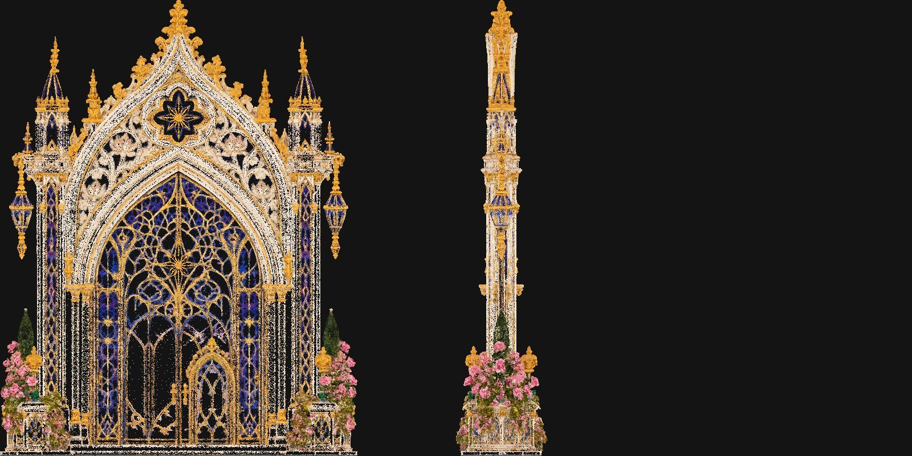
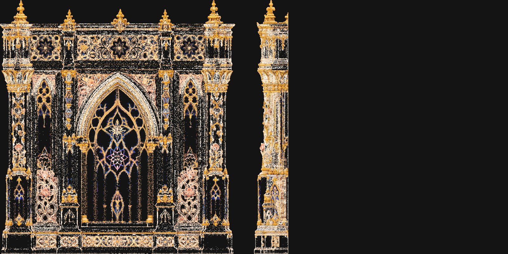

# Palace kit (Meshy)

The Princess Palace is 2,200 m wide, so it is never one model. It is a kit: a few pieces, each generated once, then repeated, mirrored, stacked and bent in the game. Every piece and its prompt is in [kit.json](kit.json).

## The two models you already have (0 credits)

| | Royal Portal Gate | Gilded Gothic Wall |
|---|---|---|
| Repo folder | `meshy/Meshy_AI_Royal_Portal_Gate_1016165217` | `meshy/Meshy_AI_Gilded_Gothic_Wall_Ca_1016192558` |
| Look | ivory ogee arch, gold crockets, cobalt tracery door, rose bushes at the foot | dark bay with a central gothic window, gold pilasters, pink floral panels, star medallions |
| Triangles | 4.5 million | 2.0 million |
| Files | 284 MB FBX + 8K textures | 165 MB FBX + 8K textures |
| Kit role | K00: level-1 side portals, roof-court doors (or the grand gate face) | K01: the standard bay on every tier (~150 copies) and, bent, the curved wings |




Both are far too heavy for friends' browsers as they are. Next step (free, no credits): slim them in Blender to about 40k and 25k triangles, keep detail in the normal map, 2K textures, plus a far-view picture card.

They also set the style: the wall's front view is the `style_image` every new piece is textured from, so the whole palace matches.

## New pieces to generate

| Id | Piece | Where | Reuse |
|---|---|---|---|
| P01 | Great lancet window bay | level-2 great windows | 8-16x |
| P02 | Tower drum segment | corner towers, the three spires | stacked 6-14x |
| P03 | Onion dome crown | every tower and pavilion top | many, scaled |
| P04 | Needle spire | 840 / 960 / 1100 m spire tips | 3 + small copies |
| P05 | Buttress pier with pinnacle | between bays, tier corners | ~120 |
| P06 | Crown cornice and parapet | top of every tier | ~250 |
| P07 | Two-storey arcade bay | level-1 arcade | ~20 |
| P08 | Balcony | upper tiers, curved wings | ~40 |
| P09 | Rose window panel | gate tympanum, gables | 4-8 |
| P10 | Pinnacle turret cluster | roofline | ~60 |
| P11 | Grand stair flight | cascade and side stairs | stacked, bent |
| P12 | Grand double doors | Rose Gate leaves, small doors | ~20 |
| P13 | Arching support pillar | arches joining the cliff plateaus under the palace | along every edge |
| P14 | Sea pillar segment | tall pillars rising from the water | stacked 3-10x |

Things that cost nothing and are NOT generated: curved bays (bend), left/right (mirror), tower heights (stack), smaller copies (scale), girih panels, lotus dado and brocade bands (textures already in the game).

## Credit plan

Each piece: an untextured preview first (about 20 credits), look at it, and texture only the ones that are right (about 10 more). Polycount is capped at generation, so no paid remesh is needed.

| Batch | Pieces | Credits if all kept |
|---|---|---|
| Priority 1 | P01-P06 | ~180 |
| Priority 2 | P07-P10, P13-P14 | ~180 |
| Priority 3 | P11-P12 | ~60 |
| All | 14 | ~420 |

A bad preview costs only the 20, so a couple of retries keep the whole kit under ~480. The script refuses to spend past `MESHY_BUDGET` (default 400, raise it for the full kit) and never generates the same piece twice.

## Running it

Either way works:

1. **With an API key (Claude runs it):** add `MESHY_API_KEY` to this project's cloud environment, then ask in the thread. Claude runs `plan`, then previews priority 1, shows you the thumbnails, and textures only what you approve.
2. **Yourself in the Meshy site:** Text to 3D, latest model, symmetry on, triangle topology, the polycount from kit.json. Paste each `prompt` + the `style_suffix`. Generate the preview, and only press Texture on a good one, using the `texture_prompt` and `refs/gilded-gothic-wall-front.jpg` as the style image. Upload the GLBs to `meshy/palace-kit/` in the repo.

```
python3 tools/meshy/meshy_kit.py plan
python3 tools/meshy/meshy_kit.py preview --priority 1
python3 tools/meshy/meshy_kit.py status        # thumbnails into design/palace-kit/thumbs/
python3 tools/meshy/meshy_kit.py texture P01 P03
python3 tools/meshy/meshy_kit.py download P01 P03
```

## Into the game

Each finished piece: GLB, compressed, 2K textures, a near and a far version. The game draws all copies of a piece in one go (instancing), so 150 wall bays cost about the same as one. The Game logic thread places them on the palace plan in `js/world/layout.js` (bay grid 40 x 43 m).
