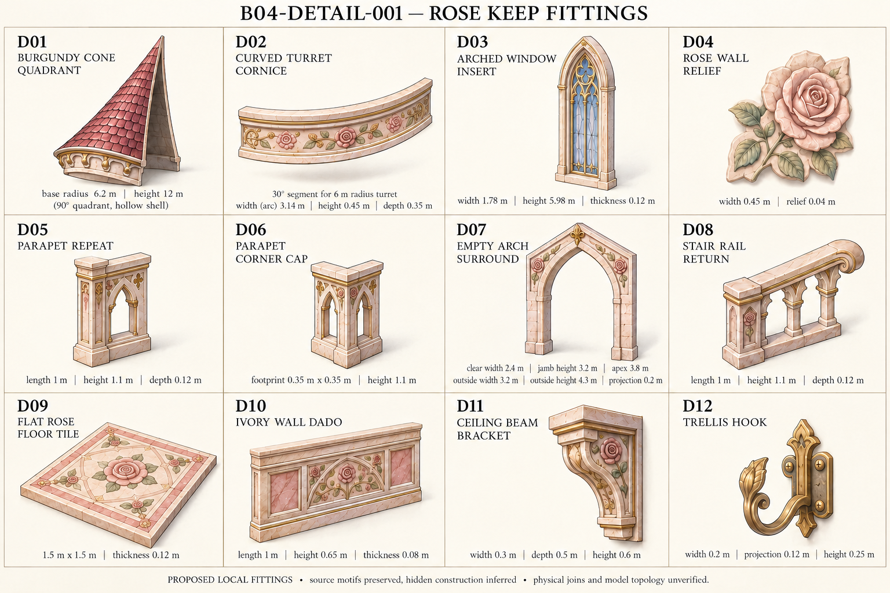

# B04-DETAIL-001 — Rose Keep — surface and detail kit

[First model batch](../../world-production-plan/rose-keep/README.md) · [Component IDs](components.json) · [Prompts and provenance](schedule.json) · [One-image gallery](../index.html)

Four structural sections or twelve fittings under existing reserved IDs. Proposed construction; source visible vocabulary retained, hidden faces inferred.

- All twelve named fittings visible. Short D01-D12 IDs resolve under the full B04-DETAIL-001 title.
- R02 removes D02 seam posts, reduces D05 to one guard bay and simplifies the D06 corner. Arc ends, corner profiles and exact fit remain unverified.
- D09 rose must be FLUSH stone inlay. Painted shading still makes relief ambiguous; do not extrude the petals or accept this as a verified walking surface.
- D01 is one proposed roof quadrant, not a complete roof. Its four-copy closure and hollow underside require geometry checks.
- D05/D06/D08 guard proportions and physical connections are illustrative. Keep independent continuous collision barriers. D09-D11 are inferred local interior options, not an added playable room.

The superseded R01 and both exact prompts are preserved in this directory. Reference saved does not mean mesh accepted or place complete.
