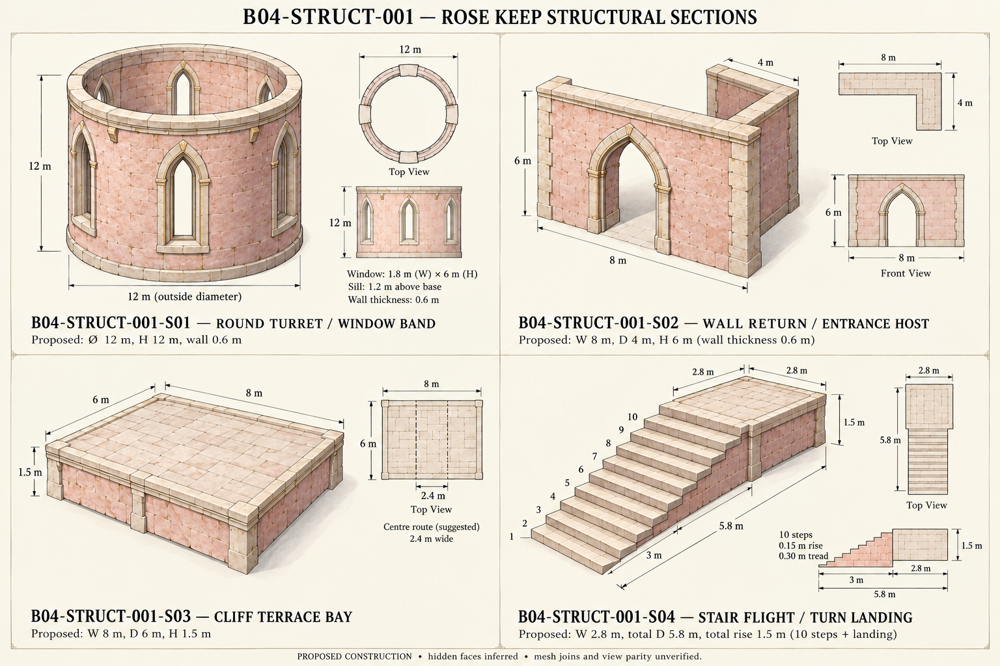

# B04-STRUCT-001 — Rose Keep — structural sections

[First model batch](../../world-production-plan/rose-keep/README.md) · [Component IDs](components.json) · [Prompts and provenance](schedule.json) · [One-image gallery](../index.html)

Four structural sections or twelve fittings under existing reserved IDs. Proposed construction; source visible vocabulary retained, hidden faces inferred.

- Four isolated structural groups visible; blush masonry, pale trim, round hollow turret and actual illustrated portal retained.
- R01 main stair had too many repeated treads. R02 adds a ten-labelled-step perspective; the small plan still has ambiguous tread divisions. Use the K09/handoff contract, not traced pixels, for exact steps.
- Turret small plan is a window-level schematic, not a verified top-ring projection: the windows terminate below the top ring. All inter-view parity remains unverified.
- S02 visible arch trim is host dressing; D07 is an optional replacement/additional surround and must not be blindly doubled over it.
- Actual aperture sizes, wall thickness, terrain supports, colliders and mesh joins require the Function prototype. No model or final layout approval.

The superseded R01 and both exact prompts are preserved in this directory. Reference saved does not mean mesh accepted or place complete.
