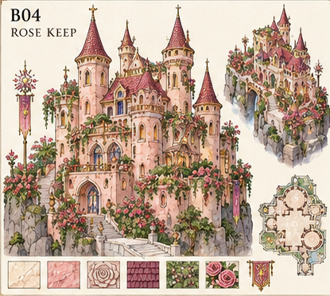

# Rose Keep — first 3D asset batch

[World production plan](../README.md) · [Rose Keep brief](../../world-layout/location-audit/B04/DESIGN-BRIEF.md) · [Machine-readable handoff](asset-handoff.json) · [Validation record](validation.json) · [One-image gallery browser check](gallery-verification.json)

Prepare **eight reusable meshes**, in the order below: four structural sections, then four matching fittings. These let us inspect one entrance/stair/terrace assembly and a separate turret specimen before requesting the rest of the keep. This is a preparation list, not a delivered model pack.

## Existing reference and style

Use **blush stone, pale stone trim, burgundy shingle cones, restrained gold accents, round turrets and climbing roses over irregular rock shoulders**. Keep the window treatment subtle. The source does not support replacing these cones with purple onion domes or giving every window the palace's saturated stained glass. Rose plants, banners, lamps and rock hosts stay separate from the structural meshes.

The source is only **415 × 372 px**. It establishes the visible design vocabulary; it cannot resolve exact carving or hidden faces. Pixel boxes below identify where to look in this one saved original. They are not new cropped/generated sheets. Proposed rear geometry must remain labelled as inferred.

## First batch

All sizes are **proposed metres, W × D × H**. They define a local test kit; they are not measured from the picture. People, doors and steps retain human dimensions even while the landmark has a much larger reservation.

| Order | Existing component ID | Mesh | Proposed W × D × H (m) |
| --- | --- | --- | --- |
| 1 | `B04-STRUCT-001-S02` | Rose keep wall return / entrance host | 8 × 4 × 6 |
| 2 | `B04-STRUCT-001-S04` | Stair flight with turn landing | 2.8 × 5.8 × 1.75 |
| 3 | `B04-STRUCT-001-S03` | Cliff terrace bay | 8 × 6 × 1.5 |
| 4 | `B04-STRUCT-001-S01` | Round turret / window band | 12 × 12 × 12 |
| 5 | `B04-DETAIL-001-D03` | Rose keep window insert | 1.78 × 0.12 × 5.98 |
| 6 | `B04-DETAIL-001-D05` | Castle parapet repeat | 1 × 0.12 × 1.1 |
| 7 | `B04-DETAIL-001-D01` | Burgundy cone roof strip / quadrant | 6.2 × 6.2 × 12 |
| 8 | `B04-DETAIL-001-D07` | Keep arch surround | 3.2 × 0.2 × 4.3 |

Start with the **wall/entrance host and stair**. Test their openings and steps before spending effort on the turret, roof and surface ornament. D01 is a roof quadrant: four instances make one roof. D03 is an insert: its host needs an actual cutout.

## Saved references and image limit

The two existing reserved sheets are now saved: [B04-STRUCT-001 — four structural sections](../../completion-pass/B04-STRUCT-001/README.md) and [B04-DETAIL-001 — twelve fittings](../../completion-pass/B04-DETAIL-001/README.md). Open either separately to keep only one image in view. Both R01 drafts and the exact generation/correction prompts are preserved. User reference approval remains pending.

The old generic structural dimensions have been replaced with this handoff's proposed fit dimensions in the B04 schedules and component records. This corrects planning placeholders; it does not certify the generated pixels as accurate measurements. The four fittings prioritised here are a subset of the twelve-part decor sheet. This pass uses **two existing slots**, adds no new reservations, and adds no accepted models.

Known limits: the structural sheet's small stair plan and turret plan are schematic rather than verified projections. The wall's host arch trim must not be blindly doubled with the separate D07 surround. D09 must use flush stone inlay even where painted rose shading suggests relief. Cornice closure, roof-quadrant joins, rail corners and all scale/contact details need geometry checks before production use.

## Join and export rules

- Export GLB in metres, with applied scale. An editable Blender file is useful alongside it. Exported GLB axes are X right, Y up, front -Z; let Blender's normal glTF exporter convert Z-up to Y-up.
- Use the filenames and pivots below. Keep stone shell, glazing and fittings as distinct named objects/materials. Never recenter a mesh after declaring its assembly origin.
- Keep openings genuinely open. A window insert is separate from its wall cutout; an arch surround does not supply a doorway by itself.
- Keep one-metre parapet repeats at their declared length. Use explicit end infill; slope and corner pieces remain outstanding.
- Supply simple substrate collision separately. Avoid convex hulls that seal entrances or hollow towers. Fine carving and foliage need not each carry collision.
- Proposed unique-mesh triangle allowance: **38,000 triangles** across these eight assets, before instances. This is a starting budget, not measured browser performance. Prefer shared materials and a 2K atlas; review accepted meshes before setting final LOD/texture budgets.

## First assembly check

The JSON includes example placements. The stair climbs **1.5 m** over ten 0.15 m risers and joins the terrace; the terrace joins a **2.4 m clear** doorway. The three declared join datums match numerically within 1 mm. The turret stands separately so its ring, window and four roof-quadrant joins can be inspected without inventing the final building plan.

These are metadata checks. The next Function prototype must supply the supported inner court stub, rock/substrate contacts, continuous guards and stair returns, then test a real player from approach through the doorway and back. No browser traversal, terrain grading, mesh fit or finished building is established by the list.

The existing world anchor **(-1700, -1500)**, **180 × 160 m** reservation and **78 m** pad stay unchanged. The inherited 360 m building-height entry is not used to multiply furniture, risers or door widths. Full tower height and placement need the source-led assembly review.

## Component instructions

### 1. Rose keep wall return / entrance host

**ID:** `B04-STRUCT-001-S02` · **File:** `B04-STRUCT-001-S02__rose-keep-wall-return__v001.glb` · **Proposed W × D × H:** 8 × 4 × 6 m

Blush masonry with pale trim, one real pointed-arch doorway, plus a short right-hand return. This orthogonal test return is inferred; angled and cliff-conforming variants follow the source audit. Keep all ornament detachable.

**Pivot and alignment:** Main wall midpoint at walking floor: [0,0,0]. Main wall X=-4..4, Z=0..0.6; right return X=3.4..4, Z=0..4; Y=0..6.

**Reference lookup:** original-pixel box [82, 201, 168, 280]. Lower portal and adjacent pink wall; rear and return depth are not visible measurements.

**Reject if:** Door is a painted recess or blocked by a single collision hull; Wrong opening profile or narrower than 2.4 m; Palace-scale door, fused roses or a complete building instead of one host.

### 2. Stair flight with turn landing

**ID:** `B04-STRUCT-001-S04` · **File:** `B04-STRUCT-001-S04__stair-terrace-corner__v001.glb` · **Proposed W × D × H:** 2.8 × 5.8 × 1.75 m

Ten planar steps, each 0.15 m rise and 0.30 m going, then a 2.8 m square landing. Source pale stone and low rounded return vocabulary; guards separate. Clear width 2.4 m after edge guards. This reuses K09 dimensions, not its final palace ornament.

**Pivot and alignment:** Lower approach at first riser [0,0,0]. Ascend -Z. Flight ends Z=-3; landing continues to Z=-5.8. Lowest underside Y=-0.25, top walking floor Y=1.5.

**Reference lookup:** original-pixel box [112, 267, 219, 329]. Winding exterior stairs and landing. Exact number and height of steps are proposed, not counted from this thumbnail.

**Reject if:** Melted, sloped or uneven treads; Rail blocks either selected landing exit; Step rises exceed 0.20 m or clear width falls below 2.4 m.

### 3. Cliff terrace bay

**ID:** `B04-STRUCT-001-S03` · **File:** `B04-STRUCT-001-S03__cliff-terrace-bay__v001.glb` · **Proposed W × D × H:** 8 × 6 × 1.5 m

Level stone deck with pale edge cornice and downward cliff-facing fascia, no surrounding garden scene. Simple joining ends. A separate rock/support host must meet its underside; the fascia is not an unsupported 8 m cantilever design. Keep a 2.4 m clear entry corridor.

**Pivot and alignment:** Centre of top walking surface [0,0,0]; X=-4..4, Z=-3..3; all substrate below Y=0, bottom Y=-1.5.

**Reference lookup:** original-pixel box [92, 273, 276, 326]. Raised entrance terrace and stone edge over the rock shoulder. Deck depth and hidden supports need engineering views.

**Reject if:** Walking top is buckled or a painted garden is fused to it; Fascia blocks the stair socket; Decor projects across the 2.4 m route.

### 4. Round turret / window band

**ID:** `B04-STRUCT-001-S01` · **File:** `B04-STRUCT-001-S01__round-turret-window-host__v001.glb` · **Proposed W × D × H:** 12 × 12 × 12 m

Hollow cylindrical blush-stone band with four identical arched openings at cardinal directions, 1.8 m wide, 6 m apex height, sill 1.2 m above band base. Front source window vocabulary; fourfold repetition and hidden back are proposed for the first fit test. Open ring ends; no cone roof, glazing, floor, vines or unrelated tower attached.

**Pivot and alignment:** Centre of lower ring [0,0,0]; bottom Y=0, upper ring Y=12; external radius 6 m, wall thickness 0.6 m.

**Reference lookup:** original-pixel box [92, 69, 142, 205]. Left round turret body. This 12 m test band is not a recovered diameter or the whole tall turret.

**Reject if:** Flattened or distorted cylinder; Windows do not cut through the shell; Interior filled or top and bottom ring sizes differ.

### 5. Rose keep window insert

**ID:** `B04-DETAIL-001-D03` · **File:** `B04-DETAIL-001-D03__rose-keep-window-insert__v001.glb` · **Proposed W × D × H:** 1.78 × 0.12 × 5.98 m

Separate frame, simple subtle glazing and restrained trim. Pale stone, muted gold and quiet glass from Rose Keep, not giant blue-and-pink palace star panes. Back face and thickness visible. Opening cut in S01 remains behind the insert.

**Pivot and alignment:** Bottom centre of insert [0,0,0], outward -Z. Match S01's 4.8 m spring / 6 m apex profile with 0.01 m edge clearance; register as a sill-relative insert, not an independent wall.

**Reference lookup:** original-pixel box [98, 81, 135, 128]. Upper left turret windows; fine tracery cannot be recovered exactly at this resolution.

**Reject if:** Opaque painted masonry replaces the glazing; Frame changes the host arch profile; Entire turret included.

### 6. Castle parapet repeat

**ID:** `B04-DETAIL-001-D05` · **File:** `B04-DETAIL-001-D05__castle-parapet-repeat__v001.glb` · **Proposed W × D × H:** 1 × 0.12 × 1.1 m

One restrained stone guard repeat; planar end profiles, separate simple continuous barrier collider. Preserve Rose Keep terrace-edge vocabulary. A 1.1 m test guard height is proposed for drops, not an assertion that every low garden edge in the source is a guard. Use short infill at ends; do not stretch decorated repeats. Slope and corner return D08/D06 remain a later matching pass.

**Pivot and alignment:** Centre of lower mounting edge [0,0,0]; repeat X=-0.5..0.5, depth Z=-0.06..0.06, top Y=1.1.

**Reference lookup:** original-pixel box [152, 292, 238, 324]. Stone terrace edge around stair return; exact baluster detail is unresolved.

**Reject if:** Repeat ends differ; Visible geometry is treated as verified collision; Guard crosses an entrance or is scaled to absorb remainder.

### 7. Burgundy cone roof strip / quadrant

**ID:** `B04-DETAIL-001-D01` · **File:** `B04-DETAIL-001-D01__burgundy-cone-roof-strip__v001.glb` · **Proposed W × D × H:** 6.2 × 6.2 × 12 m

One hollow conical quarter-shell with burgundy shingle pattern, 0.12 m nominal shell thickness and matching radial seam edges. Four copies rotated by 90 degrees give a 12.4 m diameter cap over S01's 12 m diameter, with 0.2 m overhang per side. Conical roof, not an onion dome. Finial and eave cornice are separate later fittings.

**Pivot and alignment:** Centre of cone's base circle [0,0,0]. One 90-degree sector occupies X=0..6.2, Z=0..6.2; base Y=0, tip Y=12. Pivot lies at a bounding-box corner by design.

**Reference lookup:** original-pixel box [91, 4, 143, 84]. Left tower conical shingle roof. The quadrant split and underside construction are inferred.

**Reject if:** Purple onion dome substituted; Radial joins fail to close after four rotations; Base diameter mismatches the 12.4 m cap or a solid cone fills the interior.

### 8. Keep arch surround

**ID:** `B04-DETAIL-001-D07` · **File:** `B04-DETAIL-001-D07__keep-arch-surround__v001.glb` · **Proposed W × D × H:** 3.2 × 0.2 × 4.3 m

Pale stone arch band with restrained rose-compatible carving. Inner void must match S02: 2.4 m clear, 3.2 m spring, 3.8 m apex. Outer height 4.3 m includes trim above apex. No masonry filling, gate leaf or complete wall attached.

**Pivot and alignment:** Threshold centre [0,0,0], flat mounting back at Z=0, trim projects to Z=-0.2. Fits S02 opening at X=-0.5, Y=0.

**Reference lookup:** original-pixel box [93, 222, 136, 276]. Lower pointed entrance surround; detailed carving is unresolved and must be conservatively inferred.

**Reject if:** Trim narrows or blocks the aperture; Flat back is missing; Heavy palace ornament replaces the source's restrained stone portal.

## Reuse and next batches

Reuse the tested [K09 stair/landing dimensions](../kit-fit/contract.json) and independent barrier conventions, while keeping Rose Keep's local appearance. Shared foliage/rock/prop families are reuse candidates, not certified style matches or available final models.

- D02 round turret cornice and D04 flower relief: reference now saved; geometry and repeat contacts still need checking
- D06 parapet corner cap and D08 rounded stair rail return: needed for guarded assembly; procedural collision guards can test circulation meanwhile
- D09 inner floor, D10 dado and D11 ceiling bracket: exterior D2 scope does not require a sealed room
- D12 trellis hook and roses/ivy/hazel/meadow plants: reuse indexed ecology families after supports and route work
- Rock foundation and cliff return: inspect source-specific rock ledge against terrain before final dressing
- B25 conservatory: separate glass/gold kit, not a recolour of Rose Keep; inspect its single source next

Next build the source-compatible Function specimen for these eight priority parts, using the dimension contract to resolve illustration discrepancies. Test source-specific cornices, rail returns, ledge supports and climbing-rose attachments as they are needed. Inspect **B25 Crystal Conservatory** separately, using its glass/gold dome source rather than recolouring this keep. Regional route and entrance evidence still comes before dense planting and final dressing. Bath/spa, kitchen/service and music rooms remain outside the agreed playable scope.

Rebuild/check this handoff from the repository root with `node docs/asset-image-library/world-production-plan/rose-keep/build-handoff.mjs`. Validation checks source hashes, registered IDs, source-region bounds, shared stair dimensions and proposed join coordinates. It does not approve artwork or model topology.
